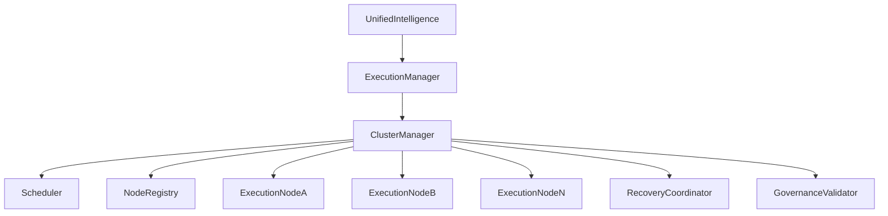

# RFC-0102

**Title:** Distributed Execution Cluster Architecture

**Document ID:** RFC-0102

**Version:** 1.0

**Status:** Accepted

**Category:** Runtime Architecture

**Layer:** Distributed Runtime / Cluster Coordination

**Target:**

```text
runtime/distributed/
```

---

# Abstract

This RFC defines the SH-3 Distributed Execution Cluster Architecture (DECA).

The Distributed Execution Cluster Architecture extends the execution orchestration model defined in RFC-0101 from a single runtime instance to a coordinated cluster of execution nodes.

The architecture enables SH-3 to execute workflows across multiple nodes while preserving deterministic execution semantics, governance compliance, observability, and fault tolerance.

Execution requests SHALL be transparently distributed across available cluster resources.

This document is normative.

---

# Motivation

Single-node execution eventually becomes constrained by:

- compute capacity
- memory limits
- I/O bandwidth
- hardware failures
- availability requirements

A distributed execution cluster enables:

- horizontal scalability
- workload balancing
- high availability
- fault isolation
- elastic resource expansion

without changing higher-level cognitive behavior.

---

# Goals

The Distributed Execution Cluster Architecture SHALL provide:

- distributed workflow execution
- cluster-wide scheduling
- node coordination
- workload balancing
- execution failover
- deterministic distributed execution
- cluster observability

---

# Non-Goals

The architecture SHALL NOT:

- change cognitive reasoning
- modify planning decisions
- bypass governance policies
- introduce non-deterministic execution ordering

---

# Architecture



---

# Design Principles

## Horizontal Scalability

Additional execution nodes SHALL increase execution capacity without architectural changes.

---

## Deterministic Scheduling

Given identical workloads and cluster state, task placement SHALL remain deterministic.

---

## Stateless Coordination

Cluster coordination SHALL minimize mutable shared state.

---

## Failure Isolation

Node failures SHALL remain isolated from unrelated workloads.

---

## Governance Preservation

Distributed execution SHALL preserve all governance constraints defined by previous RFCs.

---

# Components

| Component | Responsibility |
|-----------|----------------|
| ClusterManager | Cluster coordination |
| ClusterScheduler | Distributed scheduling |
| NodeRegistry | Node discovery and status |
| ExecutionNode | Task execution |
| LoadBalancer | Workload distribution |
| RecoveryCoordinator | Cluster failover |
| ClusterMetrics | Distributed telemetry |
| GovernanceValidator | Policy validation |

---

# Cluster Topology

A cluster SHALL consist of one or more execution nodes.

```text
               Cluster Manager
                      │
        ┌─────────────┼─────────────┐
        ▼             ▼             ▼
     Node A        Node B       Node C
        │             │             │
     Workers       Workers      Workers
```

Nodes MAY be added or removed dynamically.

---

# Node Registration

Each execution node SHALL register:

- node_id
- version
- capabilities
- resource profile
- health status
- supported execution types

Registration SHALL be immutable until updated.

---

# Cluster Scheduling

ClusterScheduler SHALL consider:

- workload size
- resource availability
- node capabilities
- execution locality
- governance restrictions
- task dependencies

Scheduling SHALL remain deterministic.

---

# Workload Distribution

Supported strategies include:

- round-robin
- least-loaded
- capability-aware
- locality-aware
- priority-aware

Strategy selection SHALL be configurable through policy.

---

# Node Health Monitoring

ClusterManager SHALL continuously monitor:

- heartbeat
- latency
- resource utilization
- execution failures
- network connectivity

Unhealthy nodes SHALL be quarantined automatically.

---

# Failover

If an execution node becomes unavailable:

```text
Node Failure

↓

Failure Detection

↓

Task Reassignment

↓

Checkpoint Recovery

↓

Execution Resume
```

No completed task SHALL be re-executed unless explicitly configured.

---

# Checkpoint Synchronization

Distributed checkpoints SHALL include:

- workflow progress
- task state
- execution context
- resource allocations
- trace identifiers

Checkpoint consistency SHALL be guaranteed before failover.

---

# Cluster Communication

Cluster communication SHALL use:

- authenticated channels
- encrypted transport
- immutable execution messages
- versioned protocols

Communication SHALL tolerate temporary network partitions where possible.

---

# Governance Integration

Every distributed execution request SHALL be validated before scheduling.

Governance SHALL remain centralized or use a synchronized policy snapshot.

---

# Message Bus Integration

Distributed execution events include:

- NodeRegistered
- NodeHeartbeat
- TaskAssigned
- TaskMigrated
- NodeUnavailable
- FailoverStarted
- FailoverCompleted
- ClusterRecovered

All events SHALL be immutable.

---

# Observability

Cluster telemetry SHALL expose:

- active nodes
- cluster utilization
- scheduler latency
- node health
- failover frequency
- workload distribution
- cluster throughput

---

# Distributed Tracing

Each distributed workflow SHALL preserve:

- trace_id
- cluster_id
- node_id
- workflow_id
- execution_id
- task_id

Tracing SHALL reconstruct execution across all nodes.

---

# Thread Model

The Distributed Execution Cluster Architecture supports concurrent:

- workflow scheduling
- node execution
- health monitoring
- checkpoint synchronization
- workload migration
- telemetry collection

The reference implementation SHALL be:

- deterministic
- thread-safe
- horizontally scalable
- event-driven
- lock-efficient

---

# Metrics

The architecture exposes:

- cluster throughput
- scheduler efficiency
- node utilization
- failover duration
- execution latency
- workload balance index
- cluster availability

---

# Performance Objectives

The Distributed Execution Cluster Architecture should optimize for:

- horizontal scalability
- deterministic execution
- rapid failover
- efficient workload balancing
- high availability
- low scheduling overhead

---

# Future Work

Potential future enhancements include:

- geo-distributed execution clusters
- edge execution nodes
- autonomous cluster scaling
- predictive workload placement
- cross-region execution federation
- self-healing cluster orchestration

---

# References

- RFC-0101 Autonomous Cognitive Execution Orchestration Architecture
- RFC-0100 Autonomous Cognitive Unified Intelligence Architecture
- SH-3 Architecture Specification v2.1

---

# End of RFC-0102