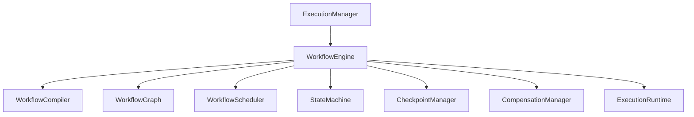

# RFC-0103

**Title:** Autonomous Workflow Engine Architecture

**Document ID:** RFC-0103

**Version:** 1.0

**Status:** Accepted

**Category:** Runtime Architecture

**Layer:** Workflow / Execution / Orchestration

**Target:**

```text
runtime/workflow/
```

---

# Abstract

This RFC defines the SH-3 Autonomous Workflow Engine Architecture (AWEA).

The Autonomous Workflow Engine Architecture provides the execution layer responsible for converting approved execution plans into deterministic workflow graphs, scheduling executable units, coordinating state transitions, and managing workflow lifecycles.

The Workflow Engine bridges planning, execution orchestration, distributed runtime, and recovery while remaining event-driven, deterministic, and governance-aware.

This document is normative.

---

# Motivation

Execution plans represent *what* should happen.

The Workflow Engine determines *how* execution progresses.

Without a dedicated workflow layer:

- execution ordering becomes inconsistent
- dependency management becomes fragmented
- retries become difficult
- recovery becomes unreliable
- observability becomes incomplete

A unified workflow engine provides a deterministic execution model independent of the underlying compute platform.

---

# Goals

The Autonomous Workflow Engine Architecture SHALL provide:

- deterministic workflow execution
- workflow lifecycle management
- dependency-aware execution
- event-driven orchestration
- retry and compensation
- checkpoint support
- distributed workflow execution

---

# Non-Goals

The architecture SHALL NOT:

- generate execution plans
- perform reasoning
- replace governance
- modify approved objectives

---

# Architecture



---

# Design Principles

## Immutable Workflows

Approved workflow definitions SHALL be immutable.

---

## Explicit State

Every workflow SHALL expose explicit lifecycle states.

---

## Event Driven

State transitions SHALL occur through immutable events.

---

## Replayable

Workflow execution SHALL be reproducible.

---

## Deterministic

Given identical workflow definitions and runtime state, execution SHALL produce identical results.

---

# Components

| Component | Responsibility |
|-----------|----------------|
| WorkflowEngine | Workflow coordination |
| WorkflowCompiler | Graph generation |
| WorkflowGraph | DAG representation |
| WorkflowScheduler | Task scheduling |
| WorkflowStateMachine | Lifecycle management |
| CheckpointManager | Execution checkpoints |
| CompensationManager | Recovery workflows |
| RuntimeBridge | Runtime integration |

---

# Workflow Definition

Every workflow SHALL define:

- workflow identifier
- version
- entry point
- exit conditions
- task graph
- dependencies
- retry policy
- compensation policy
- timeout policy
- governance policy

Workflow definitions SHALL be versioned.

---

# Workflow Lifecycle

A workflow SHALL transition through the following states.

```text
Created

↓

Validated

↓

Scheduled

↓

Running

↓

Paused

↓

Completed
```

Possible terminal states:

```text
Completed

Failed

Cancelled

Compensated
```

Every transition SHALL be recorded.

---

# Workflow Graph

The WorkflowCompiler SHALL generate a Directed Acyclic Graph (DAG).

Example:

```text
Input

↓

Validation

├── Analysis

├── Retrieval

└── Planning

↓

Execution

↓

Verification

↓

Completion
```

Cycles SHALL NOT exist.

---

# Task Model

Every task SHALL define:

- task_id
- workflow_id
- dependencies
- execution requirements
- timeout
- retry count
- compensation handler
- priority

Tasks SHALL be independently executable.

---

# Dependency Resolution

WorkflowScheduler SHALL execute a task only when:

- all dependencies are complete
- governance approval exists
- resources are available
- execution constraints are satisfied

Dependency evaluation SHALL be deterministic.

---

# Workflow Scheduling

Scheduling SHALL support:

- sequential execution
- parallel execution
- conditional branches
- fan-out
- fan-in
- nested workflows

Scheduling decisions SHALL be reproducible.

---

# Retry Policy

Supported retry strategies include:

- immediate retry
- exponential backoff
- bounded retry
- policy-driven retry
- manual retry

Retry behavior SHALL be configurable per workflow.

---

# Compensation

CompensationManager SHALL support:

- reverse execution
- logical compensation
- alternative workflows
- partial rollback
- complete rollback

Compensation SHALL preserve consistency.

---

# Timeout Handling

Timeout policies MAY include:

- task timeout
- workflow timeout
- idle timeout
- dependency timeout

Timeout expiration SHALL emit immutable events.

---

# Checkpointing

CheckpointManager SHALL persist:

- workflow state
- completed tasks
- pending tasks
- execution context
- resource bindings

Checkpoint restoration SHALL resume deterministic execution.

---

# Runtime Integration

RuntimeBridge SHALL integrate with:

- Execution Manager
- Distributed Cluster
- Scheduler
- Resource Manager
- Recovery Manager

Runtime integration SHALL remain implementation independent.

---

# Governance Integration

Every workflow SHALL undergo validation before execution.

Governance SHALL evaluate:

- permissions
- policies
- risk level
- execution scope
- resource limits

Rejected workflows SHALL never enter the Running state.

---

# Message Bus Integration

Workflow events include:

- WorkflowCreated
- WorkflowValidated
- WorkflowScheduled
- WorkflowStarted
- TaskStarted
- TaskCompleted
- TaskRetried
- WorkflowPaused
- WorkflowResumed
- WorkflowCompleted
- WorkflowFailed
- WorkflowCompensated

Events SHALL be immutable and versioned.

---

# Persistence Integration

Persistence SHALL maintain:

- workflow definitions
- execution history
- checkpoints
- compensation history
- audit logs
- lifecycle transitions

Workflow history SHALL remain reproducible.

---

# Observability

Workflow telemetry SHALL expose:

- active workflows
- completed workflows
- failed workflows
- retry count
- compensation count
- workflow latency
- scheduler efficiency

---

# Distributed Tracing

Every workflow SHALL preserve:

- trace_id
- workflow_id
- task_id
- execution_id
- checkpoint_id
- compensation_id

Tracing SHALL reconstruct complete workflow execution.

---

# Thread Model

The Autonomous Workflow Engine Architecture supports concurrent:

- workflow compilation
- scheduling
- execution
- checkpoint creation
- compensation
- telemetry collection

The reference implementation SHALL be:

- thread-safe
- deterministic
- horizontally scalable
- event-driven
- lock-efficient

---

# Metrics

The architecture exposes:

- workflow throughput
- completion rate
- average execution latency
- retry ratio
- compensation ratio
- checkpoint overhead
- scheduler utilization

---

# Performance Objectives

The Autonomous Workflow Engine Architecture should optimize for:

- deterministic execution
- scalable orchestration
- efficient scheduling
- minimal recovery latency
- low checkpoint overhead
- predictable workflow completion

---

# Future Work

Potential future enhancements include:

- adaptive workflow optimization
- workflow synthesis from cognitive plans
- predictive checkpoint placement
- federated workflow execution
- AI-assisted workflow optimization
- autonomous workflow evolution

---

# References

- RFC-0102 Distributed Execution Cluster Architecture
- RFC-0101 Autonomous Cognitive Execution Orchestration Architecture
- RFC-0100 Autonomous Cognitive Unified Intelligence Architecture
- SH-3 Architecture Specification v2.1

---

# End of RFC-0103