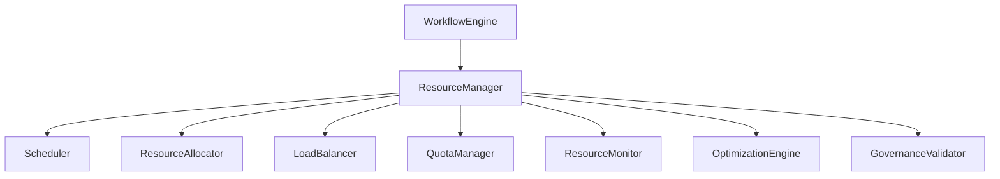

# RFC-0104

**Title:** Resource Scheduling & Optimization Architecture

**Document ID:** RFC-0104

**Version:** 1.0

**Status:** Accepted

**Category:** Runtime Architecture

**Layer:** Runtime / Resource Management / Scheduling

**Target:**

```text
runtime/resource/
```

---

# Abstract

This RFC defines the SH-3 Resource Scheduling & Optimization Architecture (RSOA).

The Resource Scheduling & Optimization Architecture is responsible for allocating, scheduling, monitoring, and optimizing computational resources required by the SH-3 runtime.

The architecture provides deterministic, policy-aware, and scalable resource management across single-node and distributed execution environments.

Resources managed by this architecture include:

- CPU
- GPU
- Memory
- Storage
- Network
- Accelerator devices
- External execution tools
- Runtime workers

This document is normative.

---

# Motivation

Efficient execution depends on efficient resource management.

Without centralized resource scheduling:

- execution latency increases
- resource contention occurs
- workloads become imbalanced
- throughput decreases
- failures become more frequent

The Resource Scheduling & Optimization Architecture provides predictable resource allocation while maximizing runtime utilization.

---

# Goals

The architecture SHALL provide:

- deterministic resource allocation
- workload-aware scheduling
- cluster-wide optimization
- resource isolation
- adaptive balancing
- policy-aware allocation
- continuous optimization

---

# Non-Goals

The architecture SHALL NOT:

- perform workflow planning
- replace execution orchestration
- bypass governance policies
- modify cognitive decisions

---

# Architecture



---

# Design Principles

## Deterministic Allocation

Resource allocation SHALL produce identical results given identical workload, policy, and cluster state.

---

## Policy First

Every allocation SHALL satisfy governance, quota, and security policies.

---

## Elastic Scaling

Resources MAY scale horizontally without affecting workflow semantics.

---

## Isolation

Workloads SHALL remain isolated from one another.

---

## Fair Scheduling

Resource starvation SHALL be prevented.

---

## Continuous Optimization

Allocation decisions SHALL improve using runtime telemetry.

---

# Components

| Component | Responsibility |
|-----------|----------------|
| ResourceManager | Global coordination |
| Scheduler | Scheduling decisions |
| ResourceAllocator | Resource assignment |
| LoadBalancer | Workload balancing |
| QuotaManager | Resource limits |
| ResourceMonitor | Runtime monitoring |
| OptimizationEngine | Allocation optimization |
| GovernanceValidator | Policy enforcement |

---

# Managed Resource Types

The architecture SHALL manage:

| Resource | Description |
|----------|-------------|
| CPU | Compute cores |
| GPU | Accelerators |
| Memory | RAM allocation |
| Storage | Persistent and temporary storage |
| Network | Communication bandwidth |
| Workers | Runtime executors |
| Tool Slots | External tool execution capacity |
| Cache | Shared runtime cache |

Additional resource types MAY be introduced without modifying the scheduling model.

---

# Resource Model

Every managed resource SHALL expose:

- resource_id
- resource_type
- capacity
- available_capacity
- allocation_state
- health_status
- owner
- utilization
- timestamp

The resource model SHALL be immutable between state transitions.

---

# Scheduling Lifecycle

The scheduling lifecycle SHALL follow:

```text
Receive Request

↓

Validate Policy

↓

Estimate Resource Demand

↓

Locate Candidate Resources

↓

Optimize Placement

↓

Reserve Resources

↓

Execute Workload

↓

Release Resources

↓

Update Metrics
```

Each phase SHALL emit immutable events.

---

# Scheduling Strategies

Supported scheduling strategies include:

- First Available
- Least Loaded
- Priority Based
- Capability Aware
- Affinity Based
- Anti-Affinity
- Cost Optimized
- Latency Optimized

The scheduling policy SHALL be configurable.

---

# Resource Reservation

Resources SHALL be reserved before execution.

Reservation SHALL include:

- reservation_id
- owner
- expiration
- allocated_capacity
- execution_scope

Expired reservations SHALL be reclaimed automatically.

---

# Load Balancing

LoadBalancer SHALL optimize:

- CPU utilization
- GPU utilization
- memory utilization
- network usage
- execution latency
- node balance

Balancing SHALL preserve deterministic execution order.

---

# Quota Management

QuotaManager SHALL enforce:

- tenant quotas
- workflow quotas
- node quotas
- priority limits
- governance restrictions

Quota violations SHALL reject allocation requests.

---

# Resource Optimization

OptimizationEngine SHALL continuously evaluate:

- idle resources
- over-utilization
- fragmentation
- allocation efficiency
- execution locality
- workload distribution

Optimization SHALL NOT interrupt active workloads unless explicitly permitted.

---

# Resource Health

ResourceMonitor SHALL classify resources as:

| State | Description |
|--------|-------------|
| Healthy | Fully operational |
| Degraded | Reduced capability |
| Busy | Temporarily unavailable |
| Draining | Accepting no new work |
| Offline | Not schedulable |

Only Healthy and Busy resources MAY receive allocations.

---

# Failure Handling

On resource failure:

```text
Failure Detected

↓

Workload Isolation

↓

Alternative Resource Search

↓

Checkpoint Recovery

↓

Resume Execution
```

Recovery SHALL preserve execution correctness.

---

# Governance Integration

Every allocation SHALL be validated against:

- execution policy
- security policy
- resource policy
- quota policy
- compliance policy

Governance SHALL precede scheduling.

---

# Message Bus Integration

Resource events include:

- ResourceRegistered
- ResourceReserved
- ResourceAllocated
- ResourceReleased
- ResourceDraining
- ResourceRecovered
- AllocationRejected
- OptimizationCompleted

Events SHALL remain immutable.

---

# Persistence Integration

Persistence SHALL store:

- resource inventory
- allocation history
- reservation history
- optimization history
- quota configuration
- utilization metrics

Historical allocation SHALL remain reproducible.

---

# Observability

Resource telemetry SHALL expose:

- CPU utilization
- GPU utilization
- memory pressure
- storage usage
- network throughput
- allocation latency
- scheduler efficiency
- resource fragmentation
- optimization gains

---

# Distributed Tracing

Each allocation SHALL preserve:

- trace_id
- allocation_id
- reservation_id
- resource_id
- workflow_id
- node_id

Tracing SHALL reconstruct resource decisions across the cluster.

---

# Thread Model

The Resource Scheduling & Optimization Architecture supports concurrent:

- scheduling
- reservation
- allocation
- optimization
- monitoring
- release
- telemetry collection

The reference implementation SHALL be:

- deterministic
- thread-safe
- horizontally scalable
- lock-efficient
- event-driven

---

# Metrics

The architecture exposes:

- allocation latency
- scheduler throughput
- resource utilization
- fragmentation index
- balancing efficiency
- reservation success rate
- optimization effectiveness
- quota compliance

---

# Performance Objectives

The architecture should optimize for:

- maximum utilization
- predictable latency
- balanced workloads
- deterministic allocation
- minimal fragmentation
- efficient scaling
- rapid recovery

---

# Future Work

Potential future enhancements include:

- predictive resource scheduling
- AI-assisted workload placement
- energy-aware scheduling
- heterogeneous accelerator optimization
- cross-cluster resource federation
- autonomous resource market

---

# References

- RFC-0103 Autonomous Workflow Engine Architecture
- RFC-0102 Distributed Execution Cluster Architecture
- RFC-0101 Autonomous Cognitive Execution Orchestration Architecture
- RFC-0100 Autonomous Cognitive Unified Intelligence Architecture
- SH-3 Architecture Specification v2.1

---

# End of RFC-0104