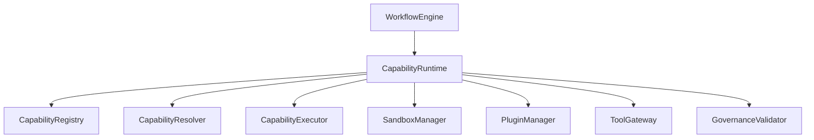

# RFC-0105

**Title:** Tool Execution & Capability Runtime Architecture

**Document ID:** RFC-0105

**Version:** 1.0

**Status:** Accepted

**Category:** Runtime Architecture

**Layer:** Capability Runtime / Tool Execution

**Target:**

```text
runtime/capabilities/
```

---

# Abstract

This RFC defines the SH-3 Tool Execution & Capability Runtime Architecture (TECRA).

The Tool Execution & Capability Runtime Architecture provides a unified runtime for executing internal capabilities, external tools, plugins, services, APIs, and code execution environments through a common capability abstraction.

Within SH-3, every executable function SHALL be represented as a Capability.

This abstraction enables deterministic execution, unified governance, consistent observability, capability discovery, version management, and secure isolation across heterogeneous execution environments.

This document is normative.

---

# Motivation

Modern AI operating systems interact with diverse execution targets:

- internal modules
- Python functions
- plugins
- REST APIs
- MCP-compatible services
- command-line tools
- containers
- remote services
- distributed workers

Treating these as separate execution models increases complexity.

A unified capability runtime provides one execution interface for every executable component.

---

# Goals

The architecture SHALL provide:

- unified capability abstraction
- deterministic capability execution
- dynamic capability discovery
- version-aware execution
- secure isolation
- policy-driven authorization
- capability lifecycle management

---

# Non-Goals

The architecture SHALL NOT:

- perform reasoning
- generate execution plans
- replace workflow scheduling
- bypass governance policies

---

# Architecture



---

# Design Principles

## Everything Is a Capability

Every executable component SHALL implement the Capability interface.

---

## Deterministic Invocation

Capability invocation SHALL be deterministic under identical inputs, configuration, and runtime state.

---

## Isolation

Capabilities SHALL execute within clearly defined isolation boundaries.

---

## Version Awareness

Multiple capability versions MAY coexist.

---

## Discoverability

Capabilities SHALL be discoverable at runtime.

---

## Replaceability

Capabilities MAY be replaced without changing callers.

---

# Components

| Component | Responsibility |
|-----------|----------------|
| CapabilityRuntime | Runtime coordination |
| CapabilityRegistry | Capability catalog |
| CapabilityResolver | Capability lookup |
| CapabilityExecutor | Execution engine |
| PluginManager | Plugin lifecycle |
| SandboxManager | Isolation management |
| ToolGateway | External tool bridge |
| GovernanceValidator | Policy enforcement |

---

# Capability Model

Every capability SHALL define:

- capability_id
- name
- namespace
- version
- description
- input_schema
- output_schema
- execution_type
- permissions
- timeout
- retry_policy
- metadata

Capability definitions SHALL be immutable and versioned.

---

# Capability Types

Supported capability types include:

| Type | Description |
|------|-------------|
| Internal | Native SH-3 implementation |
| Plugin | Dynamically loaded extension |
| Python | Python runtime execution |
| API | REST / HTTP service |
| MCP | Model Context Protocol service |
| CLI | Command-line executable |
| Container | Isolated container execution |
| Remote | Distributed execution endpoint |
| Composite | Workflow composed of capabilities |

Additional capability types MAY be introduced without changing the execution model.

---

# Capability Lifecycle

Each capability SHALL transition through:

```text
Registered

↓

Validated

↓

Available

↓

Reserved

↓

Executing

↓

Completed
```

Terminal states:

```text
Completed

Failed

Cancelled

Deprecated
```

Lifecycle transitions SHALL be persisted.

---

# Capability Discovery

CapabilityRegistry SHALL support discovery by:

- identifier
- namespace
- version
- type
- metadata
- semantic tags
- declared interfaces

Discovery SHALL return deterministic results.

---

# Capability Resolution

CapabilityResolver SHALL evaluate:

- requested version
- compatibility
- execution policy
- resource availability
- governance restrictions

Resolution SHALL occur before execution.

---

# Capability Invocation

The execution lifecycle SHALL follow:

```text
Resolve Capability

↓

Validate Inputs

↓

Authorize

↓

Reserve Resources

↓

Execute

↓

Validate Outputs

↓

Emit Events

↓

Release Resources
```

Every invocation SHALL produce an execution record.

---

# Input and Output Contracts

Capabilities SHALL define explicit schemas for:

- input parameters
- output values
- error conditions

Schema validation SHALL occur before and after execution.

---

# Execution Isolation

SandboxManager SHALL support isolation using:

- process boundaries
- containers
- virtual environments
- restricted interpreters
- permission scopes

Isolation SHALL be configurable according to policy.

---

# Plugin Management

PluginManager SHALL support:

- installation
- activation
- deactivation
- upgrades
- rollback
- dependency validation

Plugins SHALL remain independently versioned.

---

# External Tool Integration

ToolGateway SHALL integrate with:

- REST APIs
- gRPC services
- MCP servers
- CLI tools
- distributed execution services

External integrations SHALL be represented as capabilities.

---

# Capability Composition

Composite capabilities MAY orchestrate multiple child capabilities.

Example:

```text
Research Capability

├── Search

├── Retrieval

├── Analysis

└── Summary
```

Composition SHALL remain deterministic.

---

# Governance Integration

Before execution, GovernanceValidator SHALL evaluate:

- authorization
- permissions
- execution policy
- security policy
- compliance rules
- resource limits

Unauthorized capability execution SHALL be rejected.

---

# Message Bus Integration

Capability events include:

- CapabilityRegistered
- CapabilityValidated
- CapabilityResolved
- CapabilityReserved
- CapabilityStarted
- CapabilityCompleted
- CapabilityFailed
- CapabilityDeprecated

Events SHALL be immutable and versioned.

---

# Persistence Integration

Persistence SHALL maintain:

- capability registry
- version history
- execution history
- plugin metadata
- audit records
- dependency graph

Historical capability information SHALL remain reproducible.

---

# Observability

Capability telemetry SHALL expose:

- invocation count
- execution latency
- success rate
- failure rate
- timeout count
- retry count
- resource consumption
- version adoption

---

# Distributed Tracing

Every capability invocation SHALL preserve:

- trace_id
- capability_id
- execution_id
- workflow_id
- node_id
- version_id

Tracing SHALL reconstruct complete capability execution chains.

---

# Thread Model

The Tool Execution & Capability Runtime Architecture supports concurrent:

- capability discovery
- resolution
- execution
- plugin management
- registry updates
- telemetry collection

The reference implementation SHALL be:

- deterministic
- thread-safe
- horizontally scalable
- event-driven
- lock-efficient

---

# Metrics

The architecture exposes:

- capability throughput
- average invocation latency
- registry size
- execution success rate
- plugin activation count
- resolution latency
- capability utilization
- governance compliance

---

# Performance Objectives

The architecture should optimize for:

- fast capability discovery
- low invocation latency
- deterministic execution
- secure isolation
- efficient composition
- scalable execution

---

# Future Work

Potential future enhancements include:

- autonomous capability synthesis
- semantic capability matching
- capability marketplace
- distributed capability federation
- self-optimizing capability selection
- adaptive execution policies

---

# References

- RFC-0104 Resource Scheduling & Optimization Architecture
- RFC-0103 Autonomous Workflow Engine Architecture
- RFC-0102 Distributed Execution Cluster Architecture
- RFC-0101 Autonomous Cognitive Execution Orchestration Architecture
- RFC-0100 Autonomous Cognitive Unified Intelligence Architecture
- SH-3 Architecture Specification v2.1

---

# End of RFC-0105