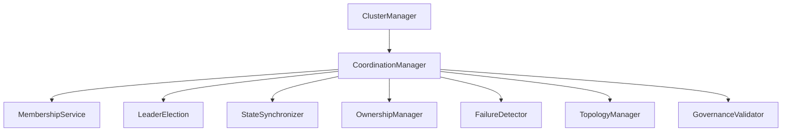

# RFC-0106

**Title:** Multi-Node Runtime Coordination Architecture

**Document ID:** RFC-0106

**Version:** 1.0

**Status:** Accepted

**Category:** Runtime Architecture

**Layer:** Distributed Runtime / Cluster Coordination

**Target:**

```text
runtime/coordination/
```

---

# Abstract

This RFC defines the SH-3 Multi-Node Runtime Coordination Architecture (MNRCA).

The Multi-Node Runtime Coordination Architecture provides the coordination layer that enables multiple SH-3 runtime nodes to operate as a single logical execution platform.

It is responsible for maintaining cluster membership, distributed state synchronization, execution ownership, leader election, task coordination, failure detection, and consistency guarantees while preserving deterministic behavior.

This document is normative.

---

# Motivation

RFC-0102 introduced distributed execution clusters, but cluster execution alone is insufficient.

A production-grade distributed runtime also requires:

- node discovery
- membership management
- coordination protocols
- ownership assignment
- distributed consistency
- fault detection
- topology awareness

Without runtime coordination, distributed execution cannot remain deterministic or resilient.

---

# Goals

The architecture SHALL provide:

- cluster membership management
- deterministic node coordination
- leader election
- distributed state synchronization
- execution ownership
- fault detection
- topology awareness

---

# Non-Goals

The architecture SHALL NOT:

- perform cognitive reasoning
- generate execution plans
- replace workflow scheduling
- bypass governance policies

---

# Architecture



---

# Design Principles

## Single Logical Runtime

Multiple runtime nodes SHALL appear as one logical execution environment.

---

## Deterministic Coordination

Given identical cluster state and workload, coordination decisions SHALL be reproducible.

---

## Event-Driven Coordination

All coordination SHALL occur through immutable events.

---

## Versioned State

Cluster state SHALL be versioned and monotonic.

---

## Failure Isolation

Failures SHALL remain localized whenever possible.

---

## Governance Preservation

Distributed coordination SHALL remain subject to governance policies.

---

# Components

| Component | Responsibility |
|-----------|----------------|
| CoordinationManager | Global runtime coordination |
| MembershipService | Cluster membership |
| LeaderElection | Leadership selection |
| StateSynchronizer | Cluster state replication |
| OwnershipManager | Execution ownership |
| FailureDetector | Health monitoring |
| TopologyManager | Cluster topology |
| GovernanceValidator | Policy validation |

---

# Cluster Membership

Every node SHALL maintain:

- node_id
- cluster_id
- runtime_version
- capabilities
- health_state
- network_endpoint
- availability_zone
- join_timestamp

Membership updates SHALL be immutable events.

---

# Membership Lifecycle

Node lifecycle SHALL follow:

```text
Joining

↓

Validating

↓

Active

↓

Draining

↓

Leaving

↓

Removed
```

State transitions SHALL be persisted.

---

# Leader Election

The architecture SHALL support pluggable leader-election algorithms.

A compliant implementation SHALL guarantee:

- at most one active leader
- deterministic leader transitions
- bounded election completion
- automatic re-election after failure

Leader responsibilities MAY include:

- coordination
- scheduling authority
- policy distribution
- cluster maintenance

---

# Distributed State Synchronization

StateSynchronizer SHALL replicate:

- cluster metadata
- execution ownership
- workflow metadata
- policy snapshots
- resource inventory

Replication SHALL preserve ordering and version history.

---

# Execution Ownership

OwnershipManager SHALL assign responsibility for:

- workflows
- tasks
- capability execution
- checkpoints
- recovery

Ownership SHALL be unique at any point in time.

Ownership transfer SHALL preserve execution correctness.

---

# Failure Detection

FailureDetector SHALL monitor:

- heartbeat intervals
- communication latency
- node responsiveness
- execution progress
- resource health

Failures SHALL be classified as:

| State | Description |
|--------|-------------|
| Healthy | Fully operational |
| Suspected | Awaiting confirmation |
| Unreachable | Communication lost |
| Failed | Confirmed failure |
| Recovering | Rejoining cluster |

---

# Cluster Topology

TopologyManager SHALL maintain:

- node graph
- network links
- regions
- zones
- latency estimates
- routing metadata

Topology changes SHALL trigger synchronization events.

---

# Consistency Model

The architecture SHALL distinguish:

- configuration consistency
- execution consistency
- metadata consistency
- telemetry consistency

Execution correctness SHALL take precedence over availability when required by policy.

---

# Coordination Protocol

A coordination cycle SHALL follow:

```text
Receive Cluster Event

↓

Validate Event

↓

Update Membership

↓

Synchronize State

↓

Assign Ownership

↓

Publish Changes

↓

Update Metrics
```

Each phase SHALL emit immutable events.

---

# Governance Integration

GovernanceValidator SHALL verify:

- node authorization
- runtime compatibility
- policy compliance
- ownership rules
- synchronization permissions

Unauthorized nodes SHALL NOT participate in cluster coordination.

---

# Message Bus Integration

Coordination events include:

- NodeJoined
- NodeValidated
- NodeActivated
- NodeDraining
- NodeRemoved
- LeaderElected
- OwnershipAssigned
- OwnershipTransferred
- StateSynchronized
- ClusterTopologyChanged
- NodeRecovered

Events SHALL be immutable and versioned.

---

# Persistence Integration

Persistence SHALL maintain:

- membership history
- leadership history
- ownership history
- topology snapshots
- synchronization logs
- coordination audit records

Historical cluster state SHALL remain reproducible.

---

# Observability

Coordination telemetry SHALL expose:

- active node count
- leader stability
- synchronization latency
- ownership transfers
- membership churn
- heartbeat latency
- cluster health score

---

# Distributed Tracing

Every coordination operation SHALL preserve:

- trace_id
- cluster_id
- node_id
- coordination_id
- ownership_id
- synchronization_id
- topology_version

Tracing SHALL reconstruct cluster-wide coordination history.

---

# Thread Model

The Multi-Node Runtime Coordination Architecture supports concurrent:

- membership updates
- synchronization
- leader election
- ownership transfer
- health monitoring
- topology updates
- telemetry collection

The reference implementation SHALL be:

- deterministic
- thread-safe
- horizontally scalable
- event-driven
- lock-efficient

---

# Metrics

The architecture exposes:

- election duration
- synchronization latency
- membership stability
- ownership transfer rate
- heartbeat delay
- topology convergence
- coordination throughput
- cluster health index

---

# Performance Objectives

The architecture should optimize for:

- deterministic coordination
- rapid convergence
- low synchronization overhead
- fast failure detection
- efficient ownership transfer
- scalable cluster membership

---

# Future Work

Potential future enhancements include:

- geo-distributed runtime federation
- autonomous topology optimization
- adaptive leader placement
- cross-cluster coordination
- decentralized policy propagation
- predictive failure detection

---

# References

- RFC-0105 Tool Execution & Capability Runtime Architecture
- RFC-0104 Resource Scheduling & Optimization Architecture
- RFC-0103 Autonomous Workflow Engine Architecture
- RFC-0102 Distributed Execution Cluster Architecture
- RFC-0101 Autonomous Cognitive Execution Orchestration Architecture
- SH-3 Architecture Specification v2.1

---

# End of RFC-0106