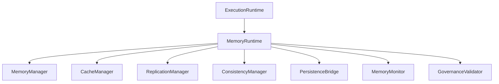

# RFC-0107

**Title:** Distributed Memory Runtime Architecture

**Document ID:** RFC-0107

**Version:** 1.0

**Status:** Accepted

**Category:** Runtime Architecture

**Layer:** Distributed Runtime / Memory Coordination

**Target:**

```text
runtime/memory/
```

---

# Abstract

This RFC defines the SH-3 Distributed Memory Runtime Architecture (DMRA).

The Distributed Memory Runtime Architecture provides a unified memory subsystem for distributed SH-3 deployments. It enables runtime nodes to access shared logical memory while preserving deterministic execution, configurable consistency, fault tolerance, and governance compliance.

The architecture separates logical memory from physical storage and defines a common abstraction for memory allocation, replication, synchronization, caching, and persistence across the runtime cluster.

This document is normative.

---

# Motivation

Distributed execution requires distributed memory.

Without a coordinated memory runtime:

- execution state becomes fragmented
- workflow migration becomes difficult
- cache consistency is unreliable
- recovery becomes incomplete
- knowledge synchronization becomes expensive

A unified distributed memory architecture allows execution to remain location-independent while preserving correctness.

---

# Goals

The architecture SHALL provide:

- shared logical memory
- distributed cache coordination
- state replication
- configurable consistency
- deterministic synchronization
- memory fault tolerance
- policy-aware memory access

---

# Non-Goals

The architecture SHALL NOT:

- replace long-term knowledge storage
- perform cognitive reasoning
- bypass governance policies
- expose implementation-specific storage mechanisms

---

# Architecture



---

# Design Principles

## Unified Logical Memory

Applications SHALL observe one logical memory space regardless of node placement.

---

## Deterministic Visibility

Memory visibility SHALL follow deterministic consistency rules.

---

## Configurable Consistency

Consistency SHALL be selected according to workload requirements.

---

## Fault Tolerant Replication

Memory SHALL tolerate individual node failures without violating correctness guarantees defined by policy.

---

## Immutable State Transitions

Every committed memory transition SHALL be versioned and traceable.

---

# Components

| Component | Responsibility |
|-----------|----------------|
| MemoryRuntime | Runtime coordination |
| MemoryManager | Allocation and ownership |
| CacheManager | Distributed cache |
| ReplicationManager | State replication |
| ConsistencyManager | Consistency enforcement |
| PersistenceBridge | Persistent storage integration |
| MemoryMonitor | Runtime monitoring |
| GovernanceValidator | Access policy enforcement |

---

# Memory Model

Every memory object SHALL define:

- memory_id
- namespace
- owner
- version
- consistency_level
- replication_policy
- lifecycle_state
- timestamp

Objects SHALL be immutable between committed versions.

---

# Memory Hierarchy

The runtime SHALL distinguish:

```text
Working Memory

↓

Workflow Memory

↓

Shared Runtime Memory

↓

Distributed Cache

↓

Persistent Storage
```

Each level SHALL expose a consistent programming model.

---

# Consistency Levels

Supported consistency models include:

| Level | Description |
|--------|-------------|
| Strong | Immediate visibility |
| Sequential | Ordered visibility |
| Session | Session-local consistency |
| Eventual | Deferred convergence |
| Read Optimized | Read latency prioritized |
| Write Optimized | Write throughput prioritized |

Consistency SHALL be selected through policy.

---

# Replication

ReplicationManager SHALL support:

- synchronous replication
- asynchronous replication
- quorum replication
- primary-secondary replication
- multi-primary replication

Replication strategy SHALL be configurable.

---

# Cache Coordination

CacheManager SHALL support:

- cache discovery
- cache invalidation
- cache synchronization
- cache warming
- eviction policies

Cache invalidation SHALL occur through immutable events.

---

# Memory Allocation

Allocation lifecycle:

```text
Allocate

↓

Reserve

↓

Use

↓

Synchronize

↓

Release

↓

Recycle
```

Allocation SHALL remain deterministic.

---

# Workflow State Sharing

Workflow state SHALL include:

- execution context
- workflow metadata
- checkpoints
- intermediate results
- ownership metadata

Workflow migration SHALL preserve state integrity.

---

# Memory Synchronization

Synchronization SHALL preserve:

- ordering
- version history
- ownership
- consistency guarantees

Synchronization conflicts SHALL follow deterministic resolution policies.

---

# Persistence Integration

PersistenceBridge SHALL synchronize:

- runtime state
- workflow checkpoints
- distributed cache snapshots
- metadata
- replication history

Persistent storage SHALL remain implementation independent.

---

# Fault Tolerance

Memory failures SHALL support:

- replica promotion
- state restoration
- cache rebuild
- checkpoint recovery
- ownership reassignment

Recovery SHALL preserve committed state.

---

# Governance Integration

Memory access SHALL require validation of:

- namespace permissions
- ownership
- execution scope
- governance policy
- compliance policy

Unauthorized access SHALL be rejected.

---

# Message Bus Integration

Memory events include:

- MemoryAllocated
- MemoryReserved
- MemoryCommitted
- MemoryReplicated
- CacheUpdated
- CacheInvalidated
- ReplicaPromoted
- MemoryReleased

Events SHALL be immutable and versioned.

---

# Observability

Memory telemetry SHALL expose:

- allocation latency
- cache hit ratio
- replication latency
- synchronization delay
- memory utilization
- consistency violations
- recovery duration

---

# Distributed Tracing

Every memory operation SHALL preserve:

- trace_id
- memory_id
- workflow_id
- allocation_id
- replica_id
- node_id
- version_id

Tracing SHALL reconstruct complete memory history.

---

# Thread Model

The Distributed Memory Runtime Architecture supports concurrent:

- allocation
- replication
- synchronization
- cache updates
- checkpoint persistence
- telemetry collection

The reference implementation SHALL be:

- deterministic
- thread-safe
- horizontally scalable
- lock-efficient
- event-driven

---

# Metrics

The architecture exposes:

- memory utilization
- cache efficiency
- replication throughput
- synchronization latency
- consistency compliance
- allocation throughput
- recovery success rate

---

# Performance Objectives

The architecture should optimize for:

- predictable memory visibility
- low synchronization overhead
- high cache efficiency
- scalable replication
- rapid recovery
- deterministic behavior

---

# Future Work

Potential future enhancements include:

- hierarchical distributed memory
- memory-aware workload placement
- adaptive replication policies
- persistent shared object spaces
- NUMA-aware scheduling
- autonomous memory optimization

---

# References

- RFC-0106 Multi-Node Runtime Coordination Architecture
- RFC-0105 Tool Execution & Capability Runtime Architecture
- RFC-0104 Resource Scheduling & Optimization Architecture
- RFC-0102 Distributed Execution Cluster Architecture
- SH-3 Architecture Specification v2.1

---

# End of RFC-0107