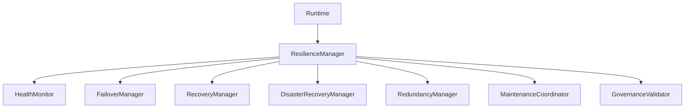

# RFC-0108

**Title:** High Availability & Fault Tolerance Architecture

**Document ID:** RFC-0108

**Version:** 1.0

**Status:** Accepted

**Category:** Runtime Architecture

**Layer:** Runtime Resilience / High Availability

**Target:**

```text
runtime/resilience/
```

---

# Abstract

This RFC defines the SH-3 High Availability & Fault Tolerance Architecture (HAFTA).

The High Availability & Fault Tolerance Architecture provides the resilience layer responsible for maintaining continuous operation despite hardware failures, software defects, network partitions, infrastructure degradation, or maintenance events.

The architecture integrates monitoring, redundancy, failover, recovery, disaster recovery, and resilience policies into a unified runtime subsystem while preserving deterministic execution, governance compliance, and complete observability.

This document is normative.

---

# Motivation

Reliable autonomous systems must assume that failures will occur.

Examples include:

- process crashes
- node failures
- storage failures
- network interruptions
- cloud outages
- software bugs
- operator mistakes

The runtime SHALL continue operating whenever recovery policies permit.

---

# Goals

The architecture SHALL provide:

- continuous service availability
- automated fault detection
- deterministic failover
- workload continuity
- disaster recovery
- resilience policy enforcement
- observability of recovery operations

---

# Non-Goals

The architecture SHALL NOT:

- replace governance
- modify cognitive decisions
- bypass execution policies
- conceal unrecoverable failures

---

# Architecture



---

# Design Principles

## Failure Is Expected

Every subsystem SHALL assume failures are possible.

---

## Automated Recovery

Recovery SHALL occur automatically whenever policy permits.

---

## Deterministic Recovery

Recovery SHALL produce reproducible outcomes given identical failure conditions.

---

## Graceful Degradation

When full recovery is impossible, essential functionality SHOULD remain available.

---

## Observable Recovery

Every recovery action SHALL generate immutable telemetry and audit events.

---

# Components

| Component | Responsibility |
|-----------|----------------|
| ResilienceManager | Global resilience coordination |
| HealthMonitor | Runtime health monitoring |
| FailoverManager | Automatic failover |
| RecoveryManager | Runtime recovery |
| DisasterRecoveryManager | Site-level recovery |
| RedundancyManager | Redundant resources |
| MaintenanceCoordinator | Planned maintenance |
| GovernanceValidator | Policy validation |

---

# Health Monitoring

HealthMonitor SHALL continuously evaluate:

- process health
- node health
- workflow progress
- capability availability
- memory integrity
- storage health
- network latency
- cluster consistency

Health evaluations SHALL produce versioned health reports.

---

# Health States

Every managed component SHALL expose one of:

| State | Description |
|--------|-------------|
| Healthy | Fully operational |
| Degraded | Reduced capability |
| Recovering | Recovery in progress |
| Maintenance | Planned maintenance |
| Failed | Unavailable |
| Retired | Permanently removed |

State transitions SHALL be recorded.

---

# Failure Classification

Failures SHALL be classified as:

| Category | Description |
|----------|-------------|
| Process | Runtime process failure |
| Node | Compute node failure |
| Storage | Persistent storage failure |
| Network | Connectivity failure |
| Dependency | External dependency unavailable |
| Configuration | Invalid runtime configuration |
| Governance | Policy enforcement failure |

Each category SHALL define an independent recovery policy.

---

# Failover Lifecycle

The failover process SHALL follow:

```text
Failure Detected

↓

Failure Confirmed

↓

Recovery Policy Selected

↓

Ownership Transferred

↓

Resources Reallocated

↓

Execution Restored

↓

Verification Completed
```

Each stage SHALL emit immutable events.

---

# Redundancy

The architecture SHALL support redundancy for:

- execution nodes
- storage
- metadata
- workflow checkpoints
- policy snapshots
- capability registry
- telemetry collection

Redundant components SHALL remain synchronized.

---

# Recovery Policies

Supported recovery strategies include:

- retry
- restart
- failover
- rollback
- checkpoint restoration
- workload migration
- graceful degradation

Policies SHALL be configurable.

---

# Disaster Recovery

DisasterRecoveryManager SHALL support:

- backup restoration
- cross-site replication
- region failover
- metadata recovery
- cluster reconstruction

Recovery objectives SHALL be policy driven.

---

# Maintenance Coordination

MaintenanceCoordinator SHALL support:

- rolling updates
- node draining
- workload migration
- version validation
- controlled restart

Maintenance SHALL minimize service interruption.

---

# Resilience Policies

Policy examples include:

- maximum recovery attempts
- failover timeout
- redundancy level
- quorum requirement
- backup frequency
- maintenance windows

Policies SHALL be centrally managed.

---

# Governance Integration

Every recovery operation SHALL be validated against:

- governance policy
- security policy
- compliance policy
- resource policy
- recovery policy

Unauthorized recovery SHALL be rejected.

---

# Message Bus Integration

Resilience events include:

- HealthChanged
- FailureDetected
- FailureConfirmed
- FailoverStarted
- FailoverCompleted
- RecoveryStarted
- RecoveryCompleted
- DisasterRecoveryStarted
- DisasterRecoveryCompleted
- MaintenanceStarted
- MaintenanceCompleted

Events SHALL be immutable and versioned.

---

# Persistence Integration

Persistence SHALL maintain:

- recovery history
- failover history
- disaster recovery records
- maintenance logs
- resilience policies
- health reports

Historical resilience data SHALL remain reproducible.

---

# Observability

Resilience telemetry SHALL expose:

- availability
- recovery latency
- failover duration
- health score
- redundancy utilization
- maintenance duration
- recovery success rate
- disaster recovery readiness

---

# Distributed Tracing

Every resilience operation SHALL preserve:

- trace_id
- recovery_id
- failover_id
- component_id
- workflow_id
- node_id
- policy_id

Tracing SHALL reconstruct complete recovery history.

---

# Thread Model

The High Availability & Fault Tolerance Architecture supports concurrent:

- health monitoring
- recovery
- failover
- redundancy synchronization
- maintenance
- telemetry collection

The reference implementation SHALL be:

- deterministic
- thread-safe
- horizontally scalable
- event-driven
- lock-efficient

---

# Metrics

The architecture exposes:

- availability percentage
- mean time to detect (MTTD)
- mean time to recover (MTTR)
- failover latency
- recovery success rate
- redundancy efficiency
- maintenance impact
- resilience index

---

# Performance Objectives

The architecture should optimize for:

- continuous availability
- rapid recovery
- deterministic resilience
- minimal service interruption
- efficient redundancy
- scalable recovery coordination

---

# Future Work

Potential future enhancements include:

- predictive failure analysis
- AI-assisted recovery planning
- autonomous resilience optimization
- multi-cloud disaster recovery
- self-healing infrastructure orchestration
- resilience-aware scheduling

---

# References

- RFC-0107 Distributed Memory Runtime Architecture
- RFC-0106 Multi-Node Runtime Coordination Architecture
- RFC-0105 Tool Execution & Capability Runtime Architecture
- RFC-0104 Resource Scheduling & Optimization Architecture
- RFC-0101 Autonomous Cognitive Execution Orchestration Architecture
- SH-3 Architecture Specification v2.1

---

# End of RFC-0108