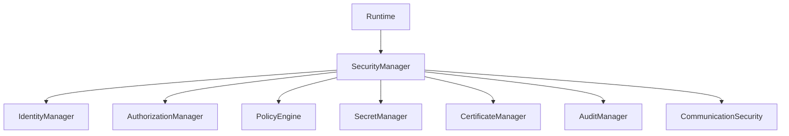

# RFC-0109

**Title:** Runtime Security & Zero Trust Architecture

**Document ID:** RFC-0109

**Version:** 1.0

**Status:** Accepted

**Category:** Runtime Architecture

**Layer:** Runtime Security / Zero Trust

**Target:**

```text
runtime/security/
```

---

# Abstract

This RFC defines the SH-3 Runtime Security & Zero Trust Architecture (RSZTA).

The Runtime Security & Zero Trust Architecture establishes a comprehensive security framework for the SH-3 runtime. It applies Zero Trust principles across every runtime component, capability, workflow, node, and communication channel.

The architecture enforces continuous authentication, authorization, least-privilege execution, secure communication, secret management, policy enforcement, and complete auditability while preserving deterministic execution and observability.

This document is normative.

---

# Motivation

Modern autonomous systems execute across multiple nodes, plugins, external APIs, and distributed workflows.

Security assumptions based on trusted networks or trusted processes are insufficient.

Every execution request SHALL be verified regardless of origin.

---

# Goals

The architecture SHALL provide:

- Zero Trust security
- continuous authentication
- policy-driven authorization
- secure secret management
- encrypted communication
- capability isolation
- complete security auditing

---

# Non-Goals

The architecture SHALL NOT:

- replace governance policies
- modify workflow semantics
- bypass execution authorization
- expose sensitive credentials

---

# Architecture



---

# Design Principles

## Never Trust

No component SHALL be implicitly trusted.

---

## Always Verify

Authentication and authorization SHALL occur before every protected operation.

---

## Least Privilege

Every execution SHALL receive the minimum permissions required.

---

## Defense in Depth

Security SHALL consist of multiple independent protection layers.

---

## Immutable Audit

Security events SHALL be immutable, versioned, and tamper-evident.

---

# Components

| Component | Responsibility |
|-----------|----------------|
| SecurityManager | Global security coordination |
| IdentityManager | Identity lifecycle |
| AuthorizationManager | Access control |
| PolicyEngine | Security policy evaluation |
| SecretManager | Secret lifecycle |
| CertificateManager | Trust infrastructure |
| AuditManager | Security audit logging |
| CommunicationSecurity | Secure transport |

---

# Identity Model

Every runtime identity SHALL define:

- identity_id
- identity_type
- namespace
- credentials
- permissions
- expiration
- status
- metadata

Supported identity types include:

- runtime node
- workflow
- capability
- plugin
- service account
- external service
- operator

Identities SHALL be versioned.

---

# Authentication

Authentication SHALL support:

- mutual TLS
- signed tokens
- hardware-backed identities
- certificate validation
- API credentials
- pluggable identity providers

Authentication SHALL precede authorization.

---

# Authorization

Authorization SHALL evaluate:

- identity
- requested operation
- resource
- execution scope
- workflow context
- governance policy
- runtime policy

Authorization SHALL default to deny.

---

# Secret Management

SecretManager SHALL manage:

- API keys
- OAuth tokens
- certificates
- encryption keys
- passwords
- runtime credentials

Secrets SHALL:

- never appear in logs
- remain encrypted at rest
- remain encrypted in transit
- support automatic rotation
- support version history

---

# Secure Communication

Every runtime communication SHALL support:

- encryption
- integrity validation
- peer authentication
- replay protection
- protocol version negotiation

Communication SHALL default to encrypted transport.

---

# Capability Security

Capability execution SHALL define:

- permission scope
- execution identity
- resource limits
- sandbox profile
- network policy
- secret access policy

Capabilities SHALL NOT inherit unrestricted permissions.

---

# Plugin Security

Plugins SHALL undergo:

- signature validation
- compatibility validation
- dependency validation
- permission validation
- integrity verification

Unsigned plugins MAY be rejected according to policy.

---

# Certificate Management

CertificateManager SHALL support:

- issuance
- renewal
- revocation
- trust chains
- expiration monitoring

Certificates SHALL remain centrally manageable.

---

# Audit Logging

AuditManager SHALL record:

- authentication events
- authorization decisions
- secret access
- policy evaluations
- capability execution
- administrative actions
- certificate lifecycle

Audit records SHALL remain immutable.

---

# Incident Detection

Security monitoring SHALL identify:

- repeated authentication failures
- privilege escalation attempts
- unexpected capability execution
- unauthorized resource access
- certificate misuse
- anomalous communication

Detected incidents SHALL generate immutable security events.

---

# Governance Integration

Security SHALL integrate with governance by validating:

- policy compliance
- execution permissions
- identity trust
- operational scope
- compliance requirements

Security validation SHALL precede runtime execution.

---

# Message Bus Integration

Security events include:

- IdentityCreated
- AuthenticationSucceeded
- AuthenticationFailed
- AuthorizationGranted
- AuthorizationDenied
- SecretAccessed
- CertificateIssued
- CertificateRevoked
- SecurityIncidentDetected
- AuditRecordCreated

Events SHALL be immutable and versioned.

---

# Persistence Integration

Persistence SHALL maintain:

- identity history
- certificate history
- authorization history
- secret metadata
- audit records
- incident history

Sensitive material SHALL never be stored in plaintext.

---

# Observability

Security telemetry SHALL expose:

- authentication latency
- authorization latency
- denied requests
- active identities
- certificate expiration
- secret rotation status
- incident frequency
- audit throughput

---

# Distributed Tracing

Every protected operation SHALL preserve:

- trace_id
- identity_id
- authorization_id
- policy_id
- workflow_id
- capability_id
- node_id

Tracing SHALL reconstruct security decisions across the runtime.

---

# Thread Model

The Runtime Security & Zero Trust Architecture supports concurrent:

- authentication
- authorization
- policy evaluation
- secret retrieval
- certificate validation
- audit logging
- telemetry collection

The reference implementation SHALL be:

- deterministic
- thread-safe
- horizontally scalable
- event-driven
- lock-efficient

---

# Metrics

The architecture exposes:

- authentication success rate
- authorization denial rate
- secret rotation interval
- certificate validity
- incident detection latency
- audit throughput
- security compliance index

---

# Performance Objectives

The architecture should optimize for:

- low authentication latency
- deterministic authorization
- strong isolation
- secure communication
- rapid incident detection
- scalable security enforcement

---

# Future Work

Potential future enhancements include:

- confidential computing support
- hardware security module integration
- post-quantum cryptography
- adaptive risk-based authorization
- autonomous threat response
- federated identity management

---

# References

- RFC-0108 High Availability & Fault Tolerance Architecture
- RFC-0107 Distributed Memory Runtime Architecture
- RFC-0106 Multi-Node Runtime Coordination Architecture
- RFC-0105 Tool Execution & Capability Runtime Architecture
- RFC-0101 Autonomous Cognitive Execution Orchestration Architecture
- SH-3 Architecture Specification v2.1

---

# End of RFC-0109