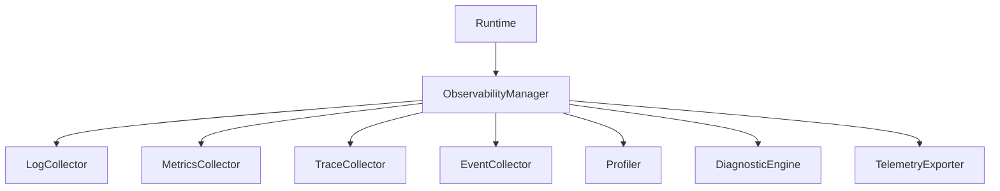

# RFC-0110

**Title:** Runtime Observability & Telemetry Architecture

**Document ID:** RFC-0110

**Version:** 1.0

**Status:** Accepted

**Category:** Runtime Architecture

**Layer:** Runtime Observability / Telemetry

**Target:**

```text
runtime/observability/
```

---

# Abstract

This RFC defines the SH-3 Runtime Observability & Telemetry Architecture (ROTA).

The Runtime Observability & Telemetry Architecture provides a unified observability framework for every component within the SH-3 Runtime. It standardizes the collection, aggregation, correlation, storage, and analysis of telemetry data while preserving deterministic execution and minimal runtime overhead.

Observability SHALL encompass logs, metrics, traces, events, health signals, profiling data, diagnostics, and audit information under a single extensible model.

This document is normative.

---

# Motivation

A production AI Operating System requires complete runtime visibility.

Without unified observability:

- failures become difficult to diagnose
- distributed execution becomes opaque
- performance bottlenecks remain hidden
- recovery validation becomes unreliable
- governance auditing becomes incomplete

A single observability architecture enables operational insight, debugging, optimization, and compliance.

---

# Goals

The architecture SHALL provide:

- unified telemetry collection
- distributed tracing
- structured logging
- metrics aggregation
- event correlation
- runtime diagnostics
- historical observability

---

# Non-Goals

The architecture SHALL NOT:

- modify runtime behavior
- replace persistence
- bypass governance
- expose protected information

---

# Architecture



---

# Design Principles

## Everything Is Observable

Every runtime component SHALL emit telemetry.

---

## Structured First

Telemetry SHALL use structured schemas.

---

## Correlated Signals

Logs, metrics, traces, and events SHALL share common identifiers.

---

## Low Overhead

Observability SHALL minimize execution impact.

---

## Immutable History

Collected telemetry SHALL remain immutable.

---

# Components

| Component | Responsibility |
|-----------|----------------|
| ObservabilityManager | Global coordination |
| LogCollector | Structured logging |
| MetricsCollector | Metrics aggregation |
| TraceCollector | Distributed tracing |
| EventCollector | Runtime events |
| Profiler | Performance profiling |
| DiagnosticEngine | Runtime diagnostics |
| TelemetryExporter | External integration |

---

# Telemetry Categories

The runtime SHALL collect:

- logs
- metrics
- traces
- events
- profiles
- diagnostics
- audits
- health reports

Each category SHALL have a versioned schema.

---

# Logging

Logs SHALL be:

- structured
- timestamped
- versioned
- immutable
- correlated
- severity classified

Supported severities:

- Trace
- Debug
- Info
- Warning
- Error
- Critical

---

# Metrics

Metrics SHALL support:

- counters
- gauges
- histograms
- summaries
- rates
- distributions

Metrics SHALL include labels and timestamps.

---

# Distributed Tracing

Every runtime operation SHALL propagate:

- trace_id
- span_id
- parent_span_id
- workflow_id
- capability_id
- execution_id
- node_id
- correlation_id

Tracing SHALL reconstruct end-to-end execution.

---

# Event Collection

Observable runtime events include:

- workflow lifecycle
- capability execution
- resource allocation
- node coordination
- security events
- recovery events
- governance decisions

Events SHALL be immutable.

---

# Runtime Profiling

Profiler SHALL support:

- CPU profiling
- memory profiling
- allocation profiling
- latency profiling
- lock contention analysis
- asynchronous execution profiling

Profiling SHALL be dynamically configurable.

---

# Diagnostics

DiagnosticEngine SHALL evaluate:

- runtime health
- deadlock detection
- resource leaks
- memory pressure
- scheduler efficiency
- execution anomalies

Diagnostics SHALL emit recommendations without modifying runtime behavior.

---

# Telemetry Correlation

Every telemetry record SHALL support:

- trace_id
- correlation_id
- workflow_id
- execution_id
- node_id
- timestamp
- version

Correlation SHALL enable complete execution reconstruction.

---

# Retention

Telemetry retention SHALL define:

- retention period
- archival policy
- compression policy
- deletion policy
- governance policy

Retention SHALL be configurable.

---

# Export

TelemetryExporter SHALL support:

- OpenTelemetry
- Prometheus
- OTLP
- JSON
- NDJSON
- Parquet
- custom exporters

Export SHALL remain asynchronous.

---

# Governance Integration

Governance SHALL validate:

- telemetry visibility
- data classification
- privacy policy
- retention policy
- export permissions

Protected information SHALL be masked or omitted according to policy.

---

# Message Bus Integration

Observability events include:

- LogRecorded
- MetricCollected
- TraceStarted
- TraceCompleted
- EventPublished
- ProfileCaptured
- DiagnosticGenerated
- TelemetryExported

Events SHALL remain immutable and versioned.

---

# Persistence Integration

Persistence SHALL maintain:

- logs
- metrics
- traces
- profiles
- diagnostics
- telemetry schemas
- retention metadata

Historical telemetry SHALL remain reproducible.

---

# Observability APIs

The architecture SHALL expose APIs for:

- querying telemetry
- trace reconstruction
- metric aggregation
- log search
- profile analysis
- diagnostic retrieval

APIs SHALL remain versioned.

---

# Thread Model

The Runtime Observability & Telemetry Architecture supports concurrent:

- log collection
- metric aggregation
- tracing
- profiling
- diagnostics
- exporting
- telemetry queries

The reference implementation SHALL be:

- deterministic
- thread-safe
- horizontally scalable
- event-driven
- lock-efficient

---

# Metrics

The architecture exposes operational metrics including:

- telemetry throughput
- export latency
- trace completeness
- log ingestion rate
- metric cardinality
- profiler overhead
- diagnostic latency

---

# Performance Objectives

The architecture should optimize for:

- low runtime overhead
- high telemetry throughput
- accurate trace correlation
- scalable aggregation
- efficient querying
- deterministic instrumentation

---

# Future Work

Potential future enhancements include:

- AI-assisted anomaly detection
- predictive diagnostics
- autonomous telemetry sampling
- adaptive instrumentation
- distributed root-cause analysis
- semantic observability graphs

---

# References

- RFC-0109 Runtime Security & Zero Trust Architecture
- RFC-0108 High Availability & Fault Tolerance Architecture
- RFC-0107 Distributed Memory Runtime Architecture
- RFC-0106 Multi-Node Runtime Coordination Architecture
- RFC-0105 Tool Execution & Capability Runtime Architecture
- SH-3 Architecture Specification v2.1

---

# End of RFC-0110