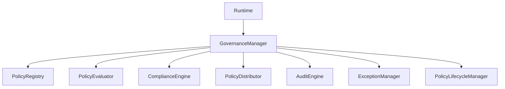

# RFC-0111

**Title:** Runtime Policy & Governance Enforcement Architecture

**Document ID:** RFC-0111

**Version:** 1.0

**Status:** Accepted

**Category:** Runtime Architecture

**Layer:** Runtime Governance / Policy Enforcement

**Target:**

```text
runtime/governance/
```

---

# Abstract

This RFC defines the SH-3 Runtime Policy & Governance Enforcement Architecture (RPGEA).

The Runtime Policy & Governance Enforcement Architecture establishes the unified governance subsystem responsible for evaluating, enforcing, distributing, auditing, and versioning runtime policies across every SH-3 component.

This architecture provides deterministic policy evaluation, centralized governance management, decentralized enforcement, immutable auditability, and dynamic policy distribution while maintaining compatibility with distributed execution and autonomous runtime operation.

This document is normative.

---

# Motivation

Previous Runtime RFCs reference governance validation before execution, resource allocation, capability invocation, security decisions, and workflow execution.

Without a unified governance architecture:

- policy enforcement becomes inconsistent
- duplicated validation logic appears
- audit trails become fragmented
- distributed nodes diverge
- compliance becomes difficult

A centralized governance model with distributed enforcement guarantees consistent runtime behavior.

---

# Goals

The architecture SHALL provide:

- centralized policy management
- distributed policy enforcement
- deterministic policy evaluation
- policy versioning
- compliance verification
- immutable governance auditing
- runtime policy distribution

---

# Non-Goals

The architecture SHALL NOT:

- perform cognitive reasoning
- replace workflow execution
- replace authentication
- directly execute capabilities

---

# Architecture



---

# Design Principles

## Governance Everywhere

Every runtime operation SHALL be governed.

---

## Policy Before Execution

Policy evaluation SHALL precede protected operations.

---

## Immutable Policies

Approved policy versions SHALL be immutable.

---

## Deterministic Decisions

Policy evaluation SHALL produce identical decisions under identical inputs.

---

## Observable Governance

Every governance decision SHALL be traceable.

---

# Components

| Component | Responsibility |
|-----------|----------------|
| GovernanceManager | Global governance coordination |
| PolicyRegistry | Policy catalog |
| PolicyEvaluator | Runtime evaluation |
| ComplianceEngine | Compliance verification |
| PolicyDistributor | Cluster-wide policy distribution |
| AuditEngine | Governance auditing |
| ExceptionManager | Exception processing |
| PolicyLifecycleManager | Version lifecycle |

---

# Policy Model

Every policy SHALL define:

- policy_id
- name
- version
- category
- scope
- priority
- conditions
- actions
- owner
- status
- metadata

Policies SHALL remain immutable after activation.

---

# Policy Categories

Supported categories include:

- execution
- workflow
- capability
- resource
- security
- networking
- storage
- memory
- observability
- compliance
- recovery
- deployment

Additional policy types MAY be added without architectural changes.

---

# Governance Lifecycle

Every policy SHALL follow:

```text
Draft

↓

Validated

↓

Approved

↓

Published

↓

Active

↓

Deprecated

↓

Archived
```

Historical versions SHALL remain available.

---

# Policy Evaluation

Evaluation SHALL include:

1. policy selection
2. scope verification
3. condition evaluation
4. conflict resolution
5. action generation
6. decision recording

Evaluation SHALL remain deterministic.

---

# Policy Scope

Policies MAY target:

- runtime
- cluster
- node
- workflow
- capability
- plugin
- execution
- user
- tenant
- namespace

Scope SHALL be explicitly declared.

---

# Conflict Resolution

When multiple policies apply:

1. explicit deny overrides allow
2. higher priority overrides lower priority
3. narrower scope overrides broader scope
4. newest compatible version wins
5. deterministic ordering resolves ties

Conflict resolution SHALL be reproducible.

---

# Compliance Verification

ComplianceEngine SHALL verify:

- organizational policies
- security policies
- regulatory requirements
- execution constraints
- operational standards

Compliance SHALL generate immutable reports.

---

# Policy Distribution

PolicyDistributor SHALL support:

- cluster synchronization
- incremental updates
- version negotiation
- rollback
- staged rollout

Distribution SHALL preserve consistency across nodes.

---

# Exception Handling

ExceptionManager SHALL support:

- temporary exceptions
- emergency overrides
- maintenance windows
- delegated approvals
- expiration policies

Every exception SHALL be audited.

---

# Governance Decision Model

Every decision SHALL record:

- decision_id
- policy_version
- evaluated_object
- evaluation_result
- timestamp
- evaluator
- trace_id

Decisions SHALL be immutable.

---

# Governance APIs

The architecture SHALL expose APIs for:

- policy registration
- policy activation
- policy validation
- policy evaluation
- compliance verification
- audit queries
- exception management

APIs SHALL be versioned.

---

# Message Bus Integration

Governance events include:

- PolicyCreated
- PolicyValidated
- PolicyApproved
- PolicyActivated
- PolicyEvaluated
- PolicyRejected
- PolicyDeprecated
- ComplianceVerified
- ExceptionGranted
- ExceptionExpired

Events SHALL be immutable and versioned.

---

# Persistence Integration

Persistence SHALL maintain:

- policy history
- evaluation history
- compliance reports
- governance decisions
- exception records
- policy metadata

Historical governance state SHALL remain reproducible.

---

# Observability

Governance telemetry SHALL expose:

- evaluation latency
- policy hit rate
- compliance score
- exception frequency
- policy conflicts
- distribution latency
- audit throughput

---

# Distributed Tracing

Every governance operation SHALL preserve:

- trace_id
- policy_id
- decision_id
- workflow_id
- capability_id
- node_id
- evaluator_id

Tracing SHALL reconstruct governance decisions across the cluster.

---

# Thread Model

The Runtime Policy & Governance Enforcement Architecture supports concurrent:

- policy evaluation
- policy distribution
- compliance verification
- audit recording
- lifecycle management
- exception processing

The reference implementation SHALL be:

- deterministic
- thread-safe
- horizontally scalable
- event-driven
- lock-efficient

---

# Metrics

The architecture exposes:

- evaluation throughput
- policy propagation latency
- compliance rate
- audit completeness
- conflict resolution count
- exception rate
- governance availability

---

# Performance Objectives

The architecture should optimize for:

- deterministic evaluation
- low decision latency
- efficient policy propagation
- scalable governance
- immutable auditability
- high compliance coverage

---

# Future Work

Potential future enhancements include:

- AI-assisted policy generation
- formal policy verification
- adaptive governance
- risk-aware policy evaluation
- federated governance domains
- autonomous compliance optimization

---

# References

- RFC-0110 Runtime Observability & Telemetry Architecture
- RFC-0109 Runtime Security & Zero Trust Architecture
- RFC-0108 High Availability & Fault Tolerance Architecture
- RFC-0107 Distributed Memory Runtime Architecture
- RFC-0105 Tool Execution & Capability Runtime Architecture
- SH-3 Architecture Specification v2.1

---

# End of RFC-0111