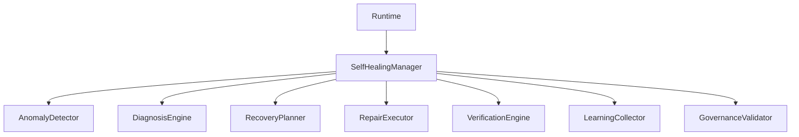

# RFC-0112

**Title:** Runtime Self-Healing & Autonomous Recovery Architecture

**Document ID:** RFC-0112

**Version:** 1.0

**Status:** Accepted

**Category:** Runtime Architecture

**Layer:** Runtime Resilience / Self-Healing

**Target:**

```text
runtime/self_healing/
```

---

# Abstract

This RFC defines the SH-3 Runtime Self-Healing & Autonomous Recovery Architecture (SHARA).

The Runtime Self-Healing & Autonomous Recovery Architecture provides an autonomous resilience framework that continuously detects, diagnoses, mitigates, repairs, validates, and learns from runtime failures.

Unlike traditional fault recovery, this architecture introduces closed-loop autonomous healing driven by policies, telemetry, diagnostics, governance, and accumulated operational knowledge.

Every recovery action SHALL be deterministic, observable, auditable, and policy-governed.

This document is normative.

---

# Motivation

Modern AI operating systems must tolerate failures without continuous human intervention.

While RFC-0108 defines High Availability and Fault Tolerance, it focuses primarily on recovery mechanisms.

SH-3 extends this capability by introducing autonomous diagnosis, adaptive repair strategies, verification, and continuous improvement.

---

# Goals

The architecture SHALL provide:

- continuous anomaly detection
- autonomous diagnosis
- deterministic repair planning
- automated recovery execution
- recovery verification
- learning from operational outcomes
- governance-controlled healing

---

# Non-Goals

The architecture SHALL NOT:

- bypass governance
- modify cognitive reasoning
- change business logic
- execute unauthorized recovery actions

---

# Architecture



---

# Design Principles

## Continuous Observation

Runtime health SHALL be continuously evaluated.

---

## Closed-Loop Healing

Healing SHALL follow an observe → diagnose → repair → verify → learn cycle.

---

## Deterministic Recovery

Given identical inputs and policies, healing decisions SHALL be reproducible.

---

## Policy Before Repair

Every repair SHALL require governance approval.

---

## Continuous Improvement

Healing outcomes SHALL improve future recovery decisions.

---

# Components

| Component | Responsibility |
|-----------|----------------|
| SelfHealingManager | Global healing coordination |
| AnomalyDetector | Detect abnormal behavior |
| DiagnosisEngine | Determine root cause |
| RecoveryPlanner | Select repair strategy |
| RepairExecutor | Execute repair actions |
| VerificationEngine | Validate recovery |
| LearningCollector | Capture recovery knowledge |
| GovernanceValidator | Validate repair policies |

---

# Healing Lifecycle

Every healing workflow SHALL follow:

```text
Observe

↓

Detect

↓

Diagnose

↓

Classify

↓

Plan

↓

Approve

↓

Repair

↓

Verify

↓

Learn

↓

Complete
```

Each stage SHALL emit immutable events.

---

# Anomaly Detection

AnomalyDetector SHALL evaluate:

- execution failures
- latency anomalies
- memory anomalies
- resource exhaustion
- workflow stalls
- capability failures
- communication failures
- policy violations

Detection SHALL support configurable thresholds.

---

# Failure Classification

Failures SHALL be classified by:

- severity
- impact
- recoverability
- affected scope
- confidence
- recurrence

Classification SHALL guide recovery planning.

---

# Diagnosis

DiagnosisEngine SHALL correlate:

- telemetry
- traces
- logs
- metrics
- health reports
- dependency graph
- historical failures

Diagnosis SHALL produce a deterministic root-cause assessment.

---

# Recovery Planning

RecoveryPlanner SHALL support strategies including:

- retry
- restart
- capability replacement
- workflow rollback
- checkpoint restoration
- workload migration
- node isolation
- graceful degradation

Planning SHALL honor governance and resource constraints.

---

# Repair Execution

RepairExecutor SHALL support:

- process restart
- workflow migration
- resource reallocation
- cache invalidation
- configuration reload
- replica promotion
- dependency replacement

Repairs SHALL be transactional whenever feasible.

---

# Recovery Verification

VerificationEngine SHALL confirm:

- health restoration
- policy compliance
- execution correctness
- performance stability
- absence of regression

Failed verification SHALL trigger replanning or escalation according to policy.

---

# Learning

LearningCollector SHALL record:

- failure signature
- diagnosis
- selected strategy
- repair duration
- verification result
- recurrence
- effectiveness score

Learning SHALL remain versioned and reproducible.

---

# Governance Integration

Every healing operation SHALL validate:

- recovery authorization
- repair scope
- operational policy
- compliance policy
- resource policy
- safety constraints

Unauthorized repair SHALL be rejected.

---

# Message Bus Integration

Self-healing events include:

- AnomalyDetected
- DiagnosisCompleted
- RecoveryPlanned
- RepairApproved
- RepairStarted
- RepairCompleted
- VerificationSucceeded
- VerificationFailed
- LearningCaptured
- HealingCompleted

Events SHALL be immutable and versioned.

---

# Persistence Integration

Persistence SHALL maintain:

- failure history
- diagnosis history
- recovery plans
- repair history
- verification records
- learning knowledge
- effectiveness metrics

Historical healing data SHALL remain reproducible.

---

# Observability

Self-healing telemetry SHALL expose:

- anomaly frequency
- diagnosis latency
- repair latency
- verification success rate
- recurrence rate
- healing effectiveness
- autonomous recovery ratio

---

# Distributed Tracing

Every healing workflow SHALL preserve:

- trace_id
- healing_id
- diagnosis_id
- recovery_plan_id
- workflow_id
- node_id
- policy_id

Tracing SHALL reconstruct complete healing lifecycles.

---

# Thread Model

The Runtime Self-Healing & Autonomous Recovery Architecture supports concurrent:

- anomaly detection
- diagnosis
- planning
- repair
- verification
- learning
- telemetry collection

The reference implementation SHALL be:

- deterministic
- thread-safe
- horizontally scalable
- event-driven
- lock-efficient

---

# Metrics

The architecture exposes:

- autonomous recovery rate
- mean diagnosis time
- mean repair time
- verification success rate
- healing effectiveness index
- recurrence frequency
- learning coverage

---

# Performance Objectives

The architecture should optimize for:

- rapid anomaly detection
- deterministic diagnosis
- minimal recovery time
- high verification accuracy
- continuous improvement
- scalable autonomous healing

---

# Future Work

Potential future enhancements include:

- predictive self-healing
- AI-assisted root cause analysis
- reinforcement learning for repair selection
- cross-cluster healing coordination
- autonomous resilience optimization
- digital twin validation for recovery plans

---

# References

- RFC-0111 Runtime Policy & Governance Enforcement Architecture
- RFC-0110 Runtime Observability & Telemetry Architecture
- RFC-0109 Runtime Security & Zero Trust Architecture
- RFC-0108 High Availability & Fault Tolerance Architecture
- RFC-0107 Distributed Memory Runtime Architecture
- SH-3 Architecture Specification v2.1

---

# End of RFC-0112