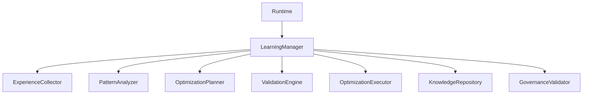

# RFC-0113

**Title:** Runtime Learning & Adaptive Optimization Architecture

**Document ID:** RFC-0113

**Version:** 1.0

**Status:** Accepted

**Category:** Runtime Architecture

**Layer:** Runtime Intelligence / Learning & Adaptive Optimization

**Target:**

```text
runtime/learning/
```

---

# Abstract

This RFC defines the SH-3 Runtime Learning & Adaptive Optimization Architecture (RLAOA).

The Runtime Learning & Adaptive Optimization Architecture provides a continuous learning framework that transforms operational experience into measurable runtime improvements. It enables the runtime to observe execution behavior, identify optimization opportunities, validate proposed improvements, and safely deploy adaptive optimizations while preserving deterministic execution, governance compliance, and reproducibility.

Unlike application-level machine learning, this architecture optimizes the runtime itself.

This document is normative.

---

# Motivation

Static runtime configurations cannot remain optimal under continuously changing workloads, resource availability, infrastructure topology, and execution patterns.

SH-3 requires a runtime capable of learning from:

- execution history
- scheduling decisions
- resource utilization
- failure recovery
- capability performance
- workflow behavior
- operational telemetry

The accumulated operational knowledge SHALL continuously improve runtime efficiency without compromising correctness.

---

# Goals

The architecture SHALL provide:

- continuous runtime learning
- adaptive optimization
- deterministic optimization validation
- policy-governed optimization deployment
- historical optimization tracking
- reproducible learning results
- rollback of ineffective optimizations

---

# Non-Goals

The architecture SHALL NOT:

- modify business logic
- replace cognitive reasoning
- bypass governance approval
- introduce nondeterministic execution

---

# Architecture



---

# Design Principles

## Learn From Operations

Operational experience SHALL become reusable knowledge.

---

## Validate Before Optimize

Every optimization SHALL be validated before deployment.

---

## Deterministic Adaptation

Identical knowledge and policies SHALL produce identical optimization decisions.

---

## Safe Evolution

Optimizations SHALL remain reversible.

---

## Continuous Improvement

Learning SHALL operate continuously throughout runtime execution.

---

# Components

| Component | Responsibility |
|-----------|----------------|
| LearningManager | Global learning coordination |
| ExperienceCollector | Collect runtime experience |
| PatternAnalyzer | Detect optimization opportunities |
| OptimizationPlanner | Generate optimization plans |
| ValidationEngine | Verify optimization safety |
| OptimizationExecutor | Apply approved optimizations |
| KnowledgeRepository | Store learned knowledge |
| GovernanceValidator | Validate optimization policies |

---

# Learning Lifecycle

Every learning cycle SHALL follow:

```text
Observe

↓

Collect

↓

Analyze

↓

Generate Candidate

↓

Validate

↓

Approve

↓

Deploy

↓

Measure

↓

Learn

↓

Archive
```

Every stage SHALL emit immutable events.

---

# Experience Collection

ExperienceCollector SHALL capture:

- workflow executions
- scheduling outcomes
- resource utilization
- capability latency
- cache behavior
- recovery operations
- security events
- governance decisions

Collected experience SHALL remain immutable.

---

# Pattern Analysis

PatternAnalyzer SHALL identify:

- repeated bottlenecks
- workload trends
- scheduling inefficiencies
- resource contention
- recurring failures
- optimization opportunities

Analysis SHALL produce deterministic outputs.

---

# Optimization Planning

OptimizationPlanner MAY generate improvements for:

- scheduler parameters
- resource allocation
- cache policies
- capability selection
- workflow placement
- replication strategies
- retry policies
- execution concurrency

Optimization proposals SHALL remain versioned.

---

# Validation

ValidationEngine SHALL evaluate:

- correctness
- reproducibility
- governance compliance
- security impact
- performance improvement
- rollback feasibility

Validation SHALL complete before deployment.

---

# Optimization Deployment

OptimizationExecutor SHALL support:

- staged rollout
- canary deployment
- gradual activation
- version pinning
- automatic rollback
- policy-controlled deployment

Deployment SHALL preserve runtime availability.

---

# Knowledge Repository

KnowledgeRepository SHALL maintain:

- optimization history
- learned patterns
- validation reports
- deployment outcomes
- rollback history
- effectiveness metrics

Knowledge SHALL be immutable and versioned.

---

# Optimization Categories

Supported optimization domains include:

- scheduling
- resource management
- workflow execution
- capability routing
- cache management
- distributed coordination
- self-healing strategies
- telemetry sampling

Additional categories MAY be introduced without architectural changes.

---

# Governance Integration

Every optimization SHALL require validation of:

- governance policy
- security policy
- operational policy
- resource policy
- compliance requirements

Unapproved optimizations SHALL NOT be deployed.

---

# Message Bus Integration

Learning events include:

- ExperienceCollected
- PatternDetected
- OptimizationGenerated
- OptimizationValidated
- OptimizationApproved
- OptimizationDeployed
- OptimizationRolledBack
- LearningCycleCompleted

Events SHALL be immutable and versioned.

---

# Persistence Integration

Persistence SHALL maintain:

- learning history
- optimization history
- deployment history
- validation history
- effectiveness reports
- rollback history

Historical learning SHALL remain reproducible.

---

# Observability

Learning telemetry SHALL expose:

- optimization frequency
- deployment latency
- validation duration
- optimization effectiveness
- rollback rate
- learning coverage
- performance improvement

---

# Distributed Tracing

Every learning operation SHALL preserve:

- trace_id
- learning_id
- optimization_id
- validation_id
- deployment_id
- workflow_id
- node_id

Tracing SHALL reconstruct complete optimization lifecycles.

---

# Thread Model

The Runtime Learning & Adaptive Optimization Architecture supports concurrent:

- experience collection
- pattern analysis
- optimization planning
- validation
- deployment
- effectiveness measurement
- telemetry collection

The reference implementation SHALL be:

- deterministic
- thread-safe
- horizontally scalable
- event-driven
- lock-efficient

---

# Metrics

The architecture exposes:

- optimization success rate
- average performance gain
- deployment success rate
- rollback frequency
- learning throughput
- validation latency
- knowledge growth rate

---

# Performance Objectives

The architecture should optimize for:

- measurable runtime improvement
- deterministic optimization
- safe deployment
- rapid validation
- minimal runtime overhead
- continuous operational learning

---

# Future Work

Potential future enhancements include:

- reinforcement learning–based runtime optimization
- federated runtime learning
- predictive scheduling optimization
- autonomous policy tuning
- adaptive cluster topology optimization
- digital twin simulation for optimization validation

---

# References

- RFC-0112 Runtime Self-Healing & Autonomous Recovery Architecture
- RFC-0111 Runtime Policy & Governance Enforcement Architecture
- RFC-0110 Runtime Observability & Telemetry Architecture
- RFC-0108 High Availability & Fault Tolerance Architecture
- RFC-0105 Tool Execution & Capability Runtime Architecture
- SH-3 Architecture Specification v2.1

---

# End of RFC-0113