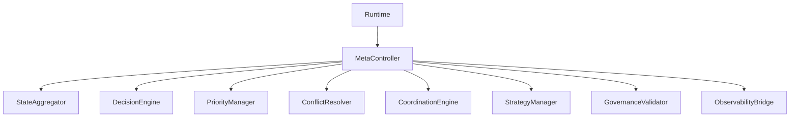

# RFC-0114

**Title:** Runtime Meta Controller Architecture

**Document ID:** RFC-0114

**Version:** 1.0

**Status:** Accepted

**Category:** Runtime Architecture

**Layer:** Runtime Intelligence / Meta Controller

**Target:**

```text
runtime/meta_controller/
```

---

# Abstract

This RFC defines the SH-3 Runtime Meta Controller Architecture (RMCA).

The Runtime Meta Controller Architecture establishes the highest-level runtime coordination layer responsible for supervising, orchestrating, and optimizing all runtime subsystems. It provides a deterministic control plane that continuously evaluates runtime state, prioritizes competing objectives, coordinates subsystem interactions, resolves operational conflicts, and maintains global runtime stability.

The Meta Controller does not execute workloads directly. Instead, it governs how runtime subsystems cooperate to achieve system-wide objectives while preserving determinism, governance compliance, resilience, and observability.

This document is normative.

---

# Motivation

Previous Runtime RFCs define specialized subsystems including execution orchestration, scheduling, distributed coordination, security, governance, observability, self-healing, and learning.

Without a unified supervisory layer:

- subsystem decisions may conflict
- optimization goals may compete
- recovery actions may interfere
- resource priorities may diverge
- distributed coordination becomes fragmented

The Meta Controller provides global runtime supervision and cross-subsystem decision coordination.

---

# Goals

The architecture SHALL provide:

- global runtime supervision
- cross-subsystem orchestration
- deterministic decision coordination
- conflict detection and resolution
- adaptive priority management
- policy-aware optimization
- continuous runtime stabilization

---

# Non-Goals

The architecture SHALL NOT:

- execute workflows directly
- replace individual subsystem logic
- bypass governance or security
- modify application semantics

---

# Architecture



---

# Design Principles

## Global Awareness

The Meta Controller SHALL maintain a consistent view of overall runtime state.

---

## Deterministic Supervision

Identical runtime state SHALL produce identical supervisory decisions.

---

## Separation of Concerns

Subsystems remain independently responsible for execution within their respective domains.

---

## Policy-Constrained Control

Every supervisory action SHALL comply with governance and security policies.

---

## Continuous Coordination

The Meta Controller SHALL continuously evaluate and coordinate runtime behavior.

---

# Components

| Component | Responsibility |
|-----------|----------------|
| MetaController | Global supervisory coordination |
| StateAggregator | Aggregate runtime state |
| DecisionEngine | Produce supervisory decisions |
| PriorityManager | Manage global priorities |
| ConflictResolver | Resolve subsystem conflicts |
| CoordinationEngine | Coordinate subsystem execution |
| StrategyManager | Select runtime strategies |
| GovernanceValidator | Validate supervisory actions |
| ObservabilityBridge | Integrate runtime telemetry |

---

# Runtime State Model

The Meta Controller SHALL aggregate:

- execution state
- workflow state
- resource state
- cluster state
- memory state
- security state
- governance state
- observability state
- healing state
- learning state

State SHALL be versioned and immutable between updates.

---

# Supervisory Lifecycle

Every supervisory cycle SHALL follow:

```text
Observe

↓

Aggregate

↓

Analyze

↓

Prioritize

↓

Resolve Conflicts

↓

Select Strategy

↓

Coordinate

↓

Validate

↓

Publish Decisions

↓

Monitor Outcomes
```

Each phase SHALL emit immutable events.

---

# Decision Domains

The Meta Controller MAY coordinate:

- workload priorities
- scheduling objectives
- resource balancing
- recovery sequencing
- optimization timing
- policy enforcement order
- maintenance coordination
- distributed synchronization

Decision domains SHALL remain extensible.

---

# Priority Management

PriorityManager SHALL evaluate:

- governance constraints
- operational urgency
- service-level objectives
- resource availability
- recovery requirements
- security posture
- optimization impact

Priority calculation SHALL be deterministic.

---

# Conflict Resolution

ConflictResolver SHALL detect conflicts between:

- scheduler decisions
- resource allocations
- recovery actions
- optimization proposals
- governance rules
- security requirements
- maintenance operations

Resolution precedence SHALL follow configurable governance policies.

---

# Strategy Management

StrategyManager SHALL support:

- performance-oriented strategies
- resilience-oriented strategies
- cost-aware strategies
- security-first strategies
- balanced strategies
- maintenance strategies
- emergency strategies

Strategy transitions SHALL be versioned.

---

# Coordination

CoordinationEngine SHALL synchronize:

- execution orchestration
- scheduling
- distributed coordination
- self-healing
- learning
- governance
- observability

Subsystem coordination SHALL preserve subsystem autonomy.

---

# Governance Integration

Every supervisory decision SHALL validate:

- governance policy
- security policy
- compliance requirements
- operational constraints
- resource policies

Validation SHALL precede publication.

---

# Message Bus Integration

Meta Controller events include:

- RuntimeStateAggregated
- SupervisoryAnalysisCompleted
- PriorityCalculated
- ConflictDetected
- ConflictResolved
- StrategySelected
- CoordinationStarted
- CoordinationCompleted
- SupervisoryDecisionPublished
- RuntimeStabilized

Events SHALL be immutable and versioned.

---

# Persistence Integration

Persistence SHALL maintain:

- supervisory decisions
- strategy history
- conflict history
- priority history
- coordination history
- runtime state snapshots

Historical supervisory state SHALL remain reproducible.

---

# Observability

Meta Controller telemetry SHALL expose:

- supervisory latency
- coordination throughput
- conflict frequency
- strategy transitions
- stabilization duration
- decision accuracy
- subsystem synchronization latency

---

# Distributed Tracing

Every supervisory operation SHALL preserve:

- trace_id
- supervisory_id
- strategy_id
- coordination_id
- workflow_id
- node_id
- policy_id

Tracing SHALL reconstruct complete supervisory decision lifecycles.

---

# Thread Model

The Runtime Meta Controller Architecture supports concurrent:

- state aggregation
- supervisory analysis
- priority evaluation
- conflict resolution
- coordination
- strategy selection
- telemetry collection

The reference implementation SHALL be:

- deterministic
- thread-safe
- horizontally scalable
- event-driven
- lock-efficient

---

# Metrics

The architecture exposes:

- supervisory throughput
- average coordination latency
- conflict resolution rate
- strategy effectiveness
- stabilization success rate
- decision consistency
- runtime efficiency index

---

# Performance Objectives

The architecture should optimize for:

- deterministic supervision
- low coordination latency
- scalable subsystem orchestration
- rapid stabilization
- policy-compliant decision making
- efficient global optimization

---

# Future Work

Potential future enhancements include:

- hierarchical meta controllers
- federated supervisory coordination
- predictive runtime control
- digital twin–assisted supervision
- autonomous strategy synthesis
- reinforcement learning–driven supervisory optimization

---

# References

- RFC-0113 Runtime Learning & Adaptive Optimization Architecture
- RFC-0112 Runtime Self-Healing & Autonomous Recovery Architecture
- RFC-0111 Runtime Policy & Governance Enforcement Architecture
- RFC-0110 Runtime Observability & Telemetry Architecture
- RFC-0108 High Availability & Fault Tolerance Architecture
- SH-3 Architecture Specification v2.1

---

# End of RFC-0114