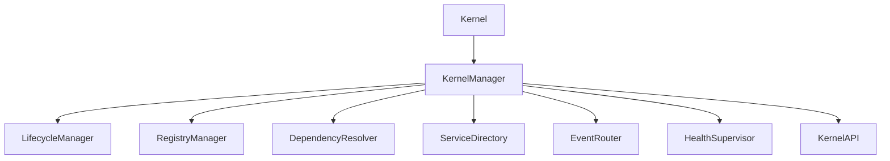

# RFC-0115

**Title:** Kernel Core Architecture

**Document ID:** RFC-0115

**Version:** 1.0

**Status:** Accepted

**Category:** Kernel Architecture

**Layer:** Kernel / Core

**Target:**

```text
kernel/core/
```

---

# Abstract

This RFC defines the SH-3 Kernel Core Architecture (KCA).

The Kernel Core Architecture establishes the central coordination layer of the SH-3 AI Operating System. It provides the stable execution backbone that connects the Runtime, Services, Infrastructure, and Deployment layers through well-defined interfaces and lifecycle management.

The Kernel is responsible for component registration, dependency resolution, lifecycle coordination, event routing, service discovery, health supervision, and system-wide initialization. It serves as the trusted execution nucleus while remaining modular, deterministic, event-driven, and replaceable.

This document is normative.

---

# Motivation

The Runtime Architecture provides execution capabilities, but a complete AI Operating System requires a stable coordination layer that:

- initializes the platform
- manages component lifecycles
- coordinates services
- resolves dependencies
- exposes stable APIs
- supervises system state

The Kernel provides this common execution foundation.

---

# Goals

The architecture SHALL provide:

- centralized lifecycle management
- deterministic initialization
- component registration
- dependency resolution
- service discovery
- event-driven coordination
- modular extensibility

---

# Non-Goals

The architecture SHALL NOT:

- execute business workflows
- implement cognitive reasoning
- replace runtime scheduling
- contain infrastructure-specific implementations

---

# Architecture



---

# Design Principles

## Everything Is a Component

Every kernel-managed element SHALL be represented as a component with a defined lifecycle.

---

## Event-Driven Coordination

Kernel communication SHALL occur through immutable events whenever practical.

---

## Deterministic Startup

Identical configurations SHALL produce identical initialization sequences.

---

## Loose Coupling

Components SHALL interact through contracts rather than concrete implementations.

---

## Replaceable Implementations

Kernel services SHALL be replaceable without changing dependent components.

---

# Components

| Component | Responsibility |
|-----------|----------------|
| KernelManager | Global kernel coordination |
| LifecycleManager | Component lifecycle |
| RegistryManager | Component registry |
| DependencyResolver | Dependency graph resolution |
| ServiceDirectory | Service discovery |
| EventRouter | Kernel event routing |
| HealthSupervisor | Kernel health supervision |
| KernelAPI | Public kernel interface |

---

# Kernel Lifecycle

The Kernel SHALL progress through:

```text
Bootstrap

↓

Initialize

↓

Register Components

↓

Resolve Dependencies

↓

Activate Services

↓

Start Runtime

↓

Operational

↓

Shutdown
```

Each transition SHALL emit immutable lifecycle events.

---

# Component Model

Every kernel component SHALL define:

- component_id
- component_type
- version
- dependencies
- capabilities
- lifecycle_state
- health_state
- metadata

Components SHALL be uniquely identifiable.

---

# Component Registration

RegistryManager SHALL support:

- registration
- deregistration
- discovery
- metadata updates
- version tracking
- capability advertisement

Registration SHALL occur before activation.

---

# Dependency Resolution

DependencyResolver SHALL:

- build dependency graphs
- detect cycles
- validate compatibility
- determine initialization order
- support optional dependencies

Resolution SHALL be deterministic.

---

# Service Discovery

ServiceDirectory SHALL provide:

- service lookup
- capability lookup
- version selection
- namespace isolation
- health-aware discovery

Discovery SHALL return only compatible services.

---

# Event Routing

EventRouter SHALL support:

- synchronous events
- asynchronous events
- broadcast
- targeted delivery
- priority routing
- replay support

Events SHALL remain immutable.

---

# Lifecycle Management

LifecycleManager SHALL support:

- initialize
- activate
- suspend
- resume
- reload
- deactivate
- terminate

Lifecycle transitions SHALL be validated.

---

# Health Supervision

HealthSupervisor SHALL monitor:

- component health
- service availability
- dependency integrity
- initialization success
- runtime status

Health SHALL be continuously evaluated.

---

# Kernel API

The Kernel SHALL expose APIs for:

- registration
- discovery
- lifecycle operations
- dependency inspection
- health queries
- event publication
- event subscription

All APIs SHALL be versioned.

---

# Governance Integration

Kernel operations SHALL validate:

- component permissions
- lifecycle policies
- dependency policies
- security requirements
- operational constraints

Validation SHALL precede execution.

---

# Message Bus Integration

Kernel events include:

- KernelBootstrapped
- ComponentRegistered
- DependencyResolved
- ServiceActivated
- ServiceDeactivated
- LifecycleChanged
- HealthUpdated
- KernelReady

Events SHALL be immutable and versioned.

---

# Persistence Integration

Persistence SHALL maintain:

- component registry
- dependency graph
- lifecycle history
- service metadata
- health history
- kernel configuration

Historical kernel state SHALL remain reproducible.

---

# Observability

Kernel telemetry SHALL expose:

- startup duration
- registration latency
- dependency resolution time
- service activation time
- health transitions
- event throughput

---

# Distributed Tracing

Every kernel operation SHALL preserve:

- trace_id
- kernel_operation_id
- component_id
- lifecycle_id
- service_id
- node_id

Tracing SHALL reconstruct complete kernel operations.

---

# Thread Model

The Kernel Core Architecture supports concurrent:

- registration
- discovery
- lifecycle transitions
- event routing
- health monitoring
- telemetry collection

The reference implementation SHALL be:

- deterministic
- thread-safe
- horizontally scalable
- event-driven
- lock-efficient

---

# Metrics

The architecture exposes:

- kernel startup time
- registration throughput
- dependency resolution latency
- service discovery latency
- lifecycle transition rate
- health availability
- event routing throughput

---

# Performance Objectives

The architecture should optimize for:

- deterministic startup
- rapid component activation
- efficient service discovery
- scalable coordination
- low event routing latency
- high operational stability

---

# Future Work

Potential future enhancements include:

- hierarchical kernels
- distributed kernel federation
- hot-pluggable kernel services
- dynamic dependency optimization
- kernel micro-partitioning
- autonomous kernel tuning

---

# References

- RFC-0114 Runtime Meta Controller Architecture
- RFC-0113 Runtime Learning & Adaptive Optimization Architecture
- RFC-0112 Runtime Self-Healing & Autonomous Recovery Architecture
- RFC-0101 Autonomous Cognitive Execution Orchestration Architecture
- SH-3 Architecture Specification v2.1

---

# End of RFC-0115