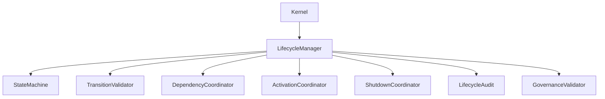

# RFC-0116

**Title:** Kernel Lifecycle Management Architecture

**Document ID:** RFC-0116

**Version:** 1.0

**Status:** Accepted

**Category:** Kernel Architecture

**Layer:** Kernel / Lifecycle Management

**Target:**

```text
kernel/lifecycle/
```

---

# Abstract

This RFC defines the SH-3 Kernel Lifecycle Management Architecture (KLMA).

The Kernel Lifecycle Management Architecture establishes the deterministic lifecycle model governing every kernel-managed component, service, module, plugin, and subsystem throughout its operational existence.

It provides standardized lifecycle states, transition rules, dependency-aware activation, coordinated shutdown, recovery integration, and immutable lifecycle auditing.

All lifecycle operations SHALL be deterministic, policy-governed, observable, and reproducible.

This document is normative.

---

# Motivation

Every component in SH-3 must behave consistently from system startup to shutdown.

Without a unified lifecycle architecture:

- components initialize inconsistently
- dependency ordering becomes unreliable
- shutdown sequences become unsafe
- recovery cannot coordinate activation
- distributed startup becomes nondeterministic

The Kernel SHALL own the authoritative lifecycle model.

---

# Goals

The architecture SHALL provide:

- deterministic lifecycle management
- dependency-aware activation
- coordinated startup
- graceful shutdown
- hot reload support
- lifecycle auditing
- distributed lifecycle synchronization

---

# Non-Goals

The architecture SHALL NOT:

- execute workflows
- schedule runtime tasks
- replace dependency resolution
- implement application logic

---

# Architecture



---

# Design Principles

## One Lifecycle Model

Every kernel-managed entity SHALL implement the same lifecycle contract.

---

## Deterministic Transitions

Identical lifecycle inputs SHALL produce identical transitions.

---

## Dependency First

Dependencies SHALL activate before dependents.

---

## Graceful Termination

Shutdown SHALL preserve consistency and integrity.

---

## Observable State

Every lifecycle transition SHALL generate immutable events and telemetry.

---

# Components

| Component | Responsibility |
|-----------|----------------|
| LifecycleManager | Global lifecycle coordination |
| StateMachine | Lifecycle state model |
| TransitionValidator | Validate transitions |
| DependencyCoordinator | Dependency ordering |
| ActivationCoordinator | Startup sequencing |
| ShutdownCoordinator | Controlled termination |
| LifecycleAudit | Lifecycle history |
| GovernanceValidator | Policy validation |

---

# Lifecycle States

Every managed component SHALL implement:

```text
Registered

↓

Validated

↓

Initialized

↓

Starting

↓

Active

↓

Suspended

↓

Resuming

↓

Stopping

↓

Stopped

↓

Terminated
```

Optional states MAY include:

- Recovering
- Reloading
- Maintenance
- Failed
- Deprecated

State definitions SHALL remain versioned.

---

# Transition Rules

Allowed transitions SHALL be explicitly defined.

Examples include:

- Registered → Validated
- Validated → Initialized
- Initialized → Starting
- Starting → Active
- Active → Suspended
- Suspended → Resuming
- Active → Stopping
- Stopping → Stopped
- Stopped → Terminated

Invalid transitions SHALL be rejected.

---

# Initialization

Initialization SHALL include:

- configuration loading
- dependency verification
- resource reservation
- security validation
- governance approval
- health initialization

Initialization SHALL complete before activation.

---

# Activation

ActivationCoordinator SHALL:

- activate dependencies first
- verify readiness
- publish activation events
- update service registry
- expose health status

Activation SHALL remain deterministic.

---

# Suspension and Resume

LifecycleManager SHALL support:

- temporary suspension
- maintenance suspension
- resource-based suspension
- coordinated resume

Resumption SHALL validate dependencies before activation.

---

# Shutdown

ShutdownCoordinator SHALL perform:

1. stop accepting work
2. drain active operations
3. persist state
4. release resources
5. notify dependents
6. terminate component

Shutdown SHALL preserve data integrity.

---

# Hot Reload

The architecture SHALL support:

- configuration reload
- module replacement
- plugin upgrade
- capability refresh

Reload SHALL preserve compatibility and governance compliance.

---

# Failure Recovery

LifecycleManager SHALL integrate with:

- Runtime Self-Healing
- High Availability
- Governance
- Observability

Recovery SHALL follow deterministic lifecycle transitions.

---

# Governance Integration

Every lifecycle transition SHALL validate:

- operational policies
- dependency policies
- security requirements
- maintenance policies
- recovery policies

Unauthorized transitions SHALL be denied.

---

# Message Bus Integration

Lifecycle events include:

- ComponentValidated
- ComponentInitialized
- ComponentStarted
- ComponentActivated
- ComponentSuspended
- ComponentResumed
- ComponentStopping
- ComponentStopped
- ComponentReloaded
- ComponentTerminated

Events SHALL remain immutable and versioned.

---

# Persistence Integration

Persistence SHALL maintain:

- lifecycle history
- transition history
- state snapshots
- activation records
- shutdown records
- reload history

Historical lifecycle data SHALL remain reproducible.

---

# Observability

Lifecycle telemetry SHALL expose:

- initialization latency
- activation latency
- suspension duration
- shutdown duration
- reload duration
- transition failures
- lifecycle availability

---

# Distributed Tracing

Every lifecycle operation SHALL preserve:

- trace_id
- lifecycle_id
- component_id
- transition_id
- node_id
- policy_id

Tracing SHALL reconstruct complete lifecycle histories.

---

# Thread Model

The Kernel Lifecycle Management Architecture supports concurrent:

- initialization
- activation
- suspension
- reload
- shutdown
- telemetry collection

The reference implementation SHALL be:

- deterministic
- thread-safe
- horizontally scalable
- event-driven
- lock-efficient

---

# Metrics

The architecture exposes:

- startup success rate
- activation latency
- shutdown latency
- reload success rate
- lifecycle transition throughput
- recovery activation rate
- lifecycle consistency index

---

# Performance Objectives

The architecture should optimize for:

- deterministic startup
- rapid activation
- graceful shutdown
- scalable lifecycle coordination
- efficient recovery
- minimal operational disruption

---

# Future Work

Potential future enhancements include:

- transactional lifecycle orchestration
- distributed lifecycle federation
- predictive activation sequencing
- autonomous lifecycle optimization
- rolling lifecycle upgrades
- lifecycle simulation

---

# References

- RFC-0115 Kernel Core Architecture
- RFC-0114 Runtime Meta Controller Architecture
- RFC-0112 Runtime Self-Healing & Autonomous Recovery Architecture
- RFC-0108 High Availability & Fault Tolerance Architecture
- SH-3 Architecture Specification v2.1

---

# End of RFC-0116