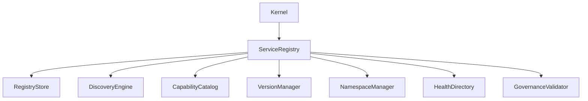

# RFC-0117

**Title:** Kernel Service Registry Architecture

**Document ID:** RFC-0117

**Version:** 1.0

**Status:** Accepted

**Category:** Kernel Architecture

**Layer:** Kernel / Service Registry

**Target:**

```text
kernel/service_registry/
```

---

# Abstract

This RFC defines the SH-3 Kernel Service Registry Architecture (KSRA).

The Kernel Service Registry Architecture provides the authoritative registry for every service, component, capability, module, plugin, and runtime provider within the SH-3 AI Operating System.

The registry enables deterministic service discovery, capability advertisement, version negotiation, namespace isolation, health-aware lookup, dependency-aware resolution, and immutable service metadata.

Every kernel-managed service SHALL be registered through this architecture before becoming available to the system.

This document is normative.

---

# Motivation

SH-3 consists of hundreds of replaceable services distributed across multiple architectural layers.

Without a unified registry:

- service discovery becomes inconsistent
- duplicate registrations occur
- dependency resolution becomes unreliable
- version compatibility cannot be guaranteed
- distributed nodes diverge

The Kernel SHALL provide a single authoritative registry.

---

# Goals

The architecture SHALL provide:

- deterministic service registration
- global service discovery
- capability advertisement
- namespace isolation
- version negotiation
- health-aware lookup
- distributed registry synchronization

---

# Non-Goals

The architecture SHALL NOT:

- execute services
- schedule workloads
- replace dependency resolution
- implement business logic

---

# Architecture



---

# Design Principles

## One Authoritative Registry

Every discoverable service SHALL have a single canonical registration.

---

## Immutable Metadata

Published service metadata SHALL be immutable for a given version.

---

## Deterministic Discovery

Identical discovery requests SHALL produce identical results.

---

## Replaceable Implementations

Multiple compatible implementations MAY coexist under a common service contract.

---

## Namespace Isolation

Services SHALL remain isolated by namespace unless explicitly shared.

---

# Components

| Component | Responsibility |
|-----------|----------------|
| ServiceRegistry | Global registry coordination |
| RegistryStore | Persistent metadata store |
| DiscoveryEngine | Service lookup |
| CapabilityCatalog | Capability advertisement |
| VersionManager | Version negotiation |
| NamespaceManager | Namespace isolation |
| HealthDirectory | Health-aware discovery |
| GovernanceValidator | Policy validation |

---

# Service Model

Every registered service SHALL define:

- service_id
- service_name
- version
- namespace
- interface
- implementation
- capabilities
- dependencies
- health_state
- lifecycle_state
- metadata

Service identifiers SHALL be globally unique.

---

# Registration

Registration SHALL perform:

- identifier validation
- interface validation
- dependency validation
- governance validation
- metadata persistence
- capability publication

Registration SHALL precede activation.

---

# Discovery

DiscoveryEngine SHALL support:

- service lookup
- capability lookup
- interface lookup
- namespace lookup
- version lookup
- health-aware lookup
- metadata filtering

Discovery SHALL remain deterministic.

---

# Capability Catalog

Capabilities SHALL declare:

- capability_id
- capability_name
- provider
- version
- compatibility
- execution_scope
- permissions

Capability definitions SHALL be versioned.

---

# Version Management

VersionManager SHALL support:

- semantic versioning
- compatibility validation
- preferred version selection
- deprecation tracking
- version pinning
- migration support

Only compatible versions SHALL be returned unless explicitly requested.

---

# Namespace Management

NamespaceManager SHALL support:

- namespace creation
- namespace isolation
- namespace delegation
- namespace inheritance
- access control

Cross-namespace access SHALL require explicit authorization.

---

# Health-Aware Discovery

HealthDirectory SHALL maintain:

- availability
- readiness
- degradation state
- maintenance state
- recovery status

Discovery SHALL exclude unavailable services unless configured otherwise.

---

# Registry Synchronization

Distributed registry synchronization SHALL support:

- incremental synchronization
- snapshot synchronization
- conflict detection
- version reconciliation
- consistency verification

Synchronization SHALL preserve deterministic state.

---

# Governance Integration

Every registry operation SHALL validate:

- registration policies
- version policies
- namespace policies
- security policies
- operational constraints

Unauthorized registration SHALL be rejected.

---

# Message Bus Integration

Registry events include:

- ServiceRegistered
- ServiceUpdated
- ServiceDeprecated
- ServiceRemoved
- CapabilityPublished
- NamespaceCreated
- DiscoveryCompleted
- RegistrySynchronized

Events SHALL remain immutable and versioned.

---

# Persistence Integration

Persistence SHALL maintain:

- service metadata
- capability catalog
- version history
- namespace definitions
- registration history
- synchronization history

Historical registry state SHALL remain reproducible.

---

# Observability

Registry telemetry SHALL expose:

- registration latency
- discovery latency
- synchronization latency
- active services
- namespace count
- capability count
- registry consistency

---

# Distributed Tracing

Every registry operation SHALL preserve:

- trace_id
- registry_operation_id
- service_id
- namespace_id
- capability_id
- node_id

Tracing SHALL reconstruct complete registry operations.

---

# Thread Model

The Kernel Service Registry Architecture supports concurrent:

- registration
- discovery
- synchronization
- metadata updates
- capability publication
- telemetry collection

The reference implementation SHALL be:

- deterministic
- thread-safe
- horizontally scalable
- event-driven
- lock-efficient

---

# Metrics

The architecture exposes:

- registration throughput
- discovery throughput
- synchronization success rate
- namespace utilization
- capability publication rate
- registry availability
- metadata consistency index

---

# Performance Objectives

The architecture should optimize for:

- deterministic discovery
- low lookup latency
- efficient synchronization
- scalable registration
- rapid capability publication
- high registry availability

---

# Future Work

Potential future enhancements include:

- federated service registries
- AI-assisted service selection
- predictive service discovery
- dynamic capability composition
- autonomous registry optimization
- cross-cluster registry federation

---

# References

- RFC-0116 Kernel Lifecycle Management Architecture
- RFC-0115 Kernel Core Architecture
- RFC-0114 Runtime Meta Controller Architecture
- RFC-0105 Tool Execution & Capability Runtime Architecture
- SH-3 Architecture Specification v2.1

---

# End of RFC-0117