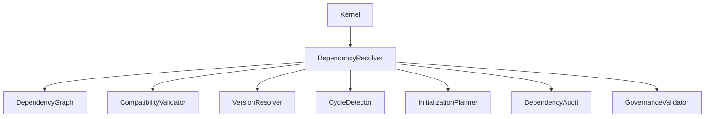

# RFC-0118

**Title:** Kernel Dependency Resolution Architecture

**Document ID:** RFC-0118

**Version:** 1.0

**Status:** Accepted

**Category:** Kernel Architecture

**Layer:** Kernel / Dependency Resolution

**Target:**

```text
kernel/dependency/
```

---

# Abstract

This RFC defines the SH-3 Kernel Dependency Resolution Architecture (KDRA).

The Kernel Dependency Resolution Architecture provides the authoritative mechanism for dependency declaration, graph construction, compatibility validation, deterministic initialization ordering, cycle detection, version negotiation, and dependency auditing across the SH-3 AI Operating System.

Every kernel-managed component SHALL declare its dependencies through a standardized dependency model. The Kernel SHALL resolve those dependencies deterministically before activation.

This document is normative.

---

# Motivation

SH-3 consists of independently replaceable components spanning the Foundation, Infrastructure, Runtime, Services, Kernel, and Deployment layers.

Without deterministic dependency resolution:

- initialization order becomes inconsistent
- circular dependencies remain undetected
- incompatible versions may execute together
- distributed nodes diverge
- recovery sequencing becomes unreliable

The Kernel SHALL provide a single dependency resolution model for the entire platform.

---

# Goals

The architecture SHALL provide:

- deterministic dependency resolution
- dependency graph construction
- cycle detection
- compatibility verification
- initialization ordering
- dependency auditing
- distributed dependency consistency

---

# Non-Goals

The architecture SHALL NOT:

- execute services
- replace the Service Registry
- schedule runtime execution
- implement business logic

---

# Architecture



---

# Design Principles

## Explicit Dependencies

Every managed component SHALL explicitly declare required and optional dependencies.

---

## Deterministic Resolution

Identical dependency inputs SHALL always produce identical resolution results.

---

## Directed Acyclic Graph

Resolved dependency graphs SHALL be acyclic before activation.

---

## Version Compatibility

Only compatible dependency versions SHALL be activated together.

---

## Immutable Resolution

Resolved dependency graphs SHALL be immutable for a given execution context.

---

# Components

| Component | Responsibility |
|-----------|----------------|
| DependencyResolver | Global dependency coordination |
| DependencyGraph | Directed dependency graph |
| CompatibilityValidator | Compatibility verification |
| VersionResolver | Version negotiation |
| CycleDetector | Circular dependency detection |
| InitializationPlanner | Activation ordering |
| DependencyAudit | Dependency history |
| GovernanceValidator | Policy validation |

---

# Dependency Model

Every dependency SHALL define:

- dependency_id
- provider
- consumer
- dependency_type
- version_constraint
- optional
- scope
- priority
- metadata

Dependency definitions SHALL be versioned.

---

# Dependency Types

Supported dependency types include:

- required
- optional
- runtime
- startup
- shutdown
- plugin
- capability
- infrastructure
- external

Additional dependency types MAY be introduced without architectural changes.

---

# Dependency Resolution Lifecycle

Every resolution SHALL follow:

```text
Collect

↓

Validate

↓

Build Graph

↓

Resolve Versions

↓

Detect Cycles

↓

Determine Order

↓

Governance Validation

↓

Publish Graph

↓

Activate Components
```

Each phase SHALL emit immutable events.

---

# Graph Construction

DependencyGraph SHALL:

- build directed graphs
- preserve metadata
- support multiple namespaces
- support multiple versions
- maintain immutable snapshots

Graph construction SHALL remain deterministic.

---

# Cycle Detection

CycleDetector SHALL identify:

- direct cycles
- indirect cycles
- namespace cycles
- plugin cycles
- optional dependency loops

Unresolved cycles SHALL prevent activation.

---

# Version Resolution

VersionResolver SHALL support:

- semantic version constraints
- compatible upgrades
- version pinning
- preferred versions
- deprecated versions
- rollback compatibility

Resolution SHALL remain reproducible.

---

# Initialization Planning

InitializationPlanner SHALL:

- compute topological ordering
- respect dependency priorities
- support parallel activation where safe
- minimize startup latency

Initialization SHALL preserve dependency correctness.

---

# Compatibility Validation

CompatibilityValidator SHALL verify:

- interface compatibility
- protocol compatibility
- API compatibility
- capability compatibility
- policy compatibility

Validation SHALL complete before activation.

---

# Distributed Resolution

Distributed dependency resolution SHALL support:

- graph synchronization
- version reconciliation
- node consistency verification
- snapshot replication

All nodes SHALL converge on an equivalent dependency graph.

---

# Governance Integration

Every dependency operation SHALL validate:

- dependency policies
- version policies
- namespace policies
- security requirements
- operational constraints

Invalid dependency graphs SHALL be rejected.

---

# Message Bus Integration

Dependency events include:

- DependencyDeclared
- DependencyValidated
- DependencyGraphBuilt
- VersionResolved
- CycleDetected
- InitializationPlanned
- DependencyActivated
- DependencyGraphPublished

Events SHALL be immutable and versioned.

---

# Persistence Integration

Persistence SHALL maintain:

- dependency graphs
- graph snapshots
- version history
- compatibility reports
- cycle reports
- initialization plans

Historical dependency state SHALL remain reproducible.

---

# Observability

Dependency telemetry SHALL expose:

- graph construction latency
- cycle detection latency
- resolution latency
- initialization planning latency
- graph size
- dependency depth
- compatibility failures

---

# Distributed Tracing

Every dependency operation SHALL preserve:

- trace_id
- dependency_operation_id
- graph_id
- component_id
- version_id
- node_id

Tracing SHALL reconstruct complete dependency resolution workflows.

---

# Thread Model

The Kernel Dependency Resolution Architecture supports concurrent:

- dependency collection
- graph construction
- version resolution
- compatibility validation
- cycle detection
- initialization planning

The reference implementation SHALL be:

- deterministic
- thread-safe
- horizontally scalable
- event-driven
- lock-efficient

---

# Metrics

The architecture exposes:

- dependency resolution throughput
- graph construction rate
- cycle detection count
- compatibility success rate
- initialization planning latency
- dependency graph consistency
- distributed convergence rate

---

# Performance Objectives

The architecture should optimize for:

- deterministic dependency resolution
- low graph construction latency
- scalable dependency management
- rapid compatibility verification
- efficient initialization planning
- high consistency across nodes

---

# Future Work

Potential future enhancements include:

- incremental dependency graph updates
- predictive dependency optimization
- distributed graph partitioning
- AI-assisted compatibility analysis
- dependency impact simulation
- autonomous dependency optimization

---

# References

- RFC-0117 Kernel Service Registry Architecture
- RFC-0116 Kernel Lifecycle Management Architecture
- RFC-0115 Kernel Core Architecture
- RFC-0114 Runtime Meta Controller Architecture
- SH-3 Architecture Specification v2.1

---

# End of RFC-0118