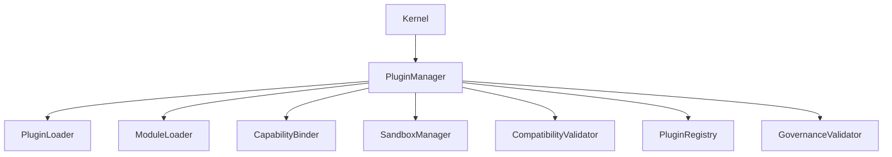

# RFC-0119

**Title:** Kernel Plugin & Module Architecture

**Document ID:** RFC-0119

**Version:** 1.0

**Status:** Accepted

**Category:** Kernel Architecture

**Layer:** Kernel / Plugin & Module System

**Target:**

```text
kernel/plugins/
```

---

# Abstract

This RFC defines the SH-3 Kernel Plugin & Module Architecture (KPMA).

The Kernel Plugin & Module Architecture establishes the extensibility model of the SH-3 AI Operating System. It enables dynamic discovery, validation, loading, activation, isolation, upgrading, unloading, and replacement of plugins and modules while preserving deterministic behavior, security, governance, and runtime stability.

Every extensible feature within SH-3 SHALL integrate through this architecture.

This document is normative.

---

# Motivation

SH-3 follows the architectural principle:

> **Everything is Replaceable**

Achieving this principle requires a unified extension mechanism that allows components to evolve independently without modifying the Kernel Core.

Without a standardized plugin architecture:

- extensibility becomes inconsistent
- module compatibility cannot be guaranteed
- upgrades become unsafe
- dependency management becomes fragmented
- runtime replacement becomes unreliable

The Kernel SHALL provide a single extensibility framework.

---

# Goals

The architecture SHALL provide:

- dynamic module discovery
- deterministic plugin loading
- dependency-aware activation
- hot-swappable modules
- capability-based extension
- sandboxed execution
- version-aware compatibility

---

# Non-Goals

The architecture SHALL NOT:

- execute business workflows
- replace the Service Registry
- bypass Kernel governance
- bypass runtime security

---

# Architecture



---

# Design Principles

## Everything Is Replaceable

Every replaceable subsystem SHALL expose a plugin contract.

---

## Explicit Contracts

Plugins SHALL communicate exclusively through published interfaces.

---

## Deterministic Loading

Identical plugin sets SHALL produce identical runtime behavior.

---

## Isolation First

Plugins SHALL execute within controlled boundaries.

---

## Safe Replacement

Replacing a plugin SHALL preserve overall system integrity.

---

# Components

| Component | Responsibility |
|-----------|----------------|
| PluginManager | Global plugin coordination |
| PluginLoader | Plugin discovery and loading |
| ModuleLoader | Module initialization |
| CapabilityBinder | Capability registration |
| SandboxManager | Runtime isolation |
| CompatibilityValidator | Version validation |
| PluginRegistry | Installed plugin catalog |
| GovernanceValidator | Policy validation |

---

# Plugin Model

Every plugin SHALL define:

- plugin_id
- plugin_name
- version
- provider
- interfaces
- capabilities
- dependencies
- permissions
- lifecycle_state
- metadata

Plugin identifiers SHALL be globally unique.

---

# Module Model

Every module SHALL define:

- module_id
- version
- namespace
- exported_interfaces
- required_interfaces
- lifecycle
- health
- metadata

Modules SHALL remain independently deployable.

---

# Plugin Lifecycle

Every plugin SHALL follow:

```text
Discovered

↓

Validated

↓

Loaded

↓

Initialized

↓

Activated

↓

Operational

↓

Suspended

↓

Reloaded

↓

Unloaded
```

Lifecycle transitions SHALL remain deterministic.

---

# Plugin Discovery

PluginLoader SHALL support:

- filesystem discovery
- package discovery
- registry discovery
- distributed discovery
- signed package discovery

Discovery SHALL produce immutable metadata.

---

# Loading

Plugin loading SHALL perform:

- signature verification
- compatibility validation
- dependency verification
- governance validation
- sandbox preparation
- capability registration

Loading SHALL complete before activation.

---

# Capability Binding

CapabilityBinder SHALL:

- register exported capabilities
- resolve required capabilities
- validate compatibility
- update Service Registry
- publish capability events

Capability registration SHALL remain deterministic.

---

# Sandboxing

SandboxManager SHALL support:

- permission isolation
- resource quotas
- filesystem isolation
- network restrictions
- execution boundaries

Sandbox policies SHALL be configurable.

---

# Compatibility Validation

CompatibilityValidator SHALL verify:

- API compatibility
- interface compatibility
- protocol compatibility
- dependency compatibility
- semantic version compatibility

Incompatible plugins SHALL NOT be activated.

---

# Hot Swapping

The architecture SHALL support:

- live replacement
- rolling upgrade
- rollback
- staged activation
- compatibility verification

Hot swapping SHALL preserve service continuity whenever feasible.

---

# Plugin Registry

PluginRegistry SHALL maintain:

- installed plugins
- module metadata
- version history
- activation history
- compatibility reports
- dependency graph

Registry state SHALL remain immutable between updates.

---

# Governance Integration

Every plugin operation SHALL validate:

- security policy
- governance policy
- operational policy
- dependency policy
- namespace policy

Unauthorized plugins SHALL be rejected.

---

# Message Bus Integration

Plugin events include:

- PluginDiscovered
- PluginValidated
- PluginLoaded
- PluginActivated
- PluginSuspended
- PluginReloaded
- PluginUnloaded
- CapabilityRegistered

Events SHALL be immutable and versioned.

---

# Persistence Integration

Persistence SHALL maintain:

- plugin catalog
- module catalog
- activation history
- compatibility history
- upgrade history
- rollback history

Historical plugin state SHALL remain reproducible.

---

# Observability

Plugin telemetry SHALL expose:

- discovery latency
- loading latency
- activation latency
- reload latency
- plugin failures
- compatibility failures
- sandbox violations

---

# Distributed Tracing

Every plugin operation SHALL preserve:

- trace_id
- plugin_operation_id
- plugin_id
- module_id
- capability_id
- node_id

Tracing SHALL reconstruct complete plugin lifecycles.

---

# Thread Model

The Kernel Plugin & Module Architecture supports concurrent:

- discovery
- loading
- activation
- unloading
- hot swapping
- capability registration

The reference implementation SHALL be:

- deterministic
- thread-safe
- horizontally scalable
- event-driven
- lock-efficient

---

# Metrics

The architecture exposes:

- plugin load throughput
- activation success rate
- hot swap latency
- compatibility success rate
- sandbox violation count
- capability registration latency
- plugin availability

---

# Performance Objectives

The architecture should optimize for:

- deterministic loading
- low activation latency
- safe hot swapping
- scalable extension management
- strong runtime isolation
- efficient capability registration

---

# Future Work

Potential future enhancements include:

- distributed plugin marketplaces
- signed remote plugin repositories
- WASM-based execution sandboxes
- adaptive plugin optimization
- autonomous plugin lifecycle management
- AI-assisted compatibility verification

---

# References

- RFC-0118 Kernel Dependency Resolution Architecture
- RFC-0117 Kernel Service Registry Architecture
- RFC-0116 Kernel Lifecycle Management Architecture
- RFC-0115 Kernel Core Architecture
- SH-3 Architecture Specification v2.1

---

# End of RFC-0119