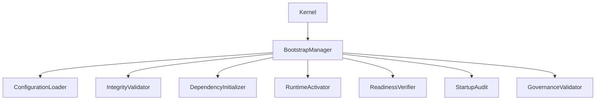

# RFC-0120

**Title:** Kernel Bootstrapping Architecture

**Document ID:** RFC-0120

**Version:** 1.0

**Status:** Accepted

**Category:** Kernel Architecture

**Layer:** Kernel / Bootstrapping

**Target:**

```text
kernel/bootstrap/
```

---

# Abstract

This RFC defines the SH-3 Kernel Bootstrapping Architecture (KBA).

The Kernel Bootstrapping Architecture establishes the deterministic startup procedure of the SH-3 AI Operating System. It specifies how the platform initializes every architectural layer, validates system integrity, constructs the execution environment, activates runtime services, and transitions the system into a fully operational state.

Bootstrapping SHALL be deterministic, reproducible, observable, policy-governed, and recoverable.

This document is normative.

---

# Motivation

The SH-3 platform contains numerous components distributed across multiple architectural layers.

Without a standardized bootstrap process:

- initialization order becomes inconsistent
- dependencies may remain unresolved
- configuration validation becomes unreliable
- startup failures become difficult to diagnose
- distributed nodes diverge

The Kernel SHALL define the authoritative startup procedure.

---

# Goals

The architecture SHALL provide:

- deterministic startup
- dependency-aware initialization
- configuration validation
- integrity verification
- distributed startup coordination
- startup auditing
- graceful startup recovery

---

# Non-Goals

The architecture SHALL NOT:

- execute business workflows
- replace lifecycle management
- bypass governance validation
- modify runtime scheduling policies

---

# Architecture



---

# Design Principles

## Deterministic Startup

Identical configurations SHALL always produce identical startup sequences.

---

## Validate Before Activate

Every initialization stage SHALL complete successfully before the next stage begins.

---

## Layered Initialization

Architectural layers SHALL initialize from the lowest dependency level upward.

---

## Observable Startup

Every startup operation SHALL emit immutable events, traces, metrics, and logs.

---

## Recoverable Boot

Startup failures SHALL support deterministic recovery or safe termination.

---

# Components

| Component | Responsibility |
|-----------|----------------|
| BootstrapManager | Global startup coordination |
| ConfigurationLoader | Load configuration |
| IntegrityValidator | Verify platform integrity |
| DependencyInitializer | Initialize dependencies |
| RuntimeActivator | Activate runtime |
| ReadinessVerifier | Verify operational readiness |
| StartupAudit | Maintain startup history |
| GovernanceValidator | Validate startup policies |

---

# Bootstrap Lifecycle

Every bootstrap SHALL follow:

```text
Power On

↓

Load Configuration

↓

Validate Configuration

↓

Verify Integrity

↓

Initialize Foundation

↓

Initialize Infrastructure

↓

Initialize Runtime

↓

Initialize Kernel

↓

Initialize Services

↓

Activate Runtime

↓

Readiness Verification

↓

Operational
```

Each stage SHALL emit immutable events.

---

# Configuration Loading

ConfigurationLoader SHALL:

- load configuration sources
- validate schemas
- resolve environment overrides
- detect conflicts
- compute configuration snapshots

Configuration SHALL remain immutable after activation.

---

# Integrity Validation

IntegrityValidator SHALL verify:

- binary integrity
- plugin signatures
- dependency consistency
- configuration integrity
- version compatibility
- policy compliance

Startup SHALL stop upon unrecoverable validation failures.

---

# Dependency Initialization

DependencyInitializer SHALL:

- construct dependency graphs
- determine activation order
- initialize required services
- prepare optional services
- verify readiness

Dependency ordering SHALL remain deterministic.

---

# Runtime Activation

RuntimeActivator SHALL activate:

- execution runtime
- scheduler
- workflow engine
- capability runtime
- distributed coordination
- observability
- governance
- self-healing
- learning
- meta controller

Activation SHALL follow lifecycle rules.

---

# Readiness Verification

ReadinessVerifier SHALL confirm:

- service availability
- dependency health
- registry consistency
- runtime stability
- policy compliance
- telemetry availability

Operational mode SHALL begin only after successful verification.

---

# Startup Recovery

BootstrapManager SHALL support:

- retry
- rollback
- checkpoint restoration
- degraded startup
- administrator intervention
- safe termination

Recovery SHALL remain deterministic.

---

# Distributed Bootstrapping

Distributed startup SHALL support:

- cluster synchronization
- leader election
- startup barriers
- readiness synchronization
- distributed configuration validation

All participating nodes SHALL converge on an equivalent operational state.

---

# Governance Integration

Every bootstrap stage SHALL validate:

- governance policy
- startup policy
- security policy
- compliance policy
- operational constraints

Unauthorized startup SHALL be rejected.

---

# Message Bus Integration

Bootstrap events include:

- BootstrapStarted
- ConfigurationLoaded
- ConfigurationValidated
- IntegrityVerified
- FoundationInitialized
- InfrastructureInitialized
- RuntimeInitialized
- KernelInitialized
- ServicesInitialized
- RuntimeActivated
- SystemReady
- BootstrapCompleted

Events SHALL be immutable and versioned.

---

# Persistence Integration

Persistence SHALL maintain:

- startup history
- configuration snapshots
- integrity reports
- activation history
- readiness reports
- recovery history

Historical startup information SHALL remain reproducible.

---

# Observability

Bootstrap telemetry SHALL expose:

- startup duration
- configuration load latency
- integrity validation latency
- dependency initialization latency
- readiness latency
- startup failures
- recovery attempts

---

# Distributed Tracing

Every bootstrap operation SHALL preserve:

- trace_id
- bootstrap_id
- startup_stage_id
- configuration_id
- node_id
- policy_id

Tracing SHALL reconstruct complete startup lifecycles.

---

# Thread Model

The Kernel Bootstrapping Architecture supports concurrent:

- configuration loading
- integrity validation
- dependency initialization
- readiness verification
- telemetry collection

The reference implementation SHALL be:

- deterministic
- thread-safe
- horizontally scalable
- event-driven
- lock-efficient

---

# Metrics

The architecture exposes:

- startup success rate
- average startup duration
- readiness latency
- integrity validation success rate
- recovery success rate
- distributed startup consistency
- bootstrap throughput

---

# Performance Objectives

The architecture should optimize for:

- deterministic initialization
- low startup latency
- reliable readiness verification
- scalable distributed startup
- rapid recovery
- complete operational observability

---

# Future Work

Potential future enhancements include:

- incremental bootstrapping
- parallel layer initialization
- predictive startup optimization
- snapshot-based fast boot
- autonomous bootstrap tuning
- distributed rolling startup

---

# References

- RFC-0119 Kernel Plugin & Module Architecture
- RFC-0118 Kernel Dependency Resolution Architecture
- RFC-0117 Kernel Service Registry Architecture
- RFC-0116 Kernel Lifecycle Management Architecture
- RFC-0115 Kernel Core Architecture
- SH-3 Architecture Specification v2.1

---

# End of RFC-0120