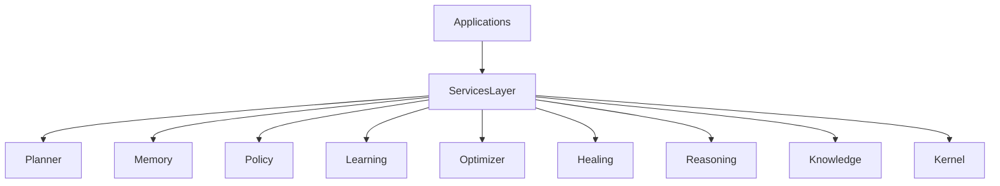

# RFC-0121

**Title:** Services Layer Architecture

**Document ID:** RFC-0121

**Version:** 1.0

**Status:** Accepted

**Category:** Services Architecture

**Layer:** Services

**Target:**

```text
services/
```

---

# Abstract

This RFC defines the SH-3 Services Layer Architecture (SLA).

The Services Layer provides the intelligent capabilities of the SH-3 AI Operating System. It hosts domain-independent services responsible for planning, memory management, policy evaluation, learning, optimization, healing, reasoning support, and knowledge management.

Unlike the Runtime Layer, which executes workloads, or the Kernel Layer, which coordinates system infrastructure, the Services Layer supplies reusable intelligence through stable, versioned service contracts.

Every service SHALL be modular, deterministic, observable, replaceable, and governed by Kernel policies.

This document is normative.

---

# Motivation

The SH-3 architecture separates execution, coordination, and intelligence into independent layers.

Without a dedicated Services Layer:

- intelligence becomes tightly coupled to execution
- reusable capabilities cannot evolve independently
- service replacement becomes difficult
- reasoning components become monolithic
- cross-domain knowledge sharing is limited

The Services Layer establishes a reusable intelligence platform shared across all applications.

---

# Goals

The architecture SHALL provide:

- reusable intelligence services
- deterministic service execution
- versioned service contracts
- service isolation
- capability composition
- policy-governed execution
- distributed scalability

---

# Non-Goals

The architecture SHALL NOT:

- replace the Runtime execution engine
- replace Kernel coordination
- directly execute user applications
- bypass governance or security

---

# Architecture



---

# Design Principles

## Service-Oriented Intelligence

Every intelligent capability SHALL be exposed as a service.

---

## Loose Coupling

Services SHALL communicate through published contracts and immutable events.

---

## Replaceable Implementations

Service implementations MAY be replaced without changing consumers.

---

## Deterministic Behavior

Identical inputs SHALL produce identical outputs unless explicitly configured otherwise.

---

## Policy First

Every service SHALL execute under Kernel governance.

---

# Core Services

The Services Layer SHALL include:

| Service | Responsibility |
|----------|----------------|
| Planner | Goal decomposition and execution planning |
| Memory | Knowledge storage and retrieval |
| Policy | Policy evaluation and enforcement |
| Learning | Experience acquisition and adaptation |
| Optimizer | Continuous system optimization |
| Healing | Failure diagnosis and recovery support |
| Reasoning | Symbolic and structured reasoning |
| Knowledge | Knowledge graph and semantic management |

Additional services MAY be introduced without architectural changes.

---

# Service Lifecycle

Every service SHALL follow:

```text
Registered

↓

Validated

↓

Initialized

↓

Activated

↓

Operational

↓

Suspended

↓

Updated

↓

Terminated
```

Lifecycle management SHALL follow RFC-0116.

---

# Service Contracts

Every service SHALL publish:

- service_id
- interface_version
- supported_capabilities
- input_schema
- output_schema
- dependency_list
- policy_requirements
- metadata

Contracts SHALL remain immutable for a released version.

---

# Service Discovery

All services SHALL register with the Kernel Service Registry.

Discovery SHALL support:

- capability lookup
- version negotiation
- namespace isolation
- health-aware selection
- metadata filtering

---

# Capability Composition

Services MAY compose other services through published contracts.

Examples include:

- Planner → Memory
- Planner → Policy
- Learning → Memory
- Optimizer → Learning
- Healing → Observability

Composition SHALL remain dependency-aware.

---

# Governance Integration

Every service invocation SHALL validate:

- governance policy
- security policy
- execution permissions
- resource quotas
- compliance requirements

Unauthorized execution SHALL be rejected.

---

# Message Bus Integration

Service events include:

- ServiceInvoked
- ServiceCompleted
- CapabilityRequested
- CapabilityResolved
- ServiceUpdated
- ServiceSuspended
- ServiceRecovered
- ServiceTerminated

Events SHALL be immutable and versioned.

---

# Persistence Integration

Persistence SHALL maintain:

- service metadata
- execution history
- capability history
- policy decisions
- service metrics
- audit records

Historical state SHALL remain reproducible.

---

# Observability

Service telemetry SHALL expose:

- invocation latency
- throughput
- success rate
- failure rate
- dependency latency
- resource utilization
- capability usage

---

# Distributed Tracing

Every service operation SHALL preserve:

- trace_id
- service_id
- invocation_id
- workflow_id
- node_id
- policy_id

Tracing SHALL reconstruct complete service interactions.

---

# Thread Model

The Services Layer supports concurrent:

- service invocation
- capability composition
- policy evaluation
- telemetry collection
- health monitoring

The reference implementation SHALL be:

- deterministic
- thread-safe
- horizontally scalable
- event-driven
- lock-efficient

---

# Metrics

The architecture exposes:

- service throughput
- average latency
- capability utilization
- invocation success rate
- dependency latency
- service availability
- composition efficiency

---

# Performance Objectives

The architecture should optimize for:

- low invocation latency
- scalable service composition
- deterministic execution
- high availability
- efficient resource usage
- reusable intelligence

---

# Future Work

Potential future enhancements include:

- autonomous service composition
- semantic capability discovery
- federated intelligence services
- adaptive service routing
- AI-assisted optimization
- cross-cluster service federation

---

# References

- RFC-0120 Kernel Bootstrapping Architecture
- RFC-0119 Kernel Plugin & Module Architecture
- RFC-0117 Kernel Service Registry Architecture
- RFC-0115 Kernel Core Architecture
- SH-3 Architecture Specification v2.1

---

# End of RFC-0121