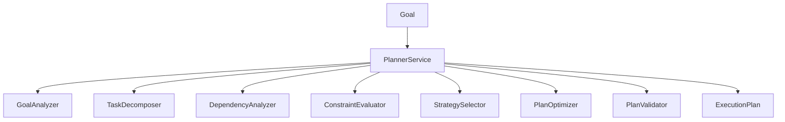

# RFC-0122

**Title:** Planner Service Architecture

**Document ID:** RFC-0122

**Version:** 1.0

**Status:** Accepted

**Category:** Services Architecture

**Layer:** Services / Planner

**Target:**

```text
services/planner/
```

---

# Abstract

This RFC defines the SH-3 Planner Service Architecture (PSA).

The Planner Service transforms high-level goals into deterministic executable plans. It performs goal decomposition, dependency analysis, task graph construction, execution strategy selection, constraint evaluation, and adaptive replanning.

The Planner does not execute work directly. Instead, it generates validated execution plans consumed by the Runtime Execution Orchestrator.

Every generated plan SHALL be deterministic, versioned, observable, reproducible, and policy-compliant.

This document is normative.

---

# Motivation

Applications express objectives rather than execution details.

Without a dedicated Planner Service:

- execution logic becomes tightly coupled to applications
- planning algorithms cannot evolve independently
- workflows become difficult to optimize
- dependency management becomes fragmented
- adaptive planning becomes inconsistent

The Planner establishes a reusable planning capability shared across the platform.

---

# Goals

The architecture SHALL provide:

- deterministic goal decomposition
- task graph generation
- dependency-aware planning
- constraint-aware planning
- adaptive replanning
- policy-compliant execution plans
- distributed planning support

---

# Non-Goals

The architecture SHALL NOT:

- execute workflows
- allocate runtime resources
- bypass governance validation
- replace Runtime scheduling

---

# Architecture



---

# Design Principles

## Goal-Oriented Planning

Planning SHALL begin with declarative goals rather than procedural instructions.

---

## Deterministic Planning

Identical goals, constraints, and knowledge SHALL produce identical plans.

---

## Dependency Awareness

Task ordering SHALL respect explicit and inferred dependencies.

---

## Policy-Constrained Planning

Plans SHALL satisfy governance and security requirements before publication.

---

## Observable Decisions

Every planning decision SHALL emit immutable events and telemetry.

---

# Components

| Component | Responsibility |
|-----------|----------------|
| PlannerService | Global planning coordination |
| GoalAnalyzer | Analyze requested goals |
| TaskDecomposer | Generate executable tasks |
| DependencyAnalyzer | Build dependency graph |
| ConstraintEvaluator | Validate planning constraints |
| StrategySelector | Select planning strategy |
| PlanOptimizer | Optimize execution plan |
| PlanValidator | Validate final plan |

---

# Planning Lifecycle

Every planning operation SHALL follow:

```text
Receive Goal

↓

Goal Analysis

↓

Task Decomposition

↓

Dependency Analysis

↓

Constraint Evaluation

↓

Strategy Selection

↓

Plan Optimization

↓

Plan Validation

↓

Publish Execution Plan
```

Each stage SHALL emit immutable events.

---

# Goal Model

Every goal SHALL define:

- goal_id
- goal_type
- objective
- priority
- constraints
- success_conditions
- deadline
- metadata

Goals SHALL be immutable after acceptance.

---

# Task Model

Every task SHALL define:

- task_id
- parent_goal
- dependencies
- required_capabilities
- estimated_cost
- execution_constraints
- priority
- metadata

Tasks SHALL remain independently schedulable.

---

# Dependency Analysis

DependencyAnalyzer SHALL identify:

- explicit dependencies
- inferred dependencies
- ordering constraints
- parallelizable tasks
- blocking operations

Dependency graphs SHALL be acyclic.

---

# Constraint Evaluation

ConstraintEvaluator SHALL validate:

- governance policies
- security policies
- resource constraints
- timing constraints
- execution constraints
- compliance requirements

Constraint violations SHALL prevent plan publication.

---

# Strategy Selection

StrategySelector SHALL support:

- sequential execution
- parallel execution
- hybrid execution
- cost-optimized execution
- latency-optimized execution
- resilience-oriented execution

Strategy selection SHALL be deterministic.

---

# Plan Optimization

PlanOptimizer MAY optimize:

- task ordering
- dependency reduction
- execution parallelism
- resource utilization
- estimated completion time
- execution cost

Optimization SHALL preserve semantic correctness.

---

# Plan Validation

PlanValidator SHALL verify:

- completeness
- dependency correctness
- constraint compliance
- capability availability
- governance compliance
- reproducibility

Only validated plans SHALL be published.

---

# Adaptive Replanning

PlannerService SHALL support:

- goal updates
- dependency changes
- capability changes
- execution feedback
- policy changes
- recovery-driven replanning

Replanning SHALL generate a new immutable plan version.

---

# Governance Integration

Every planning operation SHALL validate:

- governance policy
- security policy
- execution policy
- resource policy
- compliance requirements

Unauthorized plans SHALL be rejected.

---

# Message Bus Integration

Planner events include:

- GoalReceived
- GoalAnalyzed
- TasksGenerated
- DependenciesResolved
- ConstraintsValidated
- StrategySelected
- PlanOptimized
- PlanValidated
- ExecutionPlanPublished
- PlanRevised

Events SHALL be immutable and versioned.

---

# Persistence Integration

Persistence SHALL maintain:

- goals
- execution plans
- task graphs
- dependency graphs
- optimization history
- planning history

Historical plans SHALL remain reproducible.

---

# Observability

Planner telemetry SHALL expose:

- planning latency
- optimization latency
- task count
- dependency count
- replanning frequency
- validation failures
- planning throughput

---

# Distributed Tracing

Every planning operation SHALL preserve:

- trace_id
- planning_id
- goal_id
- plan_id
- task_id
- workflow_id
- node_id

Tracing SHALL reconstruct complete planning workflows.

---

# Thread Model

The Planner Service supports concurrent:

- goal analysis
- task decomposition
- dependency analysis
- optimization
- validation
- replanning

The reference implementation SHALL be:

- deterministic
- thread-safe
- horizontally scalable
- event-driven
- lock-efficient

---

# Metrics

The architecture exposes:

- planning throughput
- average planning latency
- optimization effectiveness
- plan validation success rate
- replanning rate
- dependency graph complexity
- plan execution readiness

---

# Performance Objectives

The architecture should optimize for:

- deterministic planning
- low planning latency
- scalable task decomposition
- efficient optimization
- high plan quality
- rapid adaptive replanning

---

# Future Work

Potential future enhancements include:

- hierarchical planning
- probabilistic planning
- multi-agent collaborative planning
- reinforcement learning–assisted planning
- predictive execution planning
- digital twin simulation for plan validation

---

# References

- RFC-0121 Services Layer Architecture
- RFC-0120 Kernel Bootstrapping Architecture
- RFC-0115 Kernel Core Architecture
- RFC-0101 Autonomous Cognitive Execution Orchestration Architecture
- SH-3 Architecture Specification v2.1

---

# End of RFC-0122