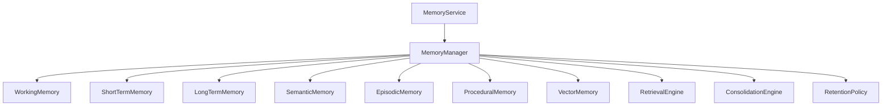

# RFC-0123

**Title:** Memory Service Architecture

**Document ID:** RFC-0123

**Version:** 1.0

**Status:** Accepted

**Category:** Services Architecture

**Layer:** Services / Memory

**Target:**

```text
services/memory/
```

---

# Abstract

This RFC defines the SH-3 Memory Service Architecture (MSA).

The Memory Service provides the unified knowledge persistence and retrieval subsystem for the SH-3 AI Operating System. It manages transient, persistent, semantic, episodic, procedural, and vector-based memory through deterministic interfaces and versioned storage contracts.

The Memory Service SHALL expose a single logical memory abstraction while allowing multiple interchangeable storage implementations.

Every memory operation SHALL be deterministic, observable, policy-compliant, auditable, and reproducible.

This document is normative.

---

# Motivation

Intelligent systems require persistent knowledge across execution boundaries.

Without a unified Memory Service:

- knowledge becomes fragmented
- retrieval becomes inconsistent
- duplicate storage mechanisms emerge
- learning cannot accumulate experience
- reasoning lacks shared context

The Memory Service establishes a single authoritative knowledge subsystem shared across the entire platform.

---

# Goals

The architecture SHALL provide:

- unified memory abstraction
- deterministic storage
- deterministic retrieval
- multiple memory models
- versioned persistence
- distributed synchronization
- policy-governed access

---

# Non-Goals

The architecture SHALL NOT:

- replace external databases
- execute workflows
- perform autonomous reasoning
- bypass governance policies

---

# Architecture



---

# Design Principles

## One Logical Memory

Applications SHALL interact with a unified logical memory model.

---

## Immutable Records

Stored memory records SHALL remain immutable.

Updates SHALL generate new versions.

---

## Deterministic Retrieval

Identical queries SHALL produce identical retrieval results under identical state.

---

## Replaceable Storage

Memory backends SHALL be interchangeable through stable contracts.

---

## Knowledge Preservation

Historical knowledge SHALL remain reproducible.

---

# Components

| Component | Responsibility |
|-----------|----------------|
| MemoryManager | Global memory coordination |
| WorkingMemory | Active execution context |
| ShortTermMemory | Temporary operational memory |
| LongTermMemory | Persistent knowledge |
| SemanticMemory | Structured concepts |
| EpisodicMemory | Event history |
| ProceduralMemory | Skills and procedures |
| VectorMemory | Embedding storage |
| RetrievalEngine | Unified retrieval |
| ConsolidationEngine | Memory promotion |
| RetentionPolicy | Retention management |

---

# Memory Types

The architecture SHALL support:

- Working Memory
- Short-Term Memory
- Long-Term Memory
- Semantic Memory
- Episodic Memory
- Procedural Memory
- Vector Memory

Additional memory models MAY be introduced.

---

# Memory Record

Every record SHALL define:

- memory_id
- memory_type
- namespace
- owner
- version
- timestamp
- payload
- embedding_reference
- metadata

Records SHALL remain immutable.

---

# Memory Lifecycle

Every memory operation SHALL follow:

```text
Receive

↓

Validate

↓

Normalize

↓

Index

↓

Persist

↓

Publish Event

↓

Available

↓

Archive

↓

Expire
```

Each stage SHALL emit immutable events.

---

# Retrieval Engine

RetrievalEngine SHALL support:

- key lookup
- semantic lookup
- vector similarity search
- metadata filtering
- hybrid retrieval
- namespace filtering
- version-aware retrieval

Retrieval SHALL remain deterministic.

---

# Consolidation

ConsolidationEngine SHALL promote:

- working → short-term
- short-term → long-term
- episodic → semantic
- repeated procedures → procedural

Promotion SHALL preserve historical versions.

---

# Vector Memory

VectorMemory SHALL support:

- embedding storage
- similarity search
- ANN indexing
- embedding versioning
- metadata association

Embedding generation is outside the scope of this RFC.

---

# Retention Policy

RetentionPolicy SHALL define:

- expiration rules
- archival rules
- deletion policies
- legal retention
- governance retention
- snapshot frequency

Deletion SHALL remain auditable.

---

# Distributed Memory

Distributed Memory SHALL support:

- replication
- synchronization
- consistency verification
- conflict resolution
- snapshot distribution

Consistency SHALL remain deterministic.

---

# Governance Integration

Every memory operation SHALL validate:

- access permissions
- governance policy
- retention policy
- privacy policy
- compliance requirements

Unauthorized access SHALL be denied.

---

# Message Bus Integration

Memory events include:

- MemoryStored
- MemoryIndexed
- MemoryRetrieved
- MemoryUpdated
- MemoryArchived
- MemoryExpired
- MemoryReplicated
- MemoryConsolidated

Events SHALL remain immutable and versioned.

---

# Persistence Integration

Persistence SHALL maintain:

- memory records
- embeddings
- indices
- snapshots
- retention history
- access history

Historical memory SHALL remain reproducible.

---

# Observability

Memory telemetry SHALL expose:

- storage latency
- retrieval latency
- consolidation latency
- replication latency
- cache hit ratio
- retrieval accuracy
- storage utilization

---

# Distributed Tracing

Every memory operation SHALL preserve:

- trace_id
- memory_operation_id
- memory_id
- retrieval_id
- namespace_id
- node_id

Tracing SHALL reconstruct complete memory lifecycles.

---

# Thread Model

The Memory Service supports concurrent:

- storage
- retrieval
- indexing
- replication
- consolidation
- telemetry collection

The reference implementation SHALL be:

- deterministic
- thread-safe
- horizontally scalable
- event-driven
- lock-efficient

---

# Metrics

The architecture exposes:

- storage throughput
- retrieval throughput
- average latency
- consolidation rate
- replication success rate
- cache efficiency
- memory utilization

---

# Performance Objectives

The architecture should optimize for:

- deterministic retrieval
- low query latency
- scalable persistence
- efficient indexing
- reliable replication
- knowledge durability

---

# Future Work

Potential future enhancements include:

- hierarchical memory
- graph-native semantic memory
- adaptive consolidation
- autonomous forgetting
- multimodal memory
- distributed knowledge federation

---

# References

- RFC-0122 Planner Service Architecture
- RFC-0121 Services Layer Architecture
- RFC-0117 Kernel Service Registry Architecture
- RFC-0106 Distributed Memory Runtime Architecture
- SH-3 Architecture Specification v2.1

---

# End of RFC-0123