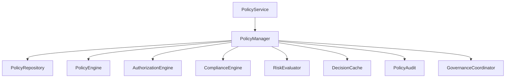

# RFC-0124

**Title:** Policy Service Architecture

**Document ID:** RFC-0124

**Version:** 1.0

**Status:** Accepted

**Category:** Services Architecture

**Layer:** Services / Policy

**Target:**

```text
services/policy/
```

---

# Abstract

This RFC defines the SH-3 Policy Service Architecture (PSA).

The Policy Service provides centralized policy evaluation, authorization, governance enforcement, compliance verification, operational constraint management, and risk assessment for the SH-3 AI Operating System.

Every request executed within SH-3 SHALL be evaluated against applicable policies before execution. Policy decisions SHALL be deterministic, explainable, auditable, versioned, and reproducible.

This document is normative.

---

# Motivation

As SH-3 evolves into a distributed AI Operating System, independent services require consistent governance.

Without a centralized Policy Service:

- authorization becomes inconsistent
- security rules diverge
- compliance cannot be guaranteed
- risk evaluation becomes fragmented
- auditing becomes incomplete

The Policy Service establishes a single authoritative decision engine.

---

# Goals

The architecture SHALL provide:

- deterministic policy evaluation
- centralized authorization
- governance enforcement
- compliance validation
- risk assessment
- policy versioning
- distributed policy synchronization

---

# Non-Goals

The architecture SHALL NOT:

- replace authentication providers
- execute application workflows
- store application data
- bypass Kernel governance

---

# Architecture



---

# Design Principles

## Policy Before Execution

Every executable operation SHALL undergo policy evaluation before activation.

---

## Deterministic Decisions

Identical requests evaluated under identical policies SHALL produce identical decisions.

---

## Explainable Decisions

Every policy decision SHALL include an explanation describing the rules applied and the resulting outcome.

---

## Immutable Policies

Released policy definitions SHALL remain immutable.

Policy modifications SHALL create new policy versions.

---

## Separation of Concerns

Policy evaluation SHALL remain independent of business logic.

---

# Components

| Component | Responsibility |
|-----------|----------------|
| PolicyManager | Global policy coordination |
| PolicyRepository | Policy storage |
| PolicyEngine | Policy evaluation |
| AuthorizationEngine | Permission verification |
| ComplianceEngine | Compliance validation |
| RiskEvaluator | Risk scoring |
| DecisionCache | Cached decisions |
| PolicyAudit | Audit history |
| GovernanceCoordinator | Governance integration |

---

# Policy Model

Every policy SHALL define:

- policy_id
- policy_name
- policy_version
- policy_scope
- evaluation_priority
- rule_set
- effect
- validity_period
- metadata

Policies SHALL be immutable after publication.

---

# Decision Model

Every policy decision SHALL contain:

- decision_id
- request_id
- policy_version
- evaluation_timestamp
- decision
- explanation
- risk_score
- metadata

Decision records SHALL remain immutable.

---

# Evaluation Lifecycle

Every evaluation SHALL follow:

```text
Receive Request

↓

Load Policies

↓

Resolve Scope

↓

Evaluate Rules

↓

Risk Assessment

↓

Compliance Validation

↓

Decision Generation

↓

Audit

↓

Publish Decision
```

Every phase SHALL emit immutable events.

---

# Authorization

AuthorizationEngine SHALL evaluate:

- identity
- roles
- capabilities
- permissions
- ownership
- execution context

Authorization SHALL precede execution.

---

# Compliance Validation

ComplianceEngine SHALL verify:

- governance policies
- operational policies
- regulatory policies
- privacy requirements
- security requirements
- organizational constraints

Compliance violations SHALL prevent execution.

---

# Risk Assessment

RiskEvaluator SHALL calculate:

- operational risk
- security risk
- dependency risk
- resource risk
- compliance risk
- confidence score

Risk evaluation SHALL remain deterministic.

---

# Decision Cache

DecisionCache SHALL support:

- immutable cache entries
- policy version awareness
- configurable expiration
- distributed synchronization
- cache invalidation

Cached decisions SHALL never bypass policy version validation.

---

# Distributed Policy Management

Distributed deployments SHALL support:

- policy replication
- version synchronization
- conflict detection
- consistency verification
- snapshot distribution

Every node SHALL evaluate equivalent policy versions.

---

# Governance Integration

The Policy Service SHALL integrate with:

- Kernel Lifecycle
- Service Registry
- Dependency Resolution
- Runtime Governance
- Security Services
- Audit Services

All policy decisions SHALL remain traceable.

---

# Message Bus Integration

Policy events include:

- PolicyLoaded
- PolicyPublished
- PolicyUpdated
- PolicyEvaluated
- AuthorizationGranted
- AuthorizationDenied
- ComplianceVerified
- ComplianceFailed
- RiskCalculated
- DecisionPublished

Events SHALL remain immutable and versioned.

---

# Persistence Integration

Persistence SHALL maintain:

- policy definitions
- decision history
- audit records
- compliance reports
- risk assessments
- policy versions

Historical policy information SHALL remain reproducible.

---

# Observability

Policy telemetry SHALL expose:

- evaluation latency
- authorization latency
- compliance failures
- decision throughput
- cache hit ratio
- risk distribution
- policy utilization

---

# Distributed Tracing

Every policy operation SHALL preserve:

- trace_id
- policy_operation_id
- policy_id
- decision_id
- request_id
- node_id

Tracing SHALL reconstruct complete policy evaluations.

---

# Thread Model

The Policy Service supports concurrent:

- policy evaluation
- authorization
- compliance validation
- risk assessment
- cache synchronization
- telemetry collection

The reference implementation SHALL be:

- deterministic
- thread-safe
- horizontally scalable
- event-driven
- lock-efficient

---

# Metrics

The architecture exposes:

- evaluation throughput
- authorization success rate
- compliance success rate
- average evaluation latency
- cache efficiency
- policy utilization
- risk distribution

---

# Performance Objectives

The architecture should optimize for:

- low evaluation latency
- deterministic decision making
- scalable policy distribution
- efficient authorization
- rapid compliance verification
- complete auditability

---

# Future Work

Potential future enhancements include:

- attribute-based access control (ABAC)
- relationship-based access control (ReBAC)
- adaptive policy optimization
- formal policy verification
- AI-assisted policy authoring
- cross-cluster governance federation

---

# References

- RFC-0123 Memory Service Architecture
- RFC-0122 Planner Service Architecture
- RFC-0121 Services Layer Architecture
- RFC-0115 Kernel Core Architecture
- RFC-0109 Runtime Governance & Policy Architecture
- SH-3 Architecture Specification v2.1

---

# End of RFC-0124