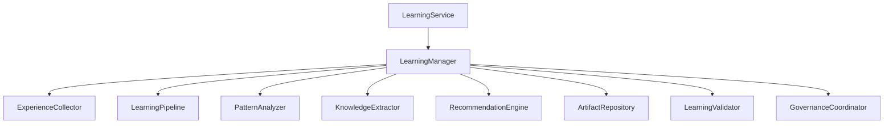

# RFC-0125

**Title:** Learning Service Architecture

**Document ID:** RFC-0125

**Version:** 1.0

**Status:** Accepted

**Category:** Services Architecture

**Layer:** Services / Learning

**Target:**

```text
services/learning/
```

---

# Abstract

This RFC defines the SH-3 Learning Service Architecture (LSA).

The Learning Service enables continuous knowledge acquisition, experience consolidation, performance analysis, adaptation recommendation, and model-independent learning throughout the SH-3 AI Operating System.

Rather than directly modifying runtime behavior, the Learning Service observes system activity, extracts reusable knowledge, evaluates outcomes, and publishes validated learning artifacts for consumption by other services.

All learning SHALL be deterministic, explainable, versioned, observable, auditable, and reproducible.

This document is normative.

---

# Motivation

An autonomous operating system must improve through experience while preserving deterministic behavior.

Without a centralized Learning Service:

- experience remains fragmented
- improvements cannot be shared
- optimization lacks historical evidence
- planners cannot benefit from execution history
- reasoning cannot accumulate validated knowledge

The Learning Service establishes a reusable learning capability shared across the platform.

---

# Goals

The architecture SHALL provide:

- experience acquisition
- deterministic learning pipelines
- knowledge extraction
- pattern discovery
- adaptation recommendations
- versioned learning artifacts
- distributed learning synchronization

---

# Non-Goals

The architecture SHALL NOT:

- directly execute workflows
- directly modify runtime components
- replace machine learning frameworks
- bypass governance policies

---

# Architecture



---

# Design Principles

## Learn From Experience

Every observable execution MAY become a learning opportunity.

---

## Deterministic Learning

Identical observations SHALL produce identical learning artifacts.

---

## Explainable Learning

Every learning result SHALL include supporting evidence.

---

## Immutable Learning Artifacts

Published learning artifacts SHALL remain immutable.

Updates SHALL generate new versions.

---

## Separation From Execution

Learning SHALL recommend improvements rather than directly changing runtime behavior.

---

# Components

| Component | Responsibility |
|-----------|----------------|
| LearningManager | Global learning coordination |
| ExperienceCollector | Capture execution observations |
| LearningPipeline | Normalize learning inputs |
| PatternAnalyzer | Detect recurring behaviors |
| KnowledgeExtractor | Generate reusable knowledge |
| RecommendationEngine | Produce improvement recommendations |
| ArtifactRepository | Store learning artifacts |
| LearningValidator | Validate learning outputs |
| GovernanceCoordinator | Policy integration |

---

# Learning Artifact

Every artifact SHALL define:

- artifact_id
- artifact_type
- source
- evidence
- confidence
- version
- timestamp
- metadata

Artifacts SHALL remain immutable.

---

# Learning Lifecycle

Every learning process SHALL follow:

```text
Observe

↓

Collect Experience

↓

Normalize

↓

Analyze

↓

Extract Knowledge

↓

Validate

↓

Generate Recommendation

↓

Publish Artifact

↓

Archive
```

Each phase SHALL emit immutable events.

---

# Experience Collection

ExperienceCollector SHALL collect:

- execution results
- planner outcomes
- workflow metrics
- runtime events
- healing events
- optimization events
- user feedback
- system telemetry

Collected observations SHALL remain immutable.

---

# Pattern Analysis

PatternAnalyzer SHALL identify:

- repeated behaviors
- recurring failures
- successful strategies
- optimization opportunities
- anomaly trends
- capability utilization

Pattern discovery SHALL remain deterministic.

---

# Knowledge Extraction

KnowledgeExtractor SHALL produce:

- reusable rules
- optimization hints
- planning heuristics
- capability statistics
- operational insights
- structured knowledge

Extracted knowledge SHALL preserve traceability.

---

# Recommendation Engine

RecommendationEngine SHALL generate recommendations for:

- Planner
- Optimizer
- Healing
- Knowledge
- Memory
- Runtime Governance

Recommendations SHALL require explicit acceptance before activation.

---

# Validation

LearningValidator SHALL verify:

- evidence completeness
- confidence thresholds
- policy compliance
- reproducibility
- consistency
- governance approval

Only validated artifacts SHALL be published.

---

# Distributed Learning

Distributed deployments SHALL support:

- artifact replication
- distributed observations
- consistency verification
- version synchronization
- conflict resolution

Learning artifacts SHALL converge across nodes.

---

# Governance Integration

Every learning operation SHALL validate:

- governance policy
- privacy policy
- retention policy
- security policy
- compliance requirements

Unauthorized learning SHALL be rejected.

---

# Message Bus Integration

Learning events include:

- ExperienceCollected
- LearningStarted
- PatternDetected
- KnowledgeExtracted
- RecommendationGenerated
- LearningValidated
- ArtifactPublished
- LearningArchived

Events SHALL remain immutable and versioned.

---

# Persistence Integration

Persistence SHALL maintain:

- experiences
- learning artifacts
- recommendations
- validation reports
- evidence history
- artifact versions

Historical learning SHALL remain reproducible.

---

# Observability

Learning telemetry SHALL expose:

- learning latency
- artifact generation rate
- validation success rate
- recommendation count
- pattern detection rate
- confidence distribution
- learning throughput

---

# Distributed Tracing

Every learning operation SHALL preserve:

- trace_id
- learning_id
- artifact_id
- observation_id
- recommendation_id
- node_id

Tracing SHALL reconstruct complete learning workflows.

---

# Thread Model

The Learning Service supports concurrent:

- observation collection
- artifact generation
- validation
- recommendation generation
- replication
- telemetry collection

The reference implementation SHALL be:

- deterministic
- thread-safe
- horizontally scalable
- event-driven
- lock-efficient

---

# Metrics

The architecture exposes:

- learning throughput
- artifact publication rate
- validation success rate
- recommendation acceptance rate
- average learning latency
- confidence score distribution
- artifact reuse rate

---

# Performance Objectives

The architecture should optimize for:

- deterministic learning
- low artifact generation latency
- scalable observation processing
- efficient recommendation generation
- reliable validation
- reusable organizational knowledge

---

# Future Work

Potential future enhancements include:

- reinforcement learning integration
- federated learning
- continual learning pipelines
- causal inference
- automatic hypothesis generation
- AI-assisted strategy discovery

---

# References

- RFC-0124 Policy Service Architecture
- RFC-0123 Memory Service Architecture
- RFC-0122 Planner Service Architecture
- RFC-0121 Services Layer Architecture
- SH-3 Architecture Specification v2.1

---

# End of RFC-0125