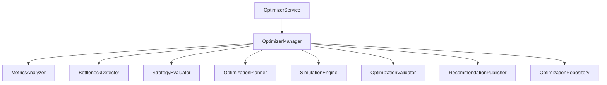

# RFC-0126

**Title:** Optimizer Service Architecture

**Document ID:** RFC-0126

**Version:** 1.0

**Status:** Accepted

**Category:** Services Architecture

**Layer:** Services / Optimizer

**Target:**

```text
services/optimizer/
```

---

# Abstract

This RFC defines the SH-3 Optimizer Service Architecture (OSA).

The Optimizer Service continuously evaluates operational efficiency across the SH-3 AI Operating System and generates validated optimization proposals for execution strategies, resource allocation, scheduling policies, workflow structures, and service configurations.

The Optimizer SHALL recommend improvements but SHALL NOT directly modify the runtime. Approved optimization plans SHALL be executed through Kernel and Runtime lifecycle mechanisms.

Every optimization SHALL be deterministic, explainable, measurable, observable, versioned, auditable, and reversible.

This document is normative.

---

# Motivation

As system complexity increases, static configurations become insufficient.

Without a centralized Optimizer Service:

- execution efficiency gradually degrades
- resource utilization becomes suboptimal
- scheduling policies cannot evolve
- repeated inefficiencies remain unresolved
- optimization knowledge cannot be shared

The Optimizer Service provides continuous operational improvement while preserving deterministic system behavior.

---

# Goals

The architecture SHALL provide:

- continuous optimization
- deterministic optimization analysis
- recommendation generation
- optimization validation
- rollback support
- optimization history
- distributed optimization coordination

---

# Non-Goals

The architecture SHALL NOT:

- directly execute optimizations
- replace Runtime scheduling
- replace Learning
- bypass governance approval

---

# Architecture



---

# Design Principles

## Measure Before Optimize

Every optimization SHALL be supported by measurable evidence.

---

## Deterministic Optimization

Identical observations SHALL produce identical optimization proposals.

---

## Explainable Recommendations

Each recommendation SHALL include:

- supporting evidence
- expected impact
- estimated cost
- associated risks

---

## Reversible Optimization

Every approved optimization SHALL support rollback.

---

## Continuous Improvement

Optimization SHALL be an ongoing process rather than a one-time activity.

---

# Components

| Component | Responsibility |
|----------|----------------|
| OptimizerManager | Global optimization coordination |
| MetricsAnalyzer | Analyze operational metrics |
| BottleneckDetector | Identify bottlenecks |
| StrategyEvaluator | Compare optimization strategies |
| OptimizationPlanner | Generate optimization plans |
| SimulationEngine | Predict optimization outcomes |
| OptimizationValidator | Validate recommendations |
| RecommendationPublisher | Publish approved recommendations |
| OptimizationRepository | Store optimization history |

---

# Optimization Lifecycle

Every optimization SHALL follow:

```text
Observe

↓

Collect Metrics

↓

Analyze

↓

Detect Bottlenecks

↓

Generate Candidates

↓

Simulate

↓

Validate

↓

Publish Recommendation

↓

Archive
```

Each phase SHALL emit immutable events.

---

# Optimization Model

Every optimization proposal SHALL define:

- optimization_id
- target
- objective
- expected_benefit
- estimated_cost
- confidence
- rollback_strategy
- version
- metadata

Optimization proposals SHALL remain immutable.

---

# Metrics Analysis

MetricsAnalyzer SHALL evaluate:

- latency
- throughput
- CPU utilization
- memory utilization
- storage utilization
- network utilization
- queue depth
- error rate
- energy consumption

Additional metrics MAY be introduced.

---

# Bottleneck Detection

BottleneckDetector SHALL identify:

- resource saturation
- execution delays
- dependency contention
- synchronization overhead
- scheduling inefficiencies
- repeated failures

Detection SHALL remain deterministic.

---

# Strategy Evaluation

StrategyEvaluator SHALL compare:

- scheduling alternatives
- execution ordering
- resource allocation
- caching strategies
- batching strategies
- scaling strategies

Strategy evaluation SHALL preserve reproducibility.

---

# Simulation

SimulationEngine SHALL estimate:

- execution time
- resource savings
- failure probability
- throughput improvement
- rollback complexity
- operational impact

Simulation SHALL NOT modify production state.

---

# Validation

OptimizationValidator SHALL verify:

- evidence quality
- confidence threshold
- governance compliance
- reproducibility
- rollback feasibility
- dependency compatibility

Only validated recommendations SHALL be published.

---

# Recommendation Publication

Recommendations MAY target:

- Planner
- Runtime
- Scheduler
- Kernel
- Memory
- Learning
- Healing
- Knowledge

Consumers SHALL explicitly approve recommendations before activation.

---

# Distributed Optimization

Distributed deployments SHALL support:

- optimization synchronization
- recommendation replication
- distributed simulations
- version reconciliation
- optimization consistency

Optimization history SHALL converge across nodes.

---

# Governance Integration

Every optimization SHALL validate:

- governance policy
- operational policy
- resource policy
- security policy
- compliance requirements

Unauthorized optimizations SHALL be rejected.

---

# Message Bus Integration

Optimizer events include:

- MetricsCollected
- BottleneckDetected
- StrategyEvaluated
- OptimizationGenerated
- SimulationCompleted
- RecommendationValidated
- RecommendationPublished
- OptimizationArchived

Events SHALL remain immutable and versioned.

---

# Persistence Integration

Persistence SHALL maintain:

- optimization proposals
- simulation reports
- recommendation history
- optimization metrics
- rollback history
- validation reports

Historical optimization state SHALL remain reproducible.

---

# Observability

Optimizer telemetry SHALL expose:

- optimization latency
- recommendation rate
- simulation duration
- validation success rate
- optimization acceptance rate
- rollback frequency
- optimization effectiveness

---

# Distributed Tracing

Every optimization SHALL preserve:

- trace_id
- optimization_id
- recommendation_id
- simulation_id
- target_service
- node_id

Tracing SHALL reconstruct complete optimization workflows.

---

# Thread Model

The Optimizer Service supports concurrent:

- metric analysis
- bottleneck detection
- simulation
- recommendation generation
- validation
- telemetry collection

The reference implementation SHALL be:

- deterministic
- thread-safe
- horizontally scalable
- event-driven
- lock-efficient

---

# Metrics

The architecture exposes:

- optimization throughput
- recommendation acceptance rate
- simulation accuracy
- rollback success rate
- average optimization latency
- system efficiency improvement
- optimization reuse rate

---

# Performance Objectives

The architecture should optimize for:

- low optimization latency
- accurate recommendations
- scalable analysis
- reliable simulations
- deterministic optimization
- measurable operational improvements

---

# Future Work

Potential future enhancements include:

- multi-objective optimization
- reinforcement learning optimization
- predictive autoscaling
- autonomous optimization scheduling
- digital twin optimization
- cross-cluster optimization federation

---

# References

- RFC-0125 Learning Service Architecture
- RFC-0124 Policy Service Architecture
- RFC-0123 Memory Service Architecture
- RFC-0121 Services Layer Architecture
- SH-3 Architecture Specification v2.1

---

# End of RFC-0126