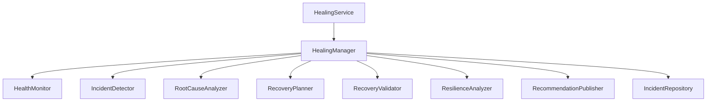

# RFC-0127

**Title:** Healing Service Architecture

**Document ID:** RFC-0127

**Version:** 1.0

**Status:** Accepted

**Category:** Services Architecture

**Layer:** Services / Healing

**Target:**

```text
services/healing/
```

---

# Abstract

This RFC defines the SH-3 Healing Service Architecture (HSA).

The Healing Service provides autonomous fault detection, diagnosis, recovery planning, remediation recommendation, health assessment, and resilience management across the SH-3 AI Operating System.

The Healing Service continuously evaluates system health, correlates failures, determines root causes, and generates validated recovery plans. Recovery actions SHALL be executed only through approved Runtime and Kernel lifecycle mechanisms.

Every healing operation SHALL be deterministic, explainable, observable, auditable, reversible, policy-compliant, and reproducible.

This document is normative.

---

# Motivation

Modern distributed AI operating systems require continuous operational resilience.

Without a centralized Healing Service:

- failures remain isolated
- diagnosis becomes inconsistent
- recovery procedures diverge
- recurring incidents cannot be eliminated
- resilience knowledge cannot accumulate

The Healing Service establishes a unified resilience capability across the entire SH-3 platform.

---

# Goals

The architecture SHALL provide:

- continuous health monitoring
- deterministic fault diagnosis
- root cause analysis
- recovery recommendation
- resilience assessment
- incident history
- distributed recovery coordination

---

# Non-Goals

The architecture SHALL NOT:

- bypass Runtime lifecycle management
- directly modify services
- replace monitoring infrastructure
- override governance policies

---

# Architecture



---

# Design Principles

## Observe Before Recover

Recovery SHALL be based on verified observations.

---

## Deterministic Diagnosis

Identical observations SHALL produce identical diagnoses.

---

## Explainable Recovery

Every recovery recommendation SHALL include:

- detected symptoms
- probable root cause
- proposed remediation
- expected outcome
- rollback procedure

---

## Safe Recovery

Recovery SHALL preserve overall system integrity.

---

## Continuous Resilience

Healing SHALL improve long-term system reliability through accumulated operational knowledge.

---

# Components

| Component | Responsibility |
|-----------|----------------|
| HealingManager | Global healing coordination |
| HealthMonitor | Continuous health evaluation |
| IncidentDetector | Detect operational incidents |
| RootCauseAnalyzer | Determine failure causes |
| RecoveryPlanner | Generate recovery plans |
| RecoveryValidator | Validate recovery feasibility |
| ResilienceAnalyzer | Evaluate resilience trends |
| RecommendationPublisher | Publish recovery recommendations |
| IncidentRepository | Store incident history |

---

# Healing Lifecycle

Every healing operation SHALL follow:

```text
Observe

↓

Detect Incident

↓

Collect Evidence

↓

Root Cause Analysis

↓

Generate Recovery Plan

↓

Validate

↓

Publish Recommendation

↓

Monitor Recovery

↓

Archive Incident
```

Each stage SHALL emit immutable events.

---

# Incident Model

Every incident SHALL define:

- incident_id
- incident_type
- severity
- affected_components
- detection_timestamp
- symptoms
- evidence
- status
- metadata

Incident records SHALL remain immutable.

---

# Health Assessment

HealthMonitor SHALL evaluate:

- service availability
- execution latency
- dependency health
- resource utilization
- communication failures
- replication status
- policy violations
- security anomalies

Health evaluations SHALL remain deterministic.

---

# Root Cause Analysis

RootCauseAnalyzer SHALL identify:

- dependency failures
- configuration errors
- resource exhaustion
- software defects
- infrastructure failures
- policy conflicts
- cascading failures

Root cause analysis SHALL preserve evidence traceability.

---

# Recovery Planning

RecoveryPlanner SHALL generate:

- restart procedures
- failover recommendations
- rollback plans
- dependency recovery
- resource reallocation
- isolation procedures
- operator escalation

Recovery plans SHALL preserve operational safety.

---

# Recovery Validation

RecoveryValidator SHALL verify:

- dependency consistency
- rollback feasibility
- governance compliance
- policy compliance
- recovery prerequisites
- operational safety

Only validated recovery plans SHALL be published.

---

# Resilience Analysis

ResilienceAnalyzer SHALL evaluate:

- MTTR trends
- MTBF trends
- recurring incidents
- recovery effectiveness
- component reliability
- operational stability

Resilience analysis SHALL remain reproducible.

---

# Distributed Healing

Distributed deployments SHALL support:

- incident synchronization
- recovery coordination
- distributed diagnosis
- resilience replication
- consensus on recovery state

Distributed recovery SHALL preserve cluster consistency.

---

# Governance Integration

Every healing operation SHALL validate:

- governance policy
- operational policy
- security policy
- compliance requirements
- recovery authorization

Unauthorized recovery SHALL be rejected.

---

# Message Bus Integration

Healing events include:

- HealthEvaluated
- IncidentDetected
- RootCauseIdentified
- RecoveryPlanned
- RecoveryValidated
- RecoveryRecommended
- RecoveryCompleted
- IncidentArchived

Events SHALL remain immutable and versioned.

---

# Persistence Integration

Persistence SHALL maintain:

- incident history
- recovery plans
- root cause reports
- resilience reports
- validation reports
- recovery metrics

Historical healing information SHALL remain reproducible.

---

# Observability

Healing telemetry SHALL expose:

- incident detection latency
- diagnosis latency
- recovery planning latency
- recovery success rate
- MTTR
- MTBF
- resilience score

---

# Distributed Tracing

Every healing operation SHALL preserve:

- trace_id
- healing_id
- incident_id
- recovery_id
- affected_component
- node_id

Tracing SHALL reconstruct complete healing workflows.

---

# Thread Model

The Healing Service supports concurrent:

- health monitoring
- incident detection
- diagnosis
- recovery planning
- resilience analysis
- telemetry collection

The reference implementation SHALL be:

- deterministic
- thread-safe
- horizontally scalable
- event-driven
- lock-efficient

---

# Metrics

The architecture exposes:

- incident throughput
- recovery success rate
- diagnosis accuracy
- average recovery latency
- resilience improvement rate
- recurring incident ratio
- recovery recommendation acceptance rate

---

# Performance Objectives

The architecture should optimize for:

- rapid incident detection
- deterministic diagnosis
- reliable recovery planning
- scalable resilience analysis
- minimal operational disruption
- continuous reliability improvement

---

# Future Work

Potential future enhancements include:

- predictive failure detection
- AI-assisted root cause analysis
- autonomous recovery approval
- digital twin recovery simulation
- self-adaptive resilience policies
- cross-cluster incident federation

---

# References

- RFC-0126 Optimizer Service Architecture
- RFC-0125 Learning Service Architecture
- RFC-0124 Policy Service Architecture
- RFC-0121 Services Layer Architecture
- RFC-0116 Kernel Lifecycle Management Architecture
- SH-3 Architecture Specification v2.1

---

# End of RFC-0127