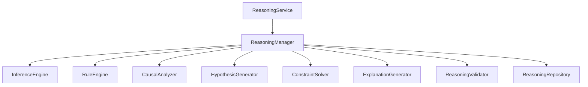

# RFC-0128

**Title:** Reasoning Service Architecture

**Document ID:** RFC-0128

**Version:** 1.0

**Status:** Accepted

**Category:** Services Architecture

**Layer:** Services / Reasoning

**Target:**

```text
services/reasoning/
```

---

# Abstract

This RFC defines the SH-3 Reasoning Service Architecture (RSA).

The Reasoning Service provides deterministic inference capabilities for the SH-3 AI Operating System. It transforms facts, observations, knowledge, policies, and goals into explainable conclusions through structured reasoning algorithms.

The Reasoning Service supports multiple reasoning paradigms including deductive, inductive, abductive, causal, rule-based, and constraint-based reasoning through a unified service interface.

Every reasoning process SHALL be deterministic, explainable, observable, reproducible, auditable, policy-compliant, and versioned.

This document is normative.

---

# Motivation

Planning, learning, optimization, healing, and knowledge management all require reliable reasoning capabilities.

Without a centralized Reasoning Service:

- reasoning logic becomes duplicated
- inference quality becomes inconsistent
- explanations become fragmented
- causal analysis becomes difficult
- knowledge utilization remains limited

The Reasoning Service establishes a reusable inference platform shared across the entire SH-3 ecosystem.

---

# Goals

The architecture SHALL provide:

- deterministic inference
- explainable reasoning
- multiple reasoning paradigms
- evidence-based conclusions
- hypothesis generation
- conflict detection
- distributed reasoning support

---

# Non-Goals

The architecture SHALL NOT:

- replace machine learning models
- directly execute workflows
- modify knowledge automatically
- bypass governance policies

---

# Architecture



---

# Design Principles

## Evidence First

Every conclusion SHALL be supported by explicit evidence.

---

## Deterministic Inference

Identical evidence SHALL always produce identical conclusions.

---

## Explainable Results

Every inference SHALL provide a machine-readable and human-readable explanation.

---

## Immutable Reasoning Records

Reasoning results SHALL remain immutable.

Updated reasoning SHALL create new versions.

---

## Separation From Knowledge

Reasoning derives conclusions from knowledge but SHALL NOT modify the underlying knowledge base directly.

---

# Components

| Component | Responsibility |
|-----------|----------------|
| ReasoningManager | Global reasoning coordination |
| InferenceEngine | Execute inference |
| RuleEngine | Evaluate rule sets |
| CausalAnalyzer | Analyze causal relationships |
| HypothesisGenerator | Generate candidate explanations |
| ConstraintSolver | Resolve logical constraints |
| ExplanationGenerator | Produce reasoning explanations |
| ReasoningValidator | Validate inference correctness |
| ReasoningRepository | Store reasoning history |

---

# Reasoning Lifecycle

Every reasoning operation SHALL follow:

```text
Receive Request

↓

Collect Evidence

↓

Normalize Facts

↓

Infer Conclusions

↓

Generate Hypotheses

↓

Validate

↓

Generate Explanation

↓

Publish Result

↓

Archive
```

Each stage SHALL emit immutable events.

---

# Evidence Model

Every evidence object SHALL define:

- evidence_id
- source
- evidence_type
- confidence
- timestamp
- version
- metadata

Evidence SHALL remain immutable.

---

# Reasoning Result

Every reasoning result SHALL define:

- reasoning_id
- conclusion
- supporting_evidence
- confidence
- explanation
- assumptions
- reasoning_type
- version
- metadata

Results SHALL remain immutable.

---

# Supported Reasoning Types

The Reasoning Service SHALL support:

- deductive reasoning
- inductive reasoning
- abductive reasoning
- causal reasoning
- rule-based reasoning
- constraint reasoning
- temporal reasoning
- probabilistic reasoning (deterministic evaluation using configured models)

Additional reasoning strategies MAY be introduced.

---

# Rule Evaluation

RuleEngine SHALL support:

- production rules
- logical predicates
- decision tables
- policy constraints
- dependency rules
- semantic rules

Rule evaluation SHALL remain deterministic.

---

# Hypothesis Generation

HypothesisGenerator SHALL generate:

- candidate causes
- alternative explanations
- missing evidence
- confidence rankings
- uncertainty reports

Hypotheses SHALL preserve traceability.

---

# Constraint Solving

ConstraintSolver SHALL evaluate:

- logical consistency
- dependency constraints
- policy constraints
- temporal constraints
- resource constraints

Constraint violations SHALL be reported.

---

# Validation

ReasoningValidator SHALL verify:

- logical consistency
- evidence completeness
- reproducibility
- governance compliance
- policy compliance
- explanation completeness

Only validated reasoning results SHALL be published.

---

# Distributed Reasoning

Distributed deployments SHALL support:

- distributed inference
- evidence synchronization
- reasoning replication
- consistency verification
- version synchronization

Distributed reasoning SHALL converge on equivalent conclusions.

---

# Governance Integration

Every reasoning operation SHALL validate:

- governance policy
- access permissions
- privacy policy
- compliance requirements
- security policy

Unauthorized reasoning SHALL be rejected.

---

# Message Bus Integration

Reasoning events include:

- ReasoningStarted
- EvidenceCollected
- RulesEvaluated
- HypothesisGenerated
- ConstraintsSolved
- ReasoningValidated
- ExplanationGenerated
- ReasoningPublished

Events SHALL remain immutable and versioned.

---

# Persistence Integration

Persistence SHALL maintain:

- reasoning history
- evidence
- hypotheses
- explanations
- validation reports
- reasoning versions

Historical reasoning SHALL remain reproducible.

---

# Observability

Reasoning telemetry SHALL expose:

- inference latency
- rule evaluation latency
- hypothesis generation rate
- validation success rate
- evidence utilization
- reasoning throughput
- confidence distribution

---

# Distributed Tracing

Every reasoning operation SHALL preserve:

- trace_id
- reasoning_id
- inference_id
- evidence_id
- hypothesis_id
- node_id

Tracing SHALL reconstruct complete reasoning workflows.

---

# Thread Model

The Reasoning Service supports concurrent:

- inference
- rule evaluation
- hypothesis generation
- validation
- explanation generation
- telemetry collection

The reference implementation SHALL be:

- deterministic
- thread-safe
- horizontally scalable
- event-driven
- lock-efficient

---

# Metrics

The architecture exposes:

- reasoning throughput
- inference accuracy
- validation success rate
- average reasoning latency
- explanation completeness
- evidence reuse rate
- hypothesis acceptance rate

---

# Performance Objectives

The architecture should optimize for:

- deterministic inference
- low reasoning latency
- scalable rule evaluation
- explainable conclusions
- reusable evidence
- high-quality hypothesis generation

---

# Future Work

Potential future enhancements include:

- formal theorem proving
- neuro-symbolic reasoning
- distributed causal graphs
- counterfactual reasoning
- probabilistic graphical models
- autonomous hypothesis refinement

---

# References

- RFC-0127 Healing Service Architecture
- RFC-0126 Optimizer Service Architecture
- RFC-0125 Learning Service Architecture
- RFC-0123 Memory Service Architecture
- RFC-0121 Services Layer Architecture
- SH-3 Architecture Specification v2.1

---

# End of RFC-0128