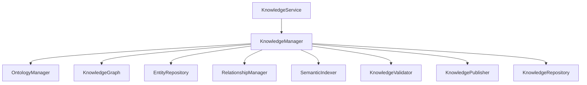

# RFC-0129

**Title:** Knowledge Service Architecture

**Document ID:** RFC-0129

**Version:** 1.0

**Status:** Accepted

**Category:** Services Architecture

**Layer:** Services / Knowledge

**Target:**

```text
services/knowledge/
```

---

# Abstract

This RFC defines the SH-3 Knowledge Service Architecture (KSA).

The Knowledge Service provides the canonical semantic knowledge management subsystem for the SH-3 AI Operating System. It organizes concepts, entities, relationships, ontologies, semantic indexes, taxonomies, and knowledge graphs into a unified, versioned, queryable knowledge space.

The Knowledge Service enables every component of SH-3 to share a common semantic representation while preserving deterministic behavior, explainability, governance, and reproducibility.

Every knowledge operation SHALL be deterministic, observable, auditable, versioned, policy-compliant, and reproducible.

This document is normative.

---

# Motivation

Large autonomous systems require a shared semantic understanding.

Without a unified Knowledge Service:

- semantic information becomes fragmented
- duplicate concepts emerge
- inconsistent terminology develops
- reasoning quality degrades
- planning cannot reuse structured knowledge
- learning cannot accumulate validated concepts

The Knowledge Service establishes the authoritative semantic knowledge foundation for the SH-3 platform.

---

# Goals

The architecture SHALL provide:

- centralized semantic knowledge
- deterministic knowledge retrieval
- ontology management
- knowledge graph management
- entity management
- semantic indexing
- distributed knowledge synchronization

---

# Non-Goals

The architecture SHALL NOT:

- replace Memory Service
- execute workflows
- bypass governance policies
- directly modify Runtime behavior

---

# Architecture



---

# Design Principles

## Single Source of Truth

The Knowledge Service SHALL represent the canonical semantic view of the platform.

---

## Immutable Knowledge

Published knowledge SHALL remain immutable.

Updates SHALL generate new versions.

---

## Explainable Semantics

Every relationship SHALL include supporting metadata describing its origin and justification.

---

## Shared Semantic Vocabulary

All services SHALL use common semantic identifiers whenever possible.

---

## Deterministic Queries

Identical knowledge queries SHALL produce identical results under identical knowledge states.

---

# Components

| Component | Responsibility |
|-----------|----------------|
| KnowledgeManager | Global knowledge coordination |
| OntologyManager | Ontology management |
| KnowledgeGraph | Semantic graph |
| EntityRepository | Entity storage |
| RelationshipManager | Relationship management |
| SemanticIndexer | Semantic indexing |
| KnowledgeValidator | Knowledge validation |
| KnowledgePublisher | Publication management |
| KnowledgeRepository | Persistent storage |

---

# Knowledge Model

Every knowledge object SHALL define:

- knowledge_id
- knowledge_type
- namespace
- version
- source
- confidence
- timestamp
- metadata

Knowledge objects SHALL remain immutable.

---

# Entity Model

Every entity SHALL define:

- entity_id
- entity_type
- canonical_name
- aliases
- attributes
- metadata

Entity identifiers SHALL remain globally unique.

---

# Relationship Model

Every relationship SHALL define:

- relationship_id
- source_entity
- target_entity
- relationship_type
- confidence
- provenance
- metadata

Relationships SHALL remain immutable.

---

# Ontology Management

OntologyManager SHALL support:

- concept hierarchies
- taxonomy management
- ontology versioning
- semantic constraints
- namespace isolation
- ontology validation

Ontology evolution SHALL preserve backward compatibility whenever possible.

---

# Knowledge Graph

KnowledgeGraph SHALL support:

- graph traversal
- relationship discovery
- semantic neighborhood queries
- graph versioning
- graph snapshots
- distributed graph synchronization

Graph traversal SHALL remain deterministic.

---

# Semantic Indexing

SemanticIndexer SHALL provide:

- concept indexing
- relationship indexing
- entity indexing
- namespace indexing
- metadata indexing
- hybrid semantic lookup

Indexes SHALL remain version-aware.

---

# Knowledge Validation

KnowledgeValidator SHALL verify:

- ontology consistency
- relationship integrity
- duplicate detection
- semantic correctness
- governance compliance
- policy compliance

Only validated knowledge SHALL be published.

---

# Knowledge Publication

KnowledgePublisher SHALL support:

- staged publication
- version promotion
- rollback
- approval workflows
- distributed publication

Published knowledge SHALL remain immutable.

---

# Distributed Knowledge

Distributed deployments SHALL support:

- graph replication
- ontology synchronization
- entity replication
- conflict detection
- version reconciliation

All nodes SHALL converge on equivalent semantic knowledge.

---

# Governance Integration

Every knowledge operation SHALL validate:

- governance policy
- access permissions
- privacy policy
- compliance requirements
- publication authorization

Unauthorized knowledge changes SHALL be rejected.

---

# Message Bus Integration

Knowledge events include:

- KnowledgeCreated
- KnowledgeValidated
- EntityRegistered
- RelationshipCreated
- OntologyUpdated
- KnowledgePublished
- GraphSynchronized
- KnowledgeArchived

Events SHALL remain immutable and versioned.

---

# Persistence Integration

Persistence SHALL maintain:

- ontologies
- entities
- relationships
- graph snapshots
- publication history
- semantic indexes

Historical knowledge SHALL remain reproducible.

---

# Observability

Knowledge telemetry SHALL expose:

- graph size
- ontology size
- entity count
- relationship count
- publication latency
- validation latency
- query throughput

---

# Distributed Tracing

Every knowledge operation SHALL preserve:

- trace_id
- knowledge_id
- entity_id
- relationship_id
- publication_id
- node_id

Tracing SHALL reconstruct complete knowledge lifecycles.

---

# Thread Model

The Knowledge Service supports concurrent:

- graph updates
- ontology validation
- semantic indexing
- publication
- replication
- telemetry collection

The reference implementation SHALL be:

- deterministic
- thread-safe
- horizontally scalable
- event-driven
- lock-efficient

---

# Metrics

The architecture exposes:

- graph growth rate
- entity creation rate
- relationship density
- validation success rate
- publication throughput
- semantic query latency
- graph consistency score

---

# Performance Objectives

The architecture should optimize for:

- deterministic semantic retrieval
- scalable graph processing
- efficient indexing
- reliable ontology management
- rapid publication
- high semantic consistency

---

# Future Work

Potential future enhancements include:

- distributed ontology federation
- semantic reasoning integration
- graph embedding support
- multimodal knowledge representation
- autonomous ontology evolution
- cross-cluster semantic federation

---

# References

- RFC-0128 Reasoning Service Architecture
- RFC-0127 Healing Service Architecture
- RFC-0125 Learning Service Architecture
- RFC-0123 Memory Service Architecture
- RFC-0121 Services Layer Architecture
- SH-3 Architecture Specification v2.1

---

# End of RFC-0129