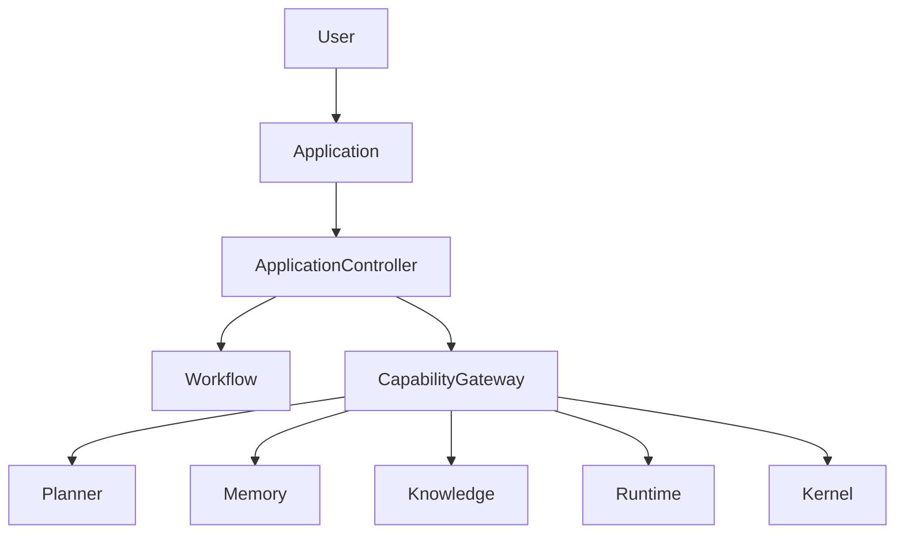

# RFC-0130

**Title:** Application Layer Architecture

**Document ID:** RFC-0130

**Version:** 1.0

**Status:** Accepted

**Category:** Application Architecture

**Layer:** Applications

**Target:**

```text
applications/
```

---

# Abstract

This RFC defines the SH-3 Application Layer Architecture (ALA).

The Application Layer provides the entry point for domain-specific workloads executed on the SH-3 AI Operating System. Applications consume Kernel and Services capabilities through stable interfaces while remaining isolated from internal platform implementation details.

Applications SHALL remain stateless whenever practical, deterministic, modular, observable, policy-governed, and independently deployable.

This document is normative.

---

# Motivation

Business logic evolves independently from the operating platform.

Without a dedicated Application Layer:

- domain logic leaks into platform services
- applications become tightly coupled
- deployment becomes difficult
- testing becomes inconsistent
- platform evolution becomes constrained

The Application Layer establishes a clean separation between reusable platform capabilities and domain-specific functionality.

---

# Goals

The architecture SHALL provide:

- application isolation
- reusable service consumption
- deterministic execution
- policy-governed operation
- lifecycle management
- observability
- horizontal scalability

---

# Non-Goals

The architecture SHALL NOT:

- replace Runtime execution
- replace Kernel coordination
- duplicate Services functionality
- bypass governance

---

# Architecture



---

# Design Principles

## Platform First

Applications SHALL consume platform capabilities rather than reimplement them.

---

## Loose Coupling

Applications SHALL communicate through contracts, events, and published interfaces.

---

## Stateless Execution

Applications SHOULD avoid persistent internal state.

Persistent data SHALL reside in platform services.

---

## Replaceable Applications

Applications MAY be upgraded or replaced independently.

---

## Policy Compliance

Every application operation SHALL pass policy validation.

---

# Components

| Component | Responsibility |
|-----------|----------------|
| ApplicationController | Application lifecycle |
| Workflow | Business workflow |
| CapabilityGateway | Platform interface |
| EventAdapter | Event integration |
| ContextManager | Execution context |
| ResultPublisher | Publish results |

---

# Application Lifecycle

Every application SHALL follow:

```text
Registered

↓

Validated

↓

Initialized

↓

Activated

↓

Operational

↓

Suspended

↓

Updated

↓

Terminated
```

Lifecycle SHALL follow Kernel lifecycle management.

---

# Capability Gateway

Applications SHALL consume capabilities through:

- Planner
- Memory
- Policy
- Learning
- Optimizer
- Healing
- Reasoning
- Knowledge
- Runtime
- Kernel

Direct internal access SHALL NOT be permitted.

---

# Workflow Model

Every workflow SHALL define:

- workflow_id
- application_id
- version
- objective
- inputs
- outputs
- dependencies
- metadata

Workflow definitions SHALL remain immutable.

---

# Context Management

Execution context SHALL include:

- trace_id
- workflow_id
- session_id
- principal_id
- namespace
- metadata

Context SHALL propagate across service boundaries.

---

# Event Integration

Applications SHALL consume and publish events through the Runtime Event Bus.

Events SHALL be immutable and versioned.

---

# Governance Integration

Every application SHALL validate:

- governance policy
- authorization
- compliance
- operational constraints
- security policy

Unauthorized execution SHALL be rejected.

---

# Persistence Integration

Applications MAY persist:

- workflow state
- checkpoints
- business artifacts
- execution history

Persistence SHALL use approved platform services.

---

# Observability

Applications SHALL expose:

- execution latency
- throughput
- failures
- resource usage
- workflow completion
- dependency latency

---

# Distributed Tracing

Every application SHALL preserve:

- trace_id
- application_id
- workflow_id
- execution_id
- node_id

Tracing SHALL reconstruct complete application execution.

---

# Thread Model

Applications support concurrent:

- workflow execution
- event processing
- service invocation
- telemetry collection

The reference implementation SHALL be:

- deterministic
- thread-safe
- horizontally scalable
- event-driven
- lock-efficient

---

# Metrics

Applications SHALL expose:

- workflow throughput
- execution latency
- success rate
- failure rate
- dependency utilization
- resource efficiency

---

# Performance Objectives

The architecture should optimize for:

- deterministic execution
- rapid startup
- scalable workloads
- efficient service utilization
- high availability

---

# Future Work

Potential future enhancements include:

- application marketplace
- dynamic capability composition
- autonomous application orchestration
- cross-cluster applications
- self-optimizing workflows

---

# References

- RFC-0129 Knowledge Service Architecture
- RFC-0121 Services Layer Architecture
- RFC-0115 Kernel Core Architecture
- SH-3 Architecture Specification v2.1

---

# End of RFC-0130