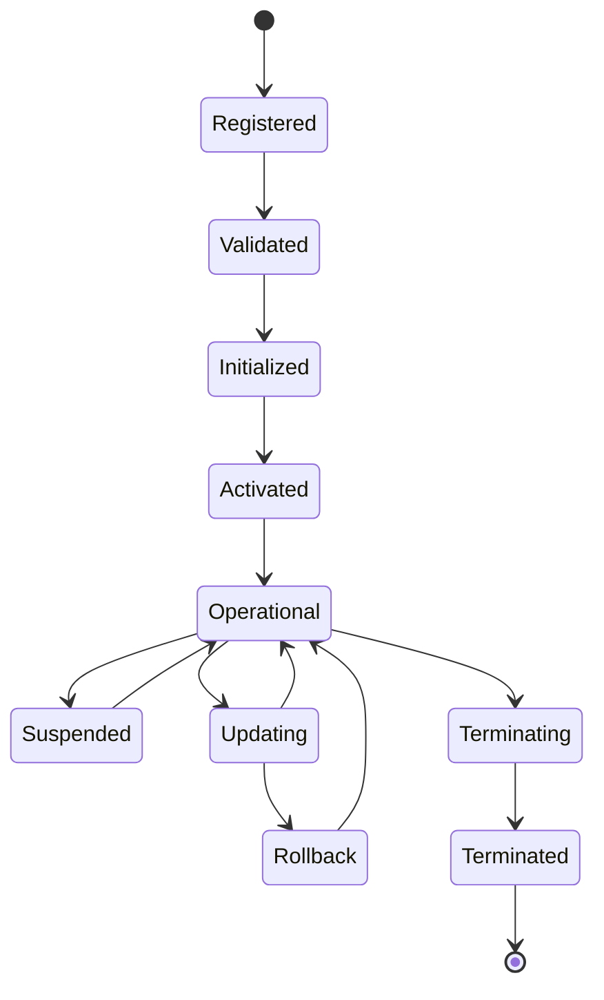

# RFC-0131

**Title:** Application Lifecycle Architecture

**Document ID:** RFC-0131

**Version:** 1.0

**Status:** Accepted

**Category:** Application Architecture

**Layer:** Applications

**Target:**

```text
applications/lifecycle/
```

---

# Abstract

This RFC defines the SH-3 Application Lifecycle Architecture (ALA-LC).

The Application Lifecycle Architecture specifies the standardized lifecycle governing every application executing within the SH-3 AI Operating System. It defines lifecycle states, transition rules, validation procedures, activation mechanisms, upgrade processes, suspension handling, recovery coordination, and termination semantics.

All lifecycle transitions SHALL be deterministic, observable, versioned, auditable, policy-compliant, and reproducible.

This document is normative.

---

# Motivation

Applications evolve independently while operating within a shared execution platform.

Without a standardized lifecycle:

- application behavior becomes inconsistent
- deployment procedures diverge
- upgrades become unsafe
- rollback becomes unreliable
- operational visibility decreases

The lifecycle architecture provides a predictable execution model for all applications.

---

# Goals

The architecture SHALL provide:

- deterministic lifecycle management
- version-aware activation
- controlled upgrades
- graceful suspension
- safe termination
- rollback capability
- distributed lifecycle coordination

---

# Non-Goals

The architecture SHALL NOT:

- execute business workflows
- replace Runtime scheduling
- bypass Kernel lifecycle management
- replace deployment orchestration

---

# Architecture



---

# Design Principles

## Explicit State Machine

Every application SHALL exist in exactly one lifecycle state.

---

## Deterministic Transitions

Identical inputs SHALL produce identical lifecycle transitions.

---

## Immutable Lifecycle History

Lifecycle events SHALL never be modified.

---

## Recoverable Operations

Recoverable transitions SHALL define rollback procedures.

---

## Observable State

Lifecycle state SHALL be continuously observable.

---

# Lifecycle States

| State | Description |
|--------|-------------|
| Registered | Application metadata accepted |
| Validated | Configuration verified |
| Initialized | Resources allocated |
| Activated | Ready for execution |
| Operational | Processing requests |
| Suspended | Temporarily unavailable |
| Updating | Upgrade in progress |
| Rollback | Restoring previous version |
| Terminating | Shutdown in progress |
| Terminated | Fully stopped |

---

# Lifecycle Model

Every lifecycle instance SHALL define:

- lifecycle_id
- application_id
- version
- current_state
- previous_state
- transition_history
- timestamp
- metadata

Lifecycle history SHALL remain immutable.

---

# Transition Rules

Every transition SHALL validate:

- current state
- requested state
- dependency readiness
- policy compliance
- security requirements
- resource availability

Invalid transitions SHALL be rejected.

---

# Registration

Registration SHALL verify:

- application identity
- manifest
- signature
- version
- compatibility
- ownership

Successful registration SHALL publish a lifecycle event.

---

# Validation

Validation SHALL verify:

- configuration
- dependency graph
- required capabilities
- runtime compatibility
- governance policy
- security policy

Only validated applications MAY be initialized.

---

# Initialization

Initialization SHALL allocate:

- execution context
- runtime bindings
- service connections
- event subscriptions
- telemetry channels

Initialization SHALL remain idempotent.

---

# Activation

Activation SHALL:

- enable request processing
- register health endpoints
- publish activation event
- expose telemetry
- enable workflow execution

Activation SHALL occur only after successful initialization.

---

# Suspension

Applications MAY be suspended for:

- maintenance
- policy enforcement
- resource pressure
- operator request
- dependency failures

Suspension SHALL preserve application state where supported.

---

# Upgrade

Upgrade SHALL support:

- version validation
- staged rollout
- health verification
- rollback preparation
- compatibility checks

Upgrade SHALL preserve deterministic execution.

---

# Rollback

Rollback SHALL restore:

- previous version
- configuration
- runtime bindings
- execution contracts

Rollback SHALL be fully auditable.

---

# Termination

Termination SHALL perform:

- workflow draining
- resource release
- event unsubscription
- telemetry flush
- lifecycle publication

Termination SHALL complete gracefully whenever possible.

---

# Distributed Lifecycle

Distributed deployments SHALL support:

- synchronized activation
- coordinated suspension
- rolling upgrades
- cluster-wide rollback
- lifecycle consensus

All nodes SHALL converge on equivalent lifecycle state.

---

# Governance Integration

Every lifecycle transition SHALL validate:

- governance policy
- authorization
- compliance
- operational constraints
- deployment policy

Unauthorized transitions SHALL be rejected.

---

# Message Bus Integration

Lifecycle events include:

- ApplicationRegistered
- ApplicationValidated
- ApplicationInitialized
- ApplicationActivated
- ApplicationSuspended
- ApplicationUpdated
- ApplicationRolledBack
- ApplicationTerminated

Events SHALL remain immutable and versioned.

---

# Persistence Integration

Persistence SHALL maintain:

- lifecycle history
- transition records
- deployment versions
- rollback history
- validation reports

Historical lifecycle information SHALL remain reproducible.

---

# Observability

Lifecycle telemetry SHALL expose:

- activation latency
- initialization latency
- upgrade duration
- rollback duration
- active application count
- lifecycle transition rate

---

# Distributed Tracing

Every lifecycle operation SHALL preserve:

- trace_id
- lifecycle_id
- application_id
- deployment_id
- node_id

Tracing SHALL reconstruct complete lifecycle transitions.

---

# Thread Model

The Application Lifecycle subsystem supports concurrent:

- registration
- validation
- activation
- suspension
- upgrades
- telemetry collection

The reference implementation SHALL be:

- deterministic
- thread-safe
- horizontally scalable
- event-driven
- lock-efficient

---

# Metrics

The architecture exposes:

- activation success rate
- rollback success rate
- lifecycle throughput
- average activation latency
- upgrade success rate
- suspension frequency

---

# Performance Objectives

The architecture should optimize for:

- predictable activation
- rapid recovery
- safe upgrades
- scalable lifecycle management
- deterministic state transitions

---

# Future Work

Potential future enhancements include:

- blue-green lifecycle orchestration
- canary activation
- autonomous deployment approval
- predictive lifecycle management
- self-healing lifecycle recovery
- multi-cluster lifecycle federation

---

# References

- RFC-0130 Application Layer Architecture
- RFC-0124 Policy Service Architecture
- RFC-0116 Kernel Lifecycle Management Architecture
- SH-3 Architecture Specification v2.1

---

# End of RFC-0131