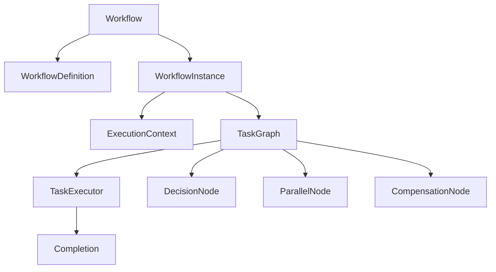

# RFC-0132

**Title:** Workflow Architecture

**Document ID:** RFC-0132

**Version:** 1.0

**Status:** Accepted

**Category:** Application Architecture

**Layer:** Applications / Workflow

**Target:**

```text
applications/workflow/
```

---

# Abstract

This RFC defines the SH-3 Workflow Architecture (WFA).

The Workflow Architecture specifies the execution model used by applications running on the SH-3 AI Operating System. A workflow represents a deterministic directed graph composed of executable tasks, decision points, synchronization barriers, compensation logic, and completion semantics.

Workflow execution SHALL be coordinated by the Runtime and Kernel while consuming platform capabilities exposed by the Services Layer.

Every workflow SHALL be deterministic, observable, recoverable, versioned, auditable, policy-compliant, and reproducible.

This document is normative.

---

# Motivation

Applications express business objectives through workflows rather than imperative execution.

Without a unified workflow architecture:

- execution models diverge
- dependency handling becomes inconsistent
- recovery becomes unreliable
- workflow portability decreases
- operational visibility is reduced

The Workflow Architecture establishes a common execution model across all SH-3 applications.

---

# Goals

The architecture SHALL provide:

- deterministic workflow execution
- dependency-aware scheduling
- parallel execution
- conditional branching
- compensation handling
- checkpoint recovery
- distributed workflow coordination

---

# Non-Goals

The architecture SHALL NOT:

- replace Runtime scheduling
- replace Planner Service
- execute infrastructure operations
- bypass governance policies

---

# Architecture



---

# Design Principles

## Declarative Workflows

Workflow definitions SHALL describe *what* is executed rather than *how* execution is implemented.

---

## Immutable Definitions

Workflow definitions SHALL remain immutable.

Changes SHALL create new workflow versions.

---

## Deterministic Execution

Equivalent workflow definitions and inputs SHALL produce equivalent execution behavior.

---

## Recoverable Execution

Workflow execution SHALL support recovery from validated checkpoints.

---

## Observable State

Every execution state SHALL be externally observable.

---

# Components

| Component | Responsibility |
|-----------|----------------|
| WorkflowDefinition | Immutable workflow specification |
| WorkflowInstance | Runtime execution instance |
| TaskGraph | Dependency graph |
| TaskExecutor | Execute individual tasks |
| DecisionNode | Conditional branching |
| ParallelNode | Concurrent execution |
| SynchronizationNode | Join parallel branches |
| CompensationNode | Recovery actions |
| CheckpointManager | Recovery checkpoints |

---

# Workflow Definition

Every workflow SHALL define:

- workflow_id
- application_id
- version
- entry_point
- task_graph
- policies
- metadata

Workflow definitions SHALL remain immutable.

---

# Workflow Instance

Every execution instance SHALL define:

- instance_id
- workflow_id
- execution_state
- active_tasks
- completed_tasks
- failed_tasks
- checkpoints
- metadata

Instances SHALL remain version-aware.

---

# Task Model

Every task SHALL define:

- task_id
- task_type
- dependencies
- inputs
- outputs
- timeout
- retry_policy
- metadata

Tasks SHALL execute independently whenever dependencies permit.

---

# Execution Lifecycle

Every workflow SHALL follow:

```text
Created

↓

Validated

↓

Scheduled

↓

Executing

↓

Checkpoint

↓

Completed

or

Failed

↓

Compensated

↓

Archived
```

Each transition SHALL emit immutable lifecycle events.

---

# Dependency Management

TaskGraph SHALL support:

- sequential execution
- dependency chains
- fan-out
- fan-in
- DAG validation
- dependency versioning

Cyclic task graphs SHALL be rejected.

---

# Parallel Execution

ParallelNode SHALL support:

- concurrent execution
- configurable concurrency
- synchronization barriers
- timeout propagation
- cancellation propagation

Parallel execution SHALL preserve deterministic ordering of observable events.

---

# Conditional Execution

DecisionNode SHALL evaluate:

- workflow variables
- planner outputs
- policy decisions
- reasoning results
- runtime state

Decision evaluation SHALL remain deterministic.

---

# Compensation

CompensationNode SHALL support:

- rollback actions
- resource cleanup
- state restoration
- retry coordination
- failure notification

Compensation SHALL execute only after validated failure conditions.

---

# Checkpoint Recovery

CheckpointManager SHALL support:

- checkpoint creation
- checkpoint validation
- workflow resume
- rollback to checkpoint
- checkpoint expiration

Recovery SHALL preserve workflow consistency.

---

# Distributed Workflows

Distributed deployments SHALL support:

- distributed task execution
- workflow migration
- node failover
- checkpoint replication
- execution synchronization

Workflow state SHALL converge across participating nodes.

---

# Governance Integration

Every workflow SHALL validate:

- governance policy
- authorization
- execution policy
- resource policy
- compliance requirements

Unauthorized workflow execution SHALL be rejected.

---

# Message Bus Integration

Workflow events include:

- WorkflowCreated
- WorkflowValidated
- WorkflowScheduled
- WorkflowStarted
- TaskStarted
- TaskCompleted
- TaskFailed
- CheckpointCreated
- WorkflowCompleted
- WorkflowCompensated
- WorkflowArchived

Events SHALL remain immutable and versioned.

---

# Persistence Integration

Persistence SHALL maintain:

- workflow definitions
- workflow instances
- checkpoints
- execution history
- compensation history
- workflow versions

Historical workflow executions SHALL remain reproducible.

---

# Observability

Workflow telemetry SHALL expose:

- workflow throughput
- execution latency
- task latency
- checkpoint frequency
- compensation rate
- success ratio
- failure ratio

---

# Distributed Tracing

Every workflow SHALL preserve:

- trace_id
- workflow_id
- instance_id
- task_id
- checkpoint_id
- node_id

Tracing SHALL reconstruct complete workflow execution.

---

# Thread Model

The Workflow subsystem supports concurrent:

- workflow execution
- task scheduling
- checkpoint creation
- compensation
- telemetry collection

The reference implementation SHALL be:

- deterministic
- thread-safe
- horizontally scalable
- event-driven
- lock-efficient

---

# Metrics

The architecture exposes:

- workflow throughput
- task throughput
- workflow completion rate
- average execution latency
- checkpoint recovery rate
- compensation success rate
- parallel execution efficiency

---

# Performance Objectives

The architecture should optimize for:

- deterministic execution
- scalable workflow orchestration
- efficient dependency scheduling
- low execution latency
- reliable recovery
- predictable resource utilization

---

# Future Work

Potential future enhancements include:

- hierarchical workflows
- dynamic workflow composition
- event-sourced workflows
- workflow simulation
- AI-assisted workflow optimization
- cross-cluster workflow federation

---

# References

- RFC-0131 Application Lifecycle Architecture
- RFC-0130 Application Layer Architecture
- RFC-0122 Planner Service Architecture
- RFC-0116 Kernel Lifecycle Management Architecture
- RFC-0103 Runtime Execution Architecture
- SH-3 Architecture Specification v2.1

---

# End of RFC-0132