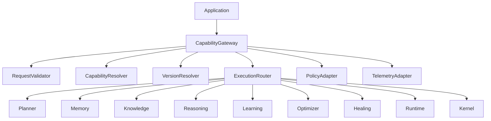

# RFC-0133

**Title:** Capability Gateway Architecture

**Document ID:** RFC-0133

**Version:** 1.0

**Status:** Accepted

**Category:** Application Architecture

**Layer:** Applications / Gateway

**Target:**

```text
applications/gateway/
```

---

# Abstract

This RFC defines the SH-3 Capability Gateway Architecture (CGA).

The Capability Gateway provides the canonical interface through which every application accesses platform capabilities provided by the Runtime, Kernel, and Services layers.

Applications SHALL communicate exclusively through the Capability Gateway rather than directly invoking internal platform components. The gateway provides capability discovery, version negotiation, request validation, policy enforcement, observability, and execution routing.

Every gateway operation SHALL be deterministic, observable, auditable, policy-compliant, version-aware, and reproducible.

This document is normative.

---

# Motivation

Applications require access to platform services while remaining isolated from implementation details.

Without a unified gateway:

- applications become tightly coupled
- service contracts diverge
- upgrades become unsafe
- governance becomes inconsistent
- observability becomes fragmented

The Capability Gateway establishes a stable abstraction layer between applications and platform services.

---

# Goals

The architecture SHALL provide:

- unified capability access
- service abstraction
- capability discovery
- version negotiation
- request validation
- execution routing
- distributed gateway coordination

---

# Non-Goals

The architecture SHALL NOT:

- replace Service Registry
- execute business logic
- bypass Policy Service
- replace Runtime scheduling

---

# Architecture



---

# Design Principles

## Single Entry Point

Every application SHALL access platform capabilities through the Capability Gateway.

---

## Stable Contracts

Capability interfaces SHALL remain stable across compatible versions.

---

## Deterministic Routing

Equivalent requests SHALL always resolve to equivalent execution paths.

---

## Explicit Versioning

Every capability SHALL expose semantic version information.

---

## Platform Isolation

Applications SHALL remain independent from internal platform implementation details.

---

# Components

| Component | Responsibility |
|-----------|----------------|
| CapabilityGateway | Public gateway |
| RequestValidator | Validate requests |
| CapabilityResolver | Resolve capability identifiers |
| VersionResolver | Resolve compatible versions |
| ExecutionRouter | Route requests |
| PolicyAdapter | Policy validation |
| TelemetryAdapter | Metrics and tracing |
| ResponseNormalizer | Standardize responses |

---

# Capability Model

Every capability SHALL define:

- capability_id
- capability_name
- semantic_version
- provider
- contract
- availability
- metadata

Capability definitions SHALL remain immutable.

---

# Request Model

Every request SHALL define:

- request_id
- application_id
- capability_id
- version
- context
- payload
- timestamp
- metadata

Requests SHALL remain immutable.

---

# Response Model

Every response SHALL define:

- response_id
- request_id
- status
- payload
- execution_metadata
- timestamp

Responses SHALL remain immutable.

---

# Gateway Lifecycle

Every request SHALL follow:

```text
Receive

↓

Validate

↓

Resolve Capability

↓

Resolve Version

↓

Policy Evaluation

↓

Route

↓

Execute

↓

Normalize Response

↓

Publish Metrics

↓

Return Result
```

Every stage SHALL emit immutable events.

---

# Capability Resolution

CapabilityResolver SHALL support:

- exact lookup
- semantic lookup
- namespace lookup
- alias resolution
- capability compatibility

Resolution SHALL remain deterministic.

---

# Version Negotiation

VersionResolver SHALL support:

- semantic versioning
- compatibility verification
- downgrade selection
- upgrade selection
- deprecation detection

Incompatible versions SHALL be rejected.

---

# Request Validation

RequestValidator SHALL verify:

- schema validity
- authentication
- authorization
- context completeness
- payload integrity
- compatibility

Invalid requests SHALL be rejected.

---

# Execution Routing

ExecutionRouter SHALL support routing toward:

- Planner
- Memory
- Policy
- Learning
- Optimizer
- Healing
- Reasoning
- Knowledge
- Runtime
- Kernel

Routing SHALL preserve request context.

---

# Distributed Gateway

Distributed deployments SHALL support:

- gateway replication
- distributed routing
- load balancing
- failover
- request synchronization

Gateway behavior SHALL remain deterministic across nodes.

---

# Governance Integration

Every gateway request SHALL validate:

- governance policy
- authorization
- capability permissions
- compliance requirements
- security policy

Unauthorized requests SHALL be rejected.

---

# Message Bus Integration

Gateway events include:

- CapabilityRequested
- CapabilityResolved
- VersionResolved
- RequestValidated
- RequestRouted
- ExecutionCompleted
- ResponseReturned

Events SHALL remain immutable and versioned.

---

# Persistence Integration

Persistence SHALL maintain:

- capability catalog
- routing history
- request history
- compatibility mappings
- gateway metrics

Historical gateway activity SHALL remain reproducible.

---

# Observability

Gateway telemetry SHALL expose:

- request throughput
- routing latency
- validation latency
- routing distribution
- compatibility failures
- gateway availability

---

# Distributed Tracing

Every gateway operation SHALL preserve:

- trace_id
- request_id
- capability_id
- routing_id
- application_id
- node_id

Tracing SHALL reconstruct complete gateway operations.

---

# Thread Model

The Capability Gateway supports concurrent:

- request validation
- routing
- version negotiation
- capability discovery
- telemetry collection

The reference implementation SHALL be:

- deterministic
- thread-safe
- horizontally scalable
- event-driven
- lock-efficient

---

# Metrics

The architecture exposes:

- request throughput
- average routing latency
- gateway availability
- validation success rate
- routing success rate
- capability utilization
- compatibility resolution rate

---

# Performance Objectives

The architecture should optimize for:

- low routing latency
- deterministic request handling
- scalable capability access
- efficient version negotiation
- reliable routing
- high gateway availability

---

# Future Work

Potential future enhancements include:

- dynamic capability composition
- adaptive routing
- gateway federation
- intelligent capability selection
- zero-downtime contract migration
- cross-cluster capability discovery

---

# References

- RFC-0132 Workflow Architecture
- RFC-0131 Application Lifecycle Architecture
- RFC-0121 Services Layer Architecture
- RFC-0117 Kernel Service Registry Architecture
- RFC-0108 Runtime API Gateway Architecture
- SH-3 Architecture Specification v2.1

---

# End of RFC-0133