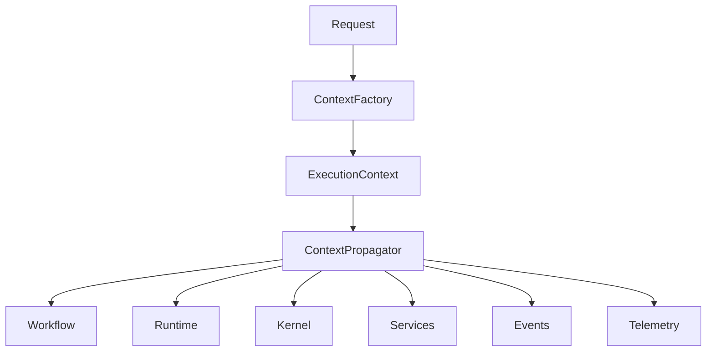

# RFC-0134

**Title:** Context Management Architecture

**Document ID:** RFC-0134

**Version:** 1.0

**Status:** Accepted

**Category:** Application Architecture

**Layer:** Applications / Context

**Target:**

```text
applications/context/
```

---

# Abstract

This RFC defines the SH-3 Context Management Architecture (CMA).

The Context Management Architecture specifies the canonical execution context propagated throughout the SH-3 AI Operating System. Every request, workflow, task, event, and service invocation SHALL execute within an immutable execution context.

The execution context provides identity, tracing, authorization, deadlines, namespaces, execution metadata, and correlation identifiers required for deterministic execution across distributed environments.

Every context SHALL be immutable, deterministic, observable, auditable, policy-compliant, versioned, and reproducible.

This document is normative.

---

# Motivation

Distributed execution requires shared execution metadata.

Without standardized context management:

- requests lose correlation
- tracing becomes fragmented
- authorization becomes inconsistent
- deadlines cannot propagate
- workflows become difficult to recover

The Context Management Architecture establishes a unified execution context shared across every layer of SH-3.

---

# Goals

The architecture SHALL provide:

- immutable execution context
- distributed propagation
- deterministic context generation
- tracing integration
- authorization propagation
- deadline propagation
- namespace isolation

---

# Non-Goals

The architecture SHALL NOT:

- replace authentication
- replace authorization
- store business data
- replace persistence

---

# Architecture



---

# Design Principles

## Immutable Context

Execution contexts SHALL never be modified after creation.

Derived contexts SHALL generate new immutable instances.

---

## End-to-End Propagation

Execution context SHALL accompany every operation throughout its lifecycle.

---

## Deterministic Construction

Equivalent requests SHALL produce equivalent execution contexts.

---

## Explicit Metadata

Execution metadata SHALL be represented as typed fields.

---

## Context Isolation

Execution contexts SHALL remain isolated across tenants, namespaces, and security domains.

---

# Components

| Component | Responsibility |
|-----------|----------------|
| ContextFactory | Create execution contexts |
| ContextPropagator | Propagate contexts |
| ContextValidator | Validate context integrity |
| ContextSerializer | Serialize contexts |
| ContextRepository | Store context snapshots |
| ContextMerger | Merge compatible contexts |
| ContextObserver | Collect telemetry |

---

# Execution Context Model

Every execution context SHALL define:

- context_id
- trace_id
- span_id
- parent_span_id
- request_id
- workflow_id
- task_id
- application_id
- principal_id
- namespace
- tenant_id
- correlation_id
- execution_deadline
- creation_timestamp
- semantic_version
- metadata

All fields SHALL remain immutable.

---

# Context Lifecycle

Every execution context SHALL follow:

```text
Created

↓

Validated

↓

Propagated

↓

Observed

↓

Serialized

↓

Archived
```

Every lifecycle transition SHALL emit immutable events.

---

# Context Creation

ContextFactory SHALL generate:

- globally unique identifiers
- trace hierarchy
- execution deadlines
- namespace bindings
- security context
- correlation identifiers

Creation SHALL remain deterministic.

---

# Context Propagation

ContextPropagator SHALL preserve:

- trace hierarchy
- execution identity
- deadlines
- namespace
- security metadata
- correlation identifiers

Propagation SHALL occur across:

- workflows
- tasks
- events
- service calls
- Runtime
- Kernel
- Services

---

# Context Validation

ContextValidator SHALL verify:

- identifier integrity
- trace consistency
- namespace validity
- authorization bindings
- deadline consistency
- schema compatibility

Invalid contexts SHALL be rejected.

---

# Context Serialization

Serialization SHALL support:

- binary encoding
- JSON encoding
- event propagation
- network transport
- persistent storage

Serialization SHALL preserve semantic equivalence.

---

# Context Merging

ContextMerger SHALL support:

- parent-child relationships
- distributed workflow joins
- parallel execution merges
- correlation preservation

Conflicting contexts SHALL be rejected.

---

# Distributed Context

Distributed deployments SHALL support:

- cross-node propagation
- distributed tracing
- context replication
- execution migration
- failover continuation

Context identity SHALL remain globally unique.

---

# Governance Integration

Every context SHALL validate:

- governance policy
- namespace policy
- security policy
- privacy policy
- compliance requirements

Unauthorized context propagation SHALL be rejected.

---

# Message Bus Integration

Context events include:

- ContextCreated
- ContextValidated
- ContextPropagated
- ContextMerged
- ContextSerialized
- ContextArchived

Events SHALL remain immutable and versioned.

---

# Persistence Integration

Persistence SHALL maintain:

- execution contexts
- trace hierarchies
- propagation history
- serialization records
- archived contexts

Historical contexts SHALL remain reproducible.

---

# Observability

Context telemetry SHALL expose:

- propagation latency
- active contexts
- serialization latency
- validation failures
- trace completeness
- propagation success rate

---

# Distributed Tracing

Every propagated context SHALL preserve:

- trace_id
- span_id
- parent_span_id
- context_id
- correlation_id
- node_id

Tracing SHALL reconstruct complete distributed execution.

---

# Thread Model

The Context subsystem supports concurrent:

- context creation
- propagation
- serialization
- validation
- telemetry collection

The reference implementation SHALL be:

- deterministic
- thread-safe
- horizontally scalable
- event-driven
- lock-efficient

---

# Metrics

The architecture exposes:

- context creation rate
- propagation throughput
- validation success rate
- serialization latency
- trace completion ratio
- propagation failure rate

---

# Performance Objectives

The architecture should optimize for:

- low propagation latency
- deterministic context generation
- scalable distributed tracing
- efficient serialization
- reliable context validation

---

# Future Work

Potential future enhancements include:

- context compression
- zero-copy propagation
- distributed context federation
- adaptive deadline propagation
- confidential execution contexts
- hardware-assisted tracing

---

# References

- RFC-0133 Capability Gateway Architecture
- RFC-0132 Workflow Architecture
- RFC-0118 Observability Architecture
- RFC-0109 Distributed Tracing Architecture
- SH-3 Architecture Specification v2.1

---

# End of RFC-0134