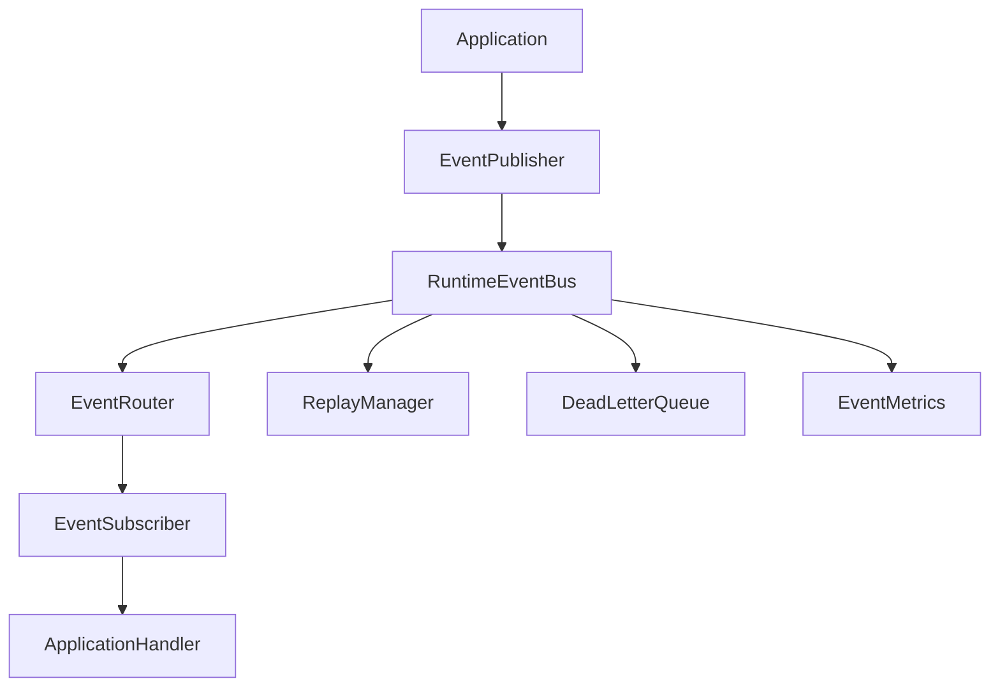

# RFC-0135

**Title:** Event Integration Architecture

**Document ID:** RFC-0135

**Version:** 1.0

**Status:** Accepted

**Category:** Application Architecture

**Layer:** Applications / Event Integration

**Target:**

```text
applications/events/
```

---

# Abstract

This RFC defines the SH-3 Event Integration Architecture (EIA).

The Event Integration Architecture specifies how applications integrate with the SH-3 Runtime Event Bus. Every application SHALL communicate asynchronously through immutable events using standardized event contracts.

Applications SHALL publish domain events and subscribe to platform events through the Runtime Event Bus. Event processing SHALL preserve deterministic ordering, delivery guarantees, traceability, and policy compliance.

Every event SHALL be immutable, versioned, observable, auditable, reproducible, and deterministic.

This document is normative.

---

# Motivation

Event-driven communication enables scalable and loosely coupled applications.

Without a standardized event integration model:

- applications become tightly coupled
- communication patterns diverge
- observability decreases
- replay becomes unreliable
- distributed coordination becomes inconsistent

The Event Integration Architecture establishes a unified event communication model across the SH-3 ecosystem.

---

# Goals

The architecture SHALL provide:

- standardized event publishing
- deterministic event subscription
- event filtering
- delivery guarantees
- replay capability
- event versioning
- distributed event coordination

---

# Non-Goals

The architecture SHALL NOT:

- replace Runtime Event Bus
- replace workflow execution
- bypass Policy Service
- implement transport protocols

---

# Architecture



---

# Design Principles

## Everything Event Driven

Every observable application state transition SHOULD be represented by an event.

---

## Immutable Events

Published events SHALL never be modified.

Updated information SHALL be represented by new events.

---

## Contract-Based Communication

Every published event SHALL conform to a versioned event contract.

---

## Deterministic Delivery

Equivalent event streams SHALL produce equivalent observable behavior.

---

## Loose Coupling

Publishers SHALL remain independent from subscribers.

---

# Components

| Component | Responsibility |
|-----------|----------------|
| EventPublisher | Publish events |
| EventSubscriber | Consume events |
| EventRouter | Route subscriptions |
| EventFilter | Apply filtering |
| ReplayManager | Replay historical events |
| DeadLetterQueue | Store failed deliveries |
| EventNormalizer | Normalize event payloads |
| EventMetrics | Event telemetry |

---

# Event Model

Every event SHALL define:

- event_id
- event_type
- semantic_version
- producer
- timestamp
- trace_id
- correlation_id
- payload
- metadata

Events SHALL remain immutable.

---

# Event Contract

Every event contract SHALL define:

- schema
- producer
- consumers
- compatibility policy
- semantic version
- validation rules

Contracts SHALL remain version-aware.

---

# Publishing Lifecycle

Every published event SHALL follow:

```text
Create

↓

Validate

↓

Serialize

↓

Publish

↓

Route

↓

Persist

↓

Observe

↓

Archive
```

Each stage SHALL emit immutable platform events.

---

# Subscription Model

Subscribers SHALL support:

- topic subscription
- event type subscription
- namespace subscription
- filtered subscription
- version-aware subscription

Subscriptions SHALL remain deterministic.

---

# Event Filtering

Filtering SHALL support:

- event type
- namespace
- producer
- application
- metadata
- policy constraints

Filtering SHALL occur before handler execution.

---

# Delivery Guarantees

The platform SHALL support:

- at-least-once delivery
- ordered delivery within partitions
- retry policies
- duplicate detection
- dead-letter routing

Delivery guarantees SHALL be configurable.

---

# Replay

ReplayManager SHALL support:

- replay by time
- replay by workflow
- replay by trace
- replay by application
- replay by event type

Replay SHALL preserve original ordering.

---

# Dead Letter Handling

DeadLetterQueue SHALL retain:

- failed event
- failure reason
- retry count
- handler metadata
- timestamp

Dead-letter events SHALL remain auditable.

---

# Distributed Event Integration

Distributed deployments SHALL support:

- cross-node routing
- partition replication
- ordered replay
- subscriber failover
- distributed subscriptions

Event ordering SHALL remain deterministic within configured guarantees.

---

# Governance Integration

Every published event SHALL validate:

- governance policy
- authorization
- event contract
- compliance policy
- security policy

Unauthorized events SHALL be rejected.

---

# Message Bus Integration

Application integration events include:

- EventCreated
- EventValidated
- EventPublished
- EventDelivered
- EventConsumed
- EventReplayed
- EventFailed
- EventArchived

Events SHALL remain immutable and versioned.

---

# Persistence Integration

Persistence SHALL maintain:

- event history
- subscriptions
- replay logs
- dead-letter queues
- contract versions

Historical events SHALL remain reproducible.

---

# Observability

Event telemetry SHALL expose:

- publish latency
- delivery latency
- replay latency
- subscriber throughput
- failed deliveries
- dead-letter count
- replay count

---

# Distributed Tracing

Every event SHALL preserve:

- trace_id
- span_id
- event_id
- producer_id
- subscriber_id
- node_id

Tracing SHALL reconstruct complete event propagation.

---

# Thread Model

The Event Integration subsystem supports concurrent:

- event publishing
- subscription
- routing
- replay
- telemetry collection

The reference implementation SHALL be:

- deterministic
- thread-safe
- horizontally scalable
- event-driven
- lock-efficient

---

# Metrics

The architecture exposes:

- publish throughput
- delivery throughput
- replay throughput
- delivery success rate
- replay success rate
- dead-letter ratio
- subscription count

---

# Performance Objectives

The architecture should optimize for:

- low publish latency
- deterministic routing
- scalable event processing
- reliable replay
- efficient filtering
- high delivery availability

---

# Future Work

Potential future enhancements include:

- event federation
- adaptive routing
- priority event channels
- event stream compression
- cross-cluster replay
- intelligent subscriber balancing

---

# References

- RFC-0134 Context Management Architecture
- RFC-0101 Runtime Event Bus Architecture
- RFC-0109 Distributed Tracing Architecture
- RFC-0118 Observability Architecture
- SH-3 Architecture Specification v2.1

---

# End of RFC-0135