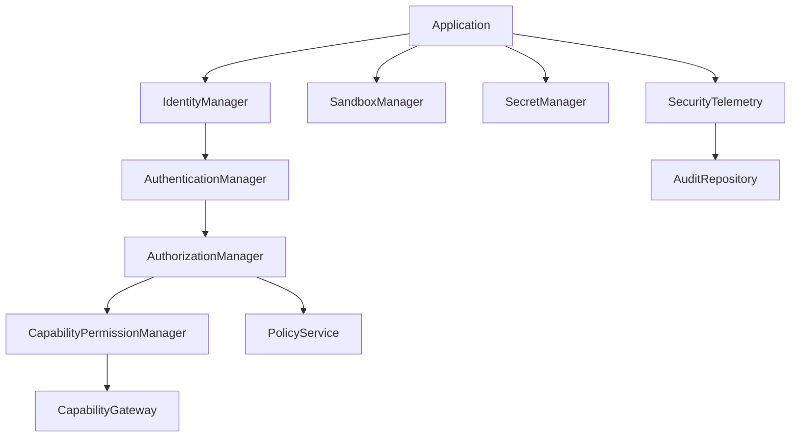

# RFC-0136

**Title:** Application Security Architecture

**Document ID:** RFC-0136

**Version:** 1.0

**Status:** Accepted

**Category:** Application Architecture

**Layer:** Applications / Security

**Target:**

```text
applications/security/
```

---

# Abstract

This RFC defines the SH-3 Application Security Architecture (ASA).

The Application Security Architecture establishes the security model governing every application executing within the SH-3 AI Operating System. It defines identity, authentication, authorization, capability permissions, secret management, execution isolation, sandboxing, trust boundaries, and security observability.

Every security decision SHALL be deterministic, policy-driven, auditable, observable, reproducible, versioned, and traceable.

This document is normative.

---

# Motivation

Applications operate with varying privilege levels while sharing a common execution platform.

Without a unified security architecture:

- privilege escalation becomes possible
- applications access unauthorized resources
- secrets become difficult to manage
- execution isolation weakens
- auditing becomes inconsistent

The Application Security Architecture provides a Zero Trust security model across the SH-3 platform.

---

# Goals

The architecture SHALL provide:

- strong authentication
- fine-grained authorization
- capability-based access control
- execution isolation
- secure secret management
- auditability
- distributed trust management

---

# Non-Goals

The architecture SHALL NOT:

- replace infrastructure security
- replace network security
- replace cryptographic algorithms
- bypass Policy Service

---

# Architecture



---

# Design Principles

## Zero Trust

Every request SHALL be authenticated and authorized regardless of origin.

---

## Least Privilege

Applications SHALL receive only the minimum permissions required.

---

## Explicit Authorization

Every privileged operation SHALL require authorization.

---

## Execution Isolation

Applications SHALL execute within isolated security boundaries.

---

## Continuous Verification

Security SHALL be continuously validated throughout execution.

---

# Components

| Component | Responsibility |
|-----------|----------------|
| IdentityManager | Application identity |
| AuthenticationManager | Identity verification |
| AuthorizationManager | Access decisions |
| CapabilityPermissionManager | Capability authorization |
| SandboxManager | Execution isolation |
| SecretManager | Secret lifecycle |
| SecurityTelemetry | Security metrics |
| AuditRepository | Security audit history |

---

# Security Identity

Every application SHALL define:

- application_id
- identity_id
- owner
- namespace
- trust_level
- security_profile
- version
- metadata

Identity SHALL remain globally unique.

---

# Authentication

Authentication SHALL support:

- mutual authentication
- signed manifests
- cryptographic identity
- certificate validation
- workload identity
- service identity

Authentication SHALL precede authorization.

---

# Authorization

Authorization SHALL evaluate:

- principal
- requested capability
- requested operation
- namespace
- policy
- execution context

Unauthorized operations SHALL be rejected.

---

# Capability Permissions

CapabilityPermissionManager SHALL enforce permissions for:

- Planner
- Memory
- Policy
- Learning
- Optimizer
- Healing
- Reasoning
- Knowledge
- Runtime
- Kernel

Permissions SHALL remain version-aware.

---

# Sandbox

SandboxManager SHALL isolate:

- memory
- filesystem
- network
- processes
- capabilities
- resource quotas

Isolation SHALL prevent unauthorized interaction between applications.

---

# Secret Management

SecretManager SHALL support:

- secret generation
- secure storage
- rotation
- expiration
- revocation
- audit logging

Secrets SHALL never appear in application logs or telemetry.

---

# Trust Boundaries

Security boundaries SHALL isolate:

- applications
- namespaces
- tenants
- execution environments
- administrative domains

Boundary violations SHALL be rejected.

---

# Distributed Security

Distributed deployments SHALL support:

- federated identity
- distributed authorization
- certificate synchronization
- trust propagation
- policy consistency

Security state SHALL converge across participating nodes.

---

# Governance Integration

Every security decision SHALL validate:

- governance policy
- security policy
- compliance policy
- privacy policy
- operational policy

Policy violations SHALL terminate the request.

---

# Message Bus Integration

Security events include:

- ApplicationAuthenticated
- AuthorizationGranted
- AuthorizationDenied
- CapabilityAccessGranted
- CapabilityAccessDenied
- SecretRotated
- SandboxCreated
- SecurityViolationDetected

Events SHALL remain immutable and versioned.

---

# Persistence Integration

Persistence SHALL maintain:

- identities
- authorization history
- capability grants
- audit logs
- secret metadata
- policy evaluations

Historical security data SHALL remain reproducible.

---

# Observability

Security telemetry SHALL expose:

- authentication latency
- authorization latency
- denied requests
- secret rotations
- sandbox count
- security violations
- policy evaluation latency

---

# Distributed Tracing

Every security operation SHALL preserve:

- trace_id
- application_id
- principal_id
- authorization_id
- policy_id
- node_id

Tracing SHALL reconstruct complete security decisions.

---

# Thread Model

The Application Security subsystem supports concurrent:

- authentication
- authorization
- secret access
- policy evaluation
- telemetry collection

The reference implementation SHALL be:

- deterministic
- thread-safe
- horizontally scalable
- event-driven
- lock-efficient

---

# Metrics

The architecture exposes:

- authentication success rate
- authorization success rate
- denied request rate
- security violation rate
- secret rotation frequency
- sandbox utilization
- policy evaluation throughput

---

# Performance Objectives

The architecture should optimize for:

- low authentication latency
- deterministic authorization
- scalable policy evaluation
- secure isolation
- reliable secret management
- continuous security monitoring

---

# Future Work

Potential future enhancements include:

- confidential computing integration
- hardware-backed identities
- adaptive risk scoring
- continuous authorization
- post-quantum cryptography
- cross-cluster trust federation

---

# References

- RFC-0135 Event Integration Architecture
- RFC-0134 Context Management Architecture
- RFC-0124 Policy Service Architecture
- RFC-0133 Capability Gateway Architecture
- RFC-0119 Governance Architecture
- SH-3 Architecture Specification v2.1

---

# End of RFC-0136