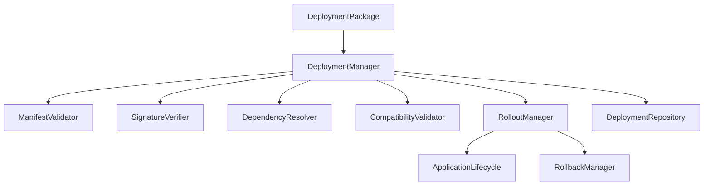

# RFC-0137

**Title:** Application Deployment Architecture

**Document ID:** RFC-0137

**Version:** 1.0

**Status:** Accepted

**Category:** Application Architecture

**Layer:** Applications / Deployment

**Target:**

```text
applications/deployment/
```

---

# Abstract

This RFC defines the SH-3 Application Deployment Architecture (ADA).

The Application Deployment Architecture specifies the lifecycle of application packaging, distribution, validation, installation, activation, update, rollback, and retirement within the SH-3 AI Operating System.

Deployments SHALL be deterministic, atomic, version-aware, cryptographically verifiable, observable, policy-compliant, auditable, and reproducible.

This document is normative.

---

# Motivation

Reliable deployment is fundamental to platform stability.

Without a standardized deployment architecture:

- application installations become inconsistent
- version compatibility cannot be guaranteed
- rollback becomes unreliable
- upgrades introduce unnecessary risk
- operational governance becomes fragmented

The Application Deployment Architecture establishes a unified deployment model across every SH-3 environment.

---

# Goals

The architecture SHALL provide:

- deterministic deployment
- package validation
- dependency verification
- cryptographic integrity
- staged rollout
- atomic rollback
- distributed deployment coordination

---

# Non-Goals

The architecture SHALL NOT:

- replace CI/CD systems
- replace container orchestration
- bypass lifecycle validation
- replace operating system package managers

---

# Architecture



---

# Design Principles

## Immutable Packages

Published deployment packages SHALL remain immutable.

---

## Atomic Deployment

Deployment SHALL either complete successfully or roll back completely.

---

## Deterministic Installation

Equivalent deployment inputs SHALL produce equivalent installations.

---

## Verified Integrity

Every deployment SHALL verify package authenticity and integrity.

---

## Controlled Rollout

Application deployment SHALL occur through validated rollout strategies.

---

# Components

| Component | Responsibility |
|-----------|----------------|
| DeploymentManager | Deployment orchestration |
| ManifestValidator | Manifest validation |
| SignatureVerifier | Signature verification |
| DependencyResolver | Dependency validation |
| CompatibilityValidator | Platform compatibility |
| RolloutManager | Deployment rollout |
| RollbackManager | Rollback execution |
| DeploymentRepository | Package storage |

---

# Deployment Package

Every deployment package SHALL define:

- package_id
- application_id
- semantic_version
- manifest
- dependencies
- signature
- checksum
- metadata

Deployment packages SHALL remain immutable.

---

# Manifest

Every deployment manifest SHALL define:

- application metadata
- required capabilities
- runtime requirements
- compatibility matrix
- permissions
- configuration schema
- deployment policy

Manifest schema SHALL be versioned.

---

# Deployment Lifecycle

Every deployment SHALL follow:

```text
Package Created

↓

Signature Verified

↓

Manifest Validated

↓

Dependency Validation

↓

Compatibility Validation

↓

Installation

↓

Activation

↓

Health Verification

↓

Deployment Completed

or

Rollback
```

Each transition SHALL emit immutable events.

---

# Dependency Resolution

DependencyResolver SHALL verify:

- required services
- required Runtime version
- required Kernel version
- required capabilities
- package compatibility
- dependency conflicts

Unresolved dependencies SHALL prevent deployment.

---

# Compatibility Validation

CompatibilityValidator SHALL evaluate:

- semantic version compatibility
- platform version
- architecture compatibility
- policy compatibility
- configuration compatibility

Unsupported deployments SHALL be rejected.

---

# Rollout

RolloutManager SHALL support:

- immediate rollout
- staged rollout
- rolling deployment
- canary deployment
- blue-green deployment

Rollout SHALL preserve service availability whenever possible.

---

# Rollback

RollbackManager SHALL restore:

- previous application version
- configuration
- permissions
- capability bindings
- deployment metadata

Rollback SHALL be deterministic and fully auditable.

---

# Distributed Deployment

Distributed deployments SHALL support:

- coordinated rollout
- deployment synchronization
- distributed rollback
- deployment consensus
- node health verification

Deployment state SHALL converge across all participating nodes.

---

# Governance Integration

Every deployment SHALL validate:

- governance policy
- security policy
- compliance policy
- operational policy
- deployment authorization

Unauthorized deployments SHALL be rejected.

---

# Message Bus Integration

Deployment events include:

- DeploymentPackageCreated
- DeploymentValidated
- DeploymentStarted
- DeploymentCompleted
- DeploymentFailed
- RolloutStarted
- RollbackStarted
- RollbackCompleted

Events SHALL remain immutable and versioned.

---

# Persistence Integration

Persistence SHALL maintain:

- deployment packages
- manifests
- deployment history
- rollout history
- rollback history
- compatibility reports

Historical deployment information SHALL remain reproducible.

---

# Observability

Deployment telemetry SHALL expose:

- deployment latency
- rollout duration
- rollback duration
- deployment success rate
- validation failures
- deployment throughput

---

# Distributed Tracing

Every deployment SHALL preserve:

- trace_id
- deployment_id
- package_id
- rollout_id
- application_id
- node_id

Tracing SHALL reconstruct complete deployment workflows.

---

# Thread Model

The Deployment subsystem supports concurrent:

- package validation
- dependency analysis
- rollout
- rollback
- telemetry collection

The reference implementation SHALL be:

- deterministic
- thread-safe
- horizontally scalable
- event-driven
- lock-efficient

---

# Metrics

The architecture exposes:

- deployment throughput
- deployment success rate
- rollback success rate
- validation latency
- rollout duration
- deployment failure ratio
- package verification latency

---

# Performance Objectives

The architecture should optimize for:

- deterministic deployment
- rapid validation
- safe upgrades
- scalable rollout
- minimal service interruption
- reliable rollback

---

# Future Work

Potential future enhancements include:

- delta package deployment
- peer-to-peer distribution
- autonomous deployment approval
- predictive deployment risk analysis
- self-healing deployment recovery
- multi-region deployment federation

---

# References

- RFC-0136 Application Security Architecture
- RFC-0131 Application Lifecycle Architecture
- RFC-0133 Capability Gateway Architecture
- RFC-0116 Kernel Lifecycle Management Architecture
- RFC-0119 Governance Architecture
- SH-3 Architecture Specification v2.1

---

# End of RFC-0137