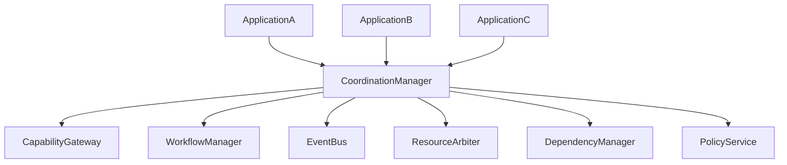

# RFC-0138

**Title:** Multi-Application Coordination Architecture

**Document ID:** RFC-0138

**Version:** 1.0

**Status:** Accepted

**Category:** Application Architecture

**Layer:** Applications / Coordination

**Target:**

```text
applications/coordination/
```

---

# Abstract

This RFC defines the SH-3 Multi-Application Coordination Architecture (MACA).

The Multi-Application Coordination Architecture specifies how multiple applications cooperate within the SH-3 AI Operating System while preserving deterministic execution, isolation, security, observability, and governance.

Applications SHALL coordinate through standardized contracts, events, workflows, and capability gateways rather than direct implementation-specific communication.

Every coordination operation SHALL be deterministic, observable, auditable, reproducible, version-aware, and policy-compliant.

This document is normative.

---

# Motivation

Modern AI systems consist of multiple independent applications that cooperate to achieve complex objectives.

Without a unified coordination architecture:

- applications become tightly coupled
- dependency management becomes inconsistent
- resource contention increases
- failures propagate unpredictably
- governance becomes fragmented

The Multi-Application Coordination Architecture establishes a standardized collaboration model across all SH-3 applications.

---

# Goals

The architecture SHALL provide:

- deterministic coordination
- application isolation
- shared capability access
- resource arbitration
- distributed orchestration
- dependency management
- fault isolation

---

# Non-Goals

The architecture SHALL NOT:

- replace Workflow execution
- replace Runtime scheduling
- replace Service implementations
- bypass Policy Service

---

# Architecture



---

# Design Principles

## Loose Coupling

Applications SHALL communicate only through standardized platform mechanisms.

---

## Deterministic Coordination

Equivalent coordination requests SHALL produce equivalent execution behavior.

---

## Resource Fairness

Shared resources SHALL be allocated through deterministic arbitration policies.

---

## Failure Isolation

Application failures SHALL remain isolated whenever possible.

---

## Observable Collaboration

Every coordination decision SHALL be externally observable.

---

# Components

| Component | Responsibility |
|-----------|----------------|
| CoordinationManager | Global coordination |
| DependencyManager | Application dependency graph |
| ResourceArbiter | Resource allocation |
| CapabilityGateway | Shared capability access |
| WorkflowManager | Cross-application workflows |
| EventCoordinator | Event routing |
| CoordinationRepository | Coordination history |

---

# Coordination Model

Every coordination SHALL define:

- coordination_id
- participating_applications
- workflow_id
- capabilities
- resources
- policies
- metadata

Coordination definitions SHALL remain immutable.

---

# Dependency Management

DependencyManager SHALL support:

- dependency graphs
- dependency validation
- startup ordering
- shutdown ordering
- version compatibility
- dependency visualization

Dependency graphs SHALL remain acyclic.

---

# Resource Arbitration

ResourceArbiter SHALL coordinate:

- CPU
- memory
- storage
- network
- accelerator devices
- shared capabilities

Allocation SHALL remain deterministic.

---

# Shared Capability Access

Applications SHALL access shared platform services through the Capability Gateway.

Direct inter-application service invocation SHALL NOT be permitted.

---

# Workflow Coordination

WorkflowManager SHALL support:

- cross-application workflows
- synchronized execution
- distributed checkpoints
- workflow dependencies
- coordinated rollback

Workflow coordination SHALL remain deterministic.

---

# Event Coordination

Applications SHALL communicate through:

- domain events
- workflow events
- lifecycle events
- platform events
- governance events

Events SHALL remain immutable.

---

# Fault Isolation

The coordination layer SHALL support:

- application isolation
- workflow isolation
- retry boundaries
- circuit breakers
- graceful degradation

Failures SHALL not propagate beyond defined coordination boundaries.

---

# Distributed Coordination

Distributed deployments SHALL support:

- cluster coordination
- leader election
- distributed locking
- consensus
- failover coordination
- coordination recovery

Cluster state SHALL converge deterministically.

---

# Governance Integration

Every coordination SHALL validate:

- governance policy
- capability permissions
- resource quotas
- security policy
- compliance requirements

Unauthorized coordination SHALL be rejected.

---

# Message Bus Integration

Coordination events include:

- CoordinationStarted
- DependencyValidated
- ResourceAllocated
- WorkflowCoordinated
- CapabilityGranted
- CoordinationCompleted
- CoordinationFailed
- CoordinationRecovered

Events SHALL remain immutable and versioned.

---

# Persistence Integration

Persistence SHALL maintain:

- coordination history
- dependency graphs
- allocation history
- workflow mappings
- resource usage
- recovery history

Historical coordination SHALL remain reproducible.

---

# Observability

Coordination telemetry SHALL expose:

- coordination latency
- active coordinations
- dependency resolution latency
- resource utilization
- coordination failures
- recovery success rate

---

# Distributed Tracing

Every coordination SHALL preserve:

- trace_id
- coordination_id
- workflow_id
- application_id
- resource_id
- node_id

Tracing SHALL reconstruct complete coordination workflows.

---

# Thread Model

The Coordination subsystem supports concurrent:

- dependency resolution
- resource arbitration
- workflow synchronization
- event routing
- telemetry collection

The reference implementation SHALL be:

- deterministic
- thread-safe
- horizontally scalable
- event-driven
- lock-efficient

---

# Metrics

The architecture exposes:

- coordination throughput
- dependency resolution rate
- resource allocation latency
- workflow synchronization latency
- coordination success rate
- recovery success rate
- coordination utilization

---

# Performance Objectives

The architecture should optimize for:

- deterministic collaboration
- scalable orchestration
- efficient resource allocation
- rapid dependency resolution
- resilient execution
- minimal coordination overhead

---

# Future Work

Potential future enhancements include:

- autonomous application federation
- adaptive coordination policies
- AI-assisted orchestration
- cross-region coordination
- decentralized coordination
- predictive resource arbitration

---

# References

- RFC-0137 Application Deployment Architecture
- RFC-0135 Event Integration Architecture
- RFC-0133 Capability Gateway Architecture
- RFC-0132 Workflow Architecture
- RFC-0124 Policy Service Architecture
- SH-3 Architecture Specification v2.1

---

# End of RFC-0138