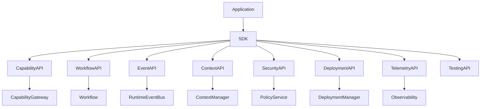

# RFC-0139

**Title:** Application SDK Architecture

**Document ID:** RFC-0139

**Version:** 1.0

**Status:** Accepted

**Category:** Application Architecture

**Layer:** Applications / SDK

**Target:**

```text
sdk/
```

---

# Abstract

This RFC defines the SH-3 Application SDK Architecture (ASDK).

The Application SDK provides the canonical programming interface for building applications on the SH-3 AI Operating System. It exposes stable, versioned APIs that allow applications to consume Runtime, Kernel, and Services capabilities without depending on internal implementation details.

The SDK standardizes application development by providing typed interfaces, workflow primitives, event integration, execution context propagation, security integration, deployment metadata, telemetry collection, and testing utilities.

Every SDK operation SHALL be deterministic, thread-safe, observable, auditable, policy-compliant, version-aware, and reproducible.

This document is normative.

---

# Motivation

Applications require a stable development interface independent of platform implementation.

Without a standardized SDK:

- applications directly depend on internal modules
- upgrades become difficult
- compatibility breaks frequently
- testing becomes inconsistent
- platform evolution slows

The SDK establishes a stable contract between application developers and the SH-3 platform.

---

# Goals

The architecture SHALL provide:

- stable APIs
- fully typed interfaces
- deterministic behavior
- workflow integration
- event integration
- context propagation
- testing support
- backward compatibility

---

# Non-Goals

The architecture SHALL NOT:

- expose internal Runtime implementation
- replace Capability Gateway
- bypass Policy Service
- replace deployment tooling

---

# Architecture



---

# Design Principles

## Stable Public API

Only documented SDK interfaces SHALL be public.

---

## Typed Contracts

All SDK interfaces SHALL use strongly typed definitions.

---

## Backward Compatibility

Compatible SDK releases SHALL preserve existing public APIs.

---

## Platform Independence

Applications SHALL remain independent from internal platform implementation.

---

## Deterministic Semantics

Equivalent API calls SHALL produce equivalent observable behavior.

---

# Components

| Component | Responsibility |
|-----------|----------------|
| CapabilityAPI | Platform capability access |
| WorkflowAPI | Workflow construction |
| EventAPI | Event publication and subscription |
| ContextAPI | Execution context |
| SecurityAPI | Authentication and authorization |
| DeploymentAPI | Deployment metadata |
| TelemetryAPI | Metrics and tracing |
| TestingAPI | Testing utilities |

---

# Capability API

CapabilityAPI SHALL provide access to:

- Planner
- Memory
- Policy
- Learning
- Optimizer
- Healing
- Reasoning
- Knowledge
- Runtime
- Kernel

Capability access SHALL occur exclusively through the Capability Gateway.

---

# Workflow API

WorkflowAPI SHALL support:

- workflow definition
- task declaration
- dependency graphs
- checkpoint creation
- compensation handlers
- execution monitoring

Workflow definitions SHALL remain immutable.

---

# Event API

EventAPI SHALL support:

- publish
- subscribe
- unsubscribe
- replay
- filtering
- event validation

Events SHALL conform to versioned event contracts.

---

# Context API

ContextAPI SHALL provide:

- context creation
- propagation
- serialization
- correlation
- deadline propagation
- namespace management

Execution contexts SHALL remain immutable.

---

# Security API

SecurityAPI SHALL support:

- identity acquisition
- authentication
- authorization
- capability permission verification
- secret retrieval
- policy evaluation

Security SHALL follow the Zero Trust model.

---

# Deployment API

DeploymentAPI SHALL expose:

- package metadata
- application version
- deployment status
- compatibility information
- rollout information

Deployment information SHALL remain version-aware.

---

# Telemetry API

TelemetryAPI SHALL support:

- metrics
- tracing
- structured logging
- health reporting
- custom instrumentation

Telemetry SHALL integrate with the platform observability subsystem.

---

# Testing API

TestingAPI SHALL support:

- mock capabilities
- simulated workflows
- event replay
- deterministic execution
- integration testing
- regression testing

Testing SHALL preserve deterministic execution semantics.

---

# SDK Versioning

SDK releases SHALL follow Semantic Versioning.

Every SDK SHALL define:

- sdk_version
- api_version
- compatibility_level
- supported_platform_versions
- deprecation_status

Version compatibility SHALL be explicitly documented.

---

# Distributed Applications

The SDK SHALL support:

- distributed workflows
- distributed tracing
- distributed events
- cluster-aware execution
- failover handling

Distributed execution SHALL remain transparent to applications.

---

# Governance Integration

Every SDK operation SHALL validate:

- governance policy
- security policy
- authorization policy
- compliance requirements
- operational constraints

Policy violations SHALL be surfaced through typed errors.

---

# Message Bus Integration

SDK events include:

- SDKInitialized
- CapabilityRequested
- WorkflowCreated
- EventPublished
- ContextPropagated
- AuthorizationEvaluated
- TelemetryCollected

Events SHALL remain immutable and versioned.

---

# Persistence Integration

Persistence SHALL maintain:

- SDK compatibility records
- supported versions
- testing artifacts
- telemetry metadata
- deployment metadata

Historical SDK information SHALL remain reproducible.

---

# Observability

SDK telemetry SHALL expose:

- API latency
- capability utilization
- workflow creation rate
- event throughput
- context propagation latency
- authorization latency

---

# Distributed Tracing

Every SDK operation SHALL preserve:

- trace_id
- span_id
- application_id
- sdk_version
- capability_id
- node_id

Tracing SHALL reconstruct complete SDK interactions.

---

# Thread Model

The SDK supports concurrent:

- capability requests
- workflow construction
- event publication
- context propagation
- telemetry collection

The reference implementation SHALL be:

- deterministic
- thread-safe
- fully typed
- event-driven
- lock-efficient

---

# Metrics

The architecture exposes:

- API throughput
- API latency
- SDK adoption rate
- compatibility success rate
- event throughput
- workflow creation rate
- telemetry overhead

---

# Performance Objectives

The architecture should optimize for:

- low API latency
- deterministic execution
- minimal abstraction overhead
- scalable application development
- efficient capability access
- long-term compatibility

---

# Future Work

Potential future enhancements include:

- multi-language SDK generation
- automatic API generation
- IDE integration
- static workflow validation
- AI-assisted SDK development
- remote SDK federation

---

# References

- RFC-0138 Multi-Application Coordination Architecture
- RFC-0137 Application Deployment Architecture
- RFC-0136 Application Security Architecture
- RFC-0135 Event Integration Architecture
- RFC-0134 Context Management Architecture
- RFC-0133 Capability Gateway Architecture
- RFC-0130 Application Layer Architecture
- SH-3 Architecture Specification v2.1

---

# End of RFC-0139