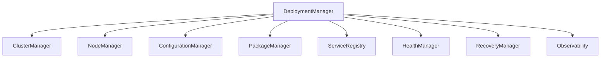

# RFC-0140

**Title:** Deployment Layer Architecture

**Document ID:** RFC-0140

**Version:** 1.0

**Status:** Accepted

**Category:** Deployment Architecture

**Layer:** Deployment

**Target:**

```text
deployment/
```

---

# Abstract

This RFC defines the SH-3 Deployment Layer Architecture (DLA).

The Deployment Layer is responsible for packaging, installation, cluster management, node orchestration, service deployment, runtime provisioning, configuration distribution, operational governance, and lifecycle coordination across deployment environments.

The Deployment Layer provides the operational foundation that transforms SH-3 from a software framework into a distributed AI Operating System.

Every deployment operation SHALL be deterministic, observable, auditable, version-aware, policy-compliant, reproducible, and fault tolerant.

This document is normative.

---

# Motivation

Modern AI systems operate across heterogeneous environments including local machines, edge devices, private clusters, cloud infrastructure, and hybrid deployments.

Without a dedicated deployment architecture:

- deployment procedures diverge
- operational governance weakens
- upgrades become inconsistent
- cluster management becomes fragmented
- platform reproducibility decreases

The Deployment Layer establishes a unified operational architecture for every SH-3 deployment.

---

# Goals

The architecture SHALL provide:

- deterministic deployment
- cluster orchestration
- node lifecycle management
- configuration distribution
- service discovery
- operational governance
- high availability
- disaster recovery

---

# Non-Goals

The architecture SHALL NOT:

- replace container runtimes
- replace operating systems
- replace infrastructure providers
- replace external orchestration platforms

---

# Architecture



---

# Design Principles

## Declarative Deployment

Infrastructure SHALL be described declaratively.

---

## Immutable Infrastructure

Running deployments SHOULD be replaced rather than modified whenever practical.

---

## Deterministic Provisioning

Equivalent deployment definitions SHALL produce equivalent environments.

---

## Autonomous Recovery

Recoverable failures SHOULD trigger automated remediation.

---

## Platform Independence

The deployment model SHALL remain independent from infrastructure providers.

---

# Components

| Component | Responsibility |
|-----------|----------------|
| DeploymentManager | Global deployment orchestration |
| ClusterManager | Cluster lifecycle |
| NodeManager | Node management |
| ConfigurationManager | Configuration distribution |
| PackageManager | Package installation |
| ServiceRegistry | Service discovery |
| HealthManager | Health monitoring |
| RecoveryManager | Failure recovery |

---

# Deployment Model

Every deployment SHALL define:

- deployment_id
- deployment_name
- deployment_version
- cluster
- nodes
- applications
- services
- policies
- metadata

Deployment definitions SHALL remain immutable.

---

# Cluster Model

Every cluster SHALL define:

- cluster_id
- cluster_name
- cluster_version
- nodes
- topology
- policies
- metadata

Clusters SHALL remain observable.

---

# Node Model

Every node SHALL define:

- node_id
- node_role
- runtime_version
- capabilities
- health_state
- resources
- metadata

Nodes SHALL be independently manageable.

---

# Configuration

Configuration SHALL support:

- global configuration
- cluster configuration
- node configuration
- application configuration
- secret references
- version history

Configuration SHALL be version-controlled.

---

# Service Discovery

The platform SHALL support:

- automatic registration
- capability discovery
- health-aware routing
- version-aware discovery
- namespace isolation

---

# Health Management

Health SHALL include:

- node health
- application health
- service health
- workflow health
- cluster health

Health information SHALL be continuously updated.

---

# Recovery

RecoveryManager SHALL support:

- node recovery
- application recovery
- workflow recovery
- cluster recovery
- deployment rollback

Recovery SHALL preserve deterministic system behavior.

---

# Governance Integration

Every deployment SHALL validate:

- governance policy
- security policy
- operational policy
- compliance policy
- deployment authorization

---

# Message Bus Integration

Deployment events include:

- ClusterCreated
- NodeRegistered
- DeploymentStarted
- DeploymentCompleted
- HealthChanged
- RecoveryStarted
- RecoveryCompleted
- DeploymentArchived

Events SHALL remain immutable and versioned.

---

# Persistence Integration

Persistence SHALL maintain:

- deployment history
- cluster topology
- node history
- configuration history
- recovery history
- operational metadata

Historical deployment information SHALL remain reproducible.

---

# Observability

Deployment telemetry SHALL expose:

- deployment duration
- node availability
- cluster utilization
- recovery latency
- service availability
- configuration drift

---

# Distributed Tracing

Every deployment SHALL preserve:

- trace_id
- deployment_id
- cluster_id
- node_id
- service_id

Tracing SHALL reconstruct complete deployment operations.

---

# Thread Model

The Deployment subsystem supports concurrent:

- deployments
- configuration updates
- node provisioning
- service discovery
- telemetry collection

The reference implementation SHALL be:

- deterministic
- thread-safe
- horizontally scalable
- event-driven
- lock-efficient

---

# Metrics

The architecture exposes:

- deployment throughput
- deployment success rate
- node uptime
- cluster availability
- recovery success rate
- service discovery latency

---

# Performance Objectives

The architecture should optimize for:

- rapid deployment
- deterministic provisioning
- high availability
- efficient recovery
- scalable operations
- minimal downtime

---

# Future Work

Potential future enhancements include:

- autonomous cluster optimization
- predictive failure detection
- global multi-region deployment
- edge orchestration
- self-balancing clusters
- autonomous infrastructure scaling

---

# References

- RFC-0139 Application SDK Architecture
- RFC-0137 Application Deployment Architecture
- RFC-0116 Kernel Lifecycle Management Architecture
- SH-3 Architecture Specification v2.1

---

# End of RFC-0140