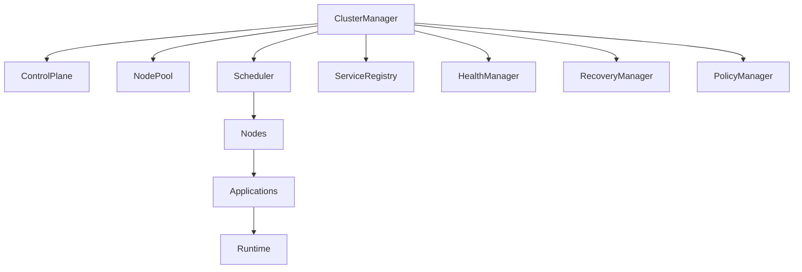

# RFC-0141

**Title:** Cluster Architecture

**Document ID:** RFC-0141

**Version:** 1.0

**Status:** Accepted

**Category:** Deployment Architecture

**Layer:** Deployment / Cluster

**Target:**

```text
deployment/cluster/
```

---

# Abstract

This RFC defines the SH-3 Cluster Architecture (CLA).

The Cluster Architecture specifies how multiple nodes form a unified execution environment within the SH-3 AI Operating System. A cluster provides distributed execution, workload coordination, resource sharing, high availability, service discovery, and operational governance.

Clusters SHALL present a logically unified platform while preserving deterministic execution, fault isolation, observability, security, and policy compliance.

Every cluster operation SHALL be deterministic, observable, auditable, reproducible, version-aware, and resilient.

This document is normative.

---

# Motivation

AI workloads increasingly require execution across multiple machines.

Without a standardized cluster architecture:

- resource utilization becomes inefficient
- workload scheduling is inconsistent
- node failures reduce availability
- governance differs between environments
- operational complexity increases

The Cluster Architecture establishes a common distributed execution model for every SH-3 deployment.

---

# Goals

The architecture SHALL provide:

- unified cluster abstraction
- deterministic scheduling
- distributed coordination
- high availability
- service discovery
- workload distribution
- fault tolerance

---

# Non-Goals

The architecture SHALL NOT:

- replace operating systems
- replace network infrastructure
- replace container runtimes
- replace external storage systems

---

# Architecture



---

# Design Principles

## Unified Cluster

Multiple physical nodes SHALL appear as a single logical execution environment.

---

## Deterministic Scheduling

Equivalent scheduling inputs SHALL produce equivalent scheduling decisions.

---

## High Availability

Cluster services SHALL tolerate recoverable node failures.

---

## Horizontal Scalability

Nodes MAY be added or removed without architectural changes.

---

## Policy Governance

Every cluster operation SHALL follow governance policies.

---

# Components

| Component | Responsibility |
|-----------|----------------|
| ClusterManager | Cluster lifecycle |
| ControlPlane | Cluster coordination |
| Scheduler | Workload placement |
| NodePool | Node management |
| ServiceRegistry | Service discovery |
| HealthManager | Cluster health |
| RecoveryManager | Failure recovery |
| PolicyManager | Governance |

---

# Cluster Model

Every cluster SHALL define:

- cluster_id
- cluster_name
- semantic_version
- topology
- control_plane
- node_pool
- namespace
- metadata

Cluster definitions SHALL remain immutable.

---

# Control Plane

The Control Plane SHALL coordinate:

- cluster state
- scheduling
- node registration
- policy enforcement
- workload assignment
- health aggregation

The Control Plane SHALL remain highly available.

---

# Node Membership

Each node SHALL define:

- node_id
- node_role
- runtime_version
- resource_capacity
- availability_zone
- health_status
- metadata

Membership changes SHALL generate lifecycle events.

---

# Scheduling

Scheduler SHALL support:

- deterministic placement
- affinity rules
- anti-affinity rules
- capability-aware scheduling
- resource-aware scheduling
- priority scheduling

Scheduling decisions SHALL remain reproducible.

---

# Service Discovery

Clusters SHALL support:

- automatic registration
- capability lookup
- namespace isolation
- health-aware routing
- version-aware routing

Discovery SHALL remain deterministic.

---

# Cluster Topology

Supported logical topologies include:

- single-node
- active-active
- active-standby
- edge cluster
- regional cluster
- hierarchical federation

Topology SHALL remain declarative.

---

# High Availability

High availability SHALL support:

- redundant control plane
- workload redistribution
- service failover
- health monitoring
- automatic recovery

Availability SHALL minimize service interruption.

---

# Resource Coordination

The cluster SHALL coordinate:

- CPU
- memory
- storage
- GPU/NPU/accelerators
- network bandwidth
- platform capabilities

Allocation SHALL follow deterministic policies.

---

# Governance Integration

Every cluster SHALL validate:

- governance policy
- deployment policy
- security policy
- compliance policy
- operational policy

Policy violations SHALL prevent cluster operations.

---

# Message Bus Integration

Cluster events include:

- ClusterCreated
- ClusterJoined
- ClusterUpdated
- NodeAdded
- NodeRemoved
- SchedulerUpdated
- ClusterRecovered
- ClusterArchived

Events SHALL remain immutable and versioned.

---

# Persistence Integration

Persistence SHALL maintain:

- cluster definitions
- topology history
- node membership
- scheduling history
- health history
- recovery history

Historical cluster state SHALL remain reproducible.

---

# Observability

Cluster telemetry SHALL expose:

- cluster availability
- node utilization
- scheduler latency
- workload distribution
- recovery latency
- control plane health

---

# Distributed Tracing

Every cluster operation SHALL preserve:

- trace_id
- cluster_id
- node_id
- scheduler_id
- workload_id
- control_plane_id

Tracing SHALL reconstruct complete cluster activity.

---

# Thread Model

The Cluster subsystem supports concurrent:

- node registration
- scheduling
- health monitoring
- workload migration
- telemetry collection

The reference implementation SHALL be:

- deterministic
- thread-safe
- horizontally scalable
- event-driven
- lock-efficient

---

# Metrics

The architecture exposes:

- cluster throughput
- scheduler throughput
- node availability
- workload placement latency
- cluster recovery rate
- control plane availability

---

# Performance Objectives

The architecture should optimize for:

- deterministic scheduling
- high availability
- low scheduling latency
- efficient resource utilization
- scalable cluster growth
- rapid failure recovery

---

# Future Work

Potential future enhancements include:

- autonomous scheduling
- predictive node balancing
- geo-distributed federation
- workload optimization using AI
- energy-aware scheduling
- self-organizing clusters

---

# References

- RFC-0140 Deployment Layer Architecture
- RFC-0138 Multi-Application Coordination Architecture
- RFC-0117 Kernel Service Registry Architecture
- RFC-0119 Governance Architecture
- SH-3 Architecture Specification v2.1

---

# End of RFC-0141