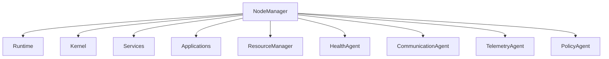

# RFC-0142

**Title:** Node Architecture

**Document ID:** RFC-0142

**Version:** 1.0

**Status:** Accepted

**Category:** Deployment Architecture

**Layer:** Deployment / Node

**Target:**

```text
deployment/node/
```

---

# Abstract

This RFC defines the SH-3 Node Architecture (NA).

The Node Architecture specifies the execution model, lifecycle, resource management, capability advertisement, communication, monitoring, and governance of every execution node participating in an SH-3 deployment.

A node represents the smallest independently manageable execution unit within a cluster. Each node hosts one Runtime instance, one Kernel instance, platform services, deployed applications, and supporting infrastructure components.

Every node SHALL operate deterministically, remain independently observable, participate in cluster coordination, and preserve platform security and governance.

This document is normative.

---

# Motivation

Clusters are composed of autonomous execution nodes.

Without a standardized node architecture:

- node behavior diverges
- scheduling becomes unpredictable
- resource accounting becomes inconsistent
- failure recovery becomes unreliable
- governance becomes fragmented

The Node Architecture establishes a uniform execution environment across every SH-3 deployment.

---

# Goals

The architecture SHALL provide:

- deterministic execution
- standardized node lifecycle
- resource accounting
- capability advertisement
- health reporting
- secure communication
- autonomous recovery

---

# Non-Goals

The architecture SHALL NOT:

- replace hardware management
- replace operating systems
- replace virtualization platforms
- replace external monitoring systems

---

# Architecture



---

# Design Principles

## Autonomous Operation

Each node SHALL remain operational independent of other nodes whenever possible.

---

## Deterministic Behavior

Equivalent workloads SHALL produce equivalent observable execution.

---

## Resource Isolation

Applications SHALL execute within controlled resource boundaries.

---

## Capability Advertisement

Every node SHALL publish its available capabilities.

---

## Continuous Observation

Node state SHALL remain continuously observable.

---

# Components

| Component | Responsibility |
|-----------|----------------|
| NodeManager | Node lifecycle |
| ResourceManager | Resource accounting |
| HealthAgent | Health monitoring |
| CommunicationAgent | Cluster communication |
| TelemetryAgent | Metrics and tracing |
| PolicyAgent | Governance enforcement |
| Runtime | Execution engine |
| Kernel | Platform coordination |

---

# Node Model

Every node SHALL define:

- node_id
- node_name
- semantic_version
- cluster_id
- runtime_version
- kernel_version
- capabilities
- resources
- health_state
- metadata

Node identity SHALL remain globally unique.

---

# Node Lifecycle

Every node SHALL follow:

```text
Provisioned

↓

Bootstrapped

↓

Registered

↓

Validated

↓

Ready

↓

Active

↓

Maintenance

↓

Draining

↓

Stopped

↓

Retired
```

Lifecycle transitions SHALL emit immutable events.

---

# Resource Model

Each node SHALL manage:

- CPU
- memory
- storage
- network bandwidth
- GPU
- NPU
- accelerator devices

Resource accounting SHALL remain deterministic.

---

# Capability Advertisement

Nodes SHALL advertise:

- Runtime capabilities
- Kernel capabilities
- available Services
- installed Applications
- hardware accelerators
- supported API versions

Capability advertisements SHALL be version-aware.

---

# Communication

CommunicationAgent SHALL support:

- node registration
- heartbeat
- capability exchange
- health propagation
- workload coordination
- cluster synchronization

Communication SHALL preserve execution context and tracing metadata.

---

# Health Monitoring

Each node SHALL continuously report:

- runtime health
- kernel health
- service health
- application health
- resource utilization
- connectivity
- storage availability

Health state SHALL be propagated to the Cluster Manager.

---

# Failure Detection

Failures SHALL include:

- node unavailable
- heartbeat timeout
- resource exhaustion
- policy violation
- communication failure
- runtime failure
- kernel failure

Recoverable failures SHALL trigger automated recovery.

---

# Security

Every node SHALL enforce:

- authenticated communication
- mutual trust
- encrypted transport
- capability authorization
- policy validation
- workload isolation

Security SHALL follow the Zero Trust model.

---

# Governance Integration

Every node SHALL validate:

- governance policy
- deployment policy
- security policy
- resource policy
- operational policy

Policy violations SHALL prevent node participation.

---

# Message Bus Integration

Node events include:

- NodeProvisioned
- NodeBootstrapped
- NodeRegistered
- NodeValidated
- NodeReady
- NodeActivated
- NodeDraining
- NodeRecovered
- NodeRetired

Events SHALL remain immutable and versioned.

---

# Persistence Integration

Persistence SHALL maintain:

- node inventory
- lifecycle history
- capability history
- health history
- resource history
- recovery history

Historical node information SHALL remain reproducible.

---

# Observability

Node telemetry SHALL expose:

- CPU utilization
- memory utilization
- storage utilization
- network throughput
- heartbeat latency
- workload count
- health status

---

# Distributed Tracing

Every node operation SHALL preserve:

- trace_id
- node_id
- cluster_id
- workload_id
- runtime_id
- kernel_id

Tracing SHALL reconstruct complete node execution.

---

# Thread Model

The Node subsystem supports concurrent:

- workload execution
- resource accounting
- heartbeat processing
- telemetry collection
- health monitoring

The reference implementation SHALL be:

- deterministic
- thread-safe
- horizontally scalable
- event-driven
- lock-efficient

---

# Metrics

The architecture exposes:

- node availability
- workload density
- heartbeat latency
- resource utilization
- node recovery rate
- capability utilization

---

# Performance Objectives

The architecture should optimize for:

- deterministic execution
- efficient resource utilization
- rapid node recovery
- low communication latency
- scalable workload execution
- high node availability

---

# Future Work

Potential future enhancements include:

- autonomous node optimization
- predictive hardware failure detection
- AI-assisted workload balancing
- energy-aware scheduling
- heterogeneous accelerator orchestration
- self-healing node federation

---

# References

- RFC-0141 Cluster Architecture
- RFC-0140 Deployment Layer Architecture
- RFC-0136 Application Security Architecture
- RFC-0116 Kernel Lifecycle Management Architecture
- RFC-0103 Runtime Execution Architecture
- SH-3 Architecture Specification v2.1

---

# End of RFC-0142