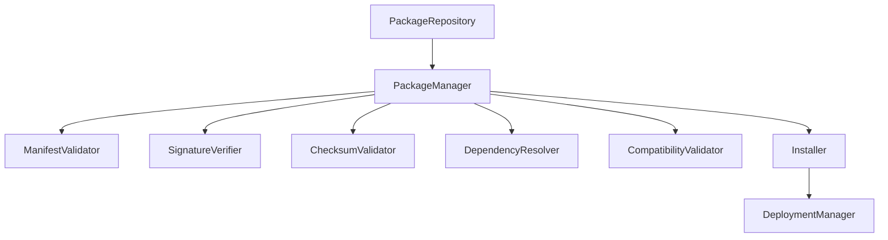

# RFC-0143

**Title:** Package Architecture

**Document ID:** RFC-0143

**Version:** 1.0

**Status:** Accepted

**Category:** Deployment Architecture

**Layer:** Deployment / Package

**Target:**

```text
deployment/package/
```

---

# Abstract

This RFC defines the SH-3 Package Architecture (PA).

The Package Architecture specifies the canonical package format used to distribute applications, services, plugins, models, policies, workflows, and platform components throughout the SH-3 AI Operating System.

Every package SHALL be immutable, cryptographically verifiable, version-aware, deterministic, policy-compliant, observable, auditable, and reproducible.

Packages SHALL provide all metadata required for dependency validation, compatibility analysis, deployment planning, integrity verification, lifecycle management, and rollback.

This document is normative.

---

# Motivation

A unified deployment package format is essential for deterministic platform operation.

Without a standardized package architecture:

- package formats diverge
- dependency resolution becomes unreliable
- integrity verification becomes inconsistent
- rollback becomes unsafe
- deployment reproducibility decreases

The Package Architecture establishes a common package specification for every deployable artifact within SH-3.

---

# Goals

The architecture SHALL provide:

- immutable packages
- deterministic installation
- dependency management
- cryptographic verification
- semantic versioning
- compatibility validation
- reproducible deployment

---

# Non-Goals

The architecture SHALL NOT:

- replace artifact repositories
- replace container images
- replace operating system packages
- replace CI/CD pipelines

---

# Architecture



---

# Design Principles

## Immutable Artifacts

Published packages SHALL never be modified.

---

## Deterministic Installation

Equivalent package inputs SHALL produce identical installations.

---

## Explicit Dependencies

All package dependencies SHALL be explicitly declared.

---

## Verified Authenticity

Every package SHALL be cryptographically verified before installation.

---

## Stable Contracts

Package manifests SHALL remain version-aware and backward compatible.

---

# Components

| Component | Responsibility |
|-----------|----------------|
| PackageManager | Package orchestration |
| ManifestValidator | Manifest validation |
| SignatureVerifier | Signature verification |
| ChecksumValidator | Integrity validation |
| DependencyResolver | Dependency analysis |
| CompatibilityValidator | Compatibility verification |
| Installer | Installation |
| PackageRepository | Package storage |

---

# Package Model

Every package SHALL define:

- package_id
- package_name
- package_type
- semantic_version
- publisher
- creation_timestamp
- manifest
- signature
- checksum
- metadata

Package identity SHALL remain globally unique.

---

# Package Types

Supported package types include:

- application
- service
- plugin
- workflow
- policy
- model
- runtime extension
- kernel extension
- deployment bundle

Future package types SHALL remain backward compatible.

---

# Manifest

Every manifest SHALL define:

- package metadata
- semantic version
- dependencies
- compatibility matrix
- required capabilities
- configuration schema
- permissions
- lifecycle hooks
- rollback policy

Manifest schemas SHALL be versioned.

---

# Dependency Management

Dependencies SHALL specify:

- package identifier
- semantic version constraints
- dependency type
- optionality
- compatibility policy

Dependency graphs SHALL remain acyclic.

---

# Compatibility Validation

Compatibility SHALL evaluate:

- Runtime version
- Kernel version
- Service compatibility
- API compatibility
- SDK compatibility
- architecture compatibility
- deployment policy

Unsupported packages SHALL be rejected.

---

# Integrity Verification

Integrity SHALL include:

- digital signature verification
- checksum validation
- publisher verification
- manifest integrity
- metadata validation

Verification SHALL precede installation.

---

# Installation Lifecycle

Every package SHALL follow:

```text
Created

↓

Published

↓

Downloaded

↓

Verified

↓

Validated

↓

Installed

↓

Activated

↓

Observed

↓

Archived

or

Rolled Back
```

Each lifecycle transition SHALL emit immutable events.

---

# Distribution

The platform SHALL support:

- local repositories
- cluster repositories
- mirrored repositories
- offline repositories
- remote repositories

Distribution SHALL preserve package integrity.

---

# Rollback

Rollback SHALL restore:

- previous package version
- configuration
- dependencies
- capability bindings
- metadata

Rollback SHALL remain deterministic.

---

# Governance Integration

Every package SHALL validate:

- governance policy
- security policy
- deployment policy
- compliance policy
- publisher trust policy

Policy violations SHALL reject installation.

---

# Message Bus Integration

Package events include:

- PackageCreated
- PackagePublished
- PackageDownloaded
- PackageVerified
- PackageValidated
- PackageInstalled
- PackageActivated
- PackageRolledBack
- PackageArchived

Events SHALL remain immutable and versioned.

---

# Persistence Integration

Persistence SHALL maintain:

- package catalog
- manifest history
- dependency graph
- installation history
- rollback history
- compatibility reports

Historical package information SHALL remain reproducible.

---

# Observability

Package telemetry SHALL expose:

- package downloads
- verification latency
- installation latency
- rollback latency
- dependency failures
- compatibility failures

---

# Distributed Tracing

Every package operation SHALL preserve:

- trace_id
- package_id
- deployment_id
- installation_id
- repository_id
- node_id

Tracing SHALL reconstruct complete package operations.

---

# Thread Model

The Package subsystem supports concurrent:

- downloads
- verification
- dependency analysis
- installation
- telemetry collection

The reference implementation SHALL be:

- deterministic
- thread-safe
- horizontally scalable
- event-driven
- lock-efficient

---

# Metrics

The architecture exposes:

- installation throughput
- verification success rate
- dependency resolution latency
- compatibility success rate
- rollback success rate
- package distribution latency

---

# Performance Objectives

The architecture should optimize for:

- deterministic installation
- efficient dependency resolution
- low verification latency
- scalable distribution
- reliable rollback
- reproducible deployments

---

# Future Work

Potential future enhancements include:

- delta packages
- content-addressable storage
- peer-to-peer distribution
- package federation
- AI-assisted compatibility analysis
- automatic dependency optimization

---

# References

- RFC-0142 Node Architecture
- RFC-0140 Deployment Layer Architecture
- RFC-0137 Application Deployment Architecture
- RFC-0119 Governance Architecture
- SH-3 Architecture Specification v2.1

---

# End of RFC-0143