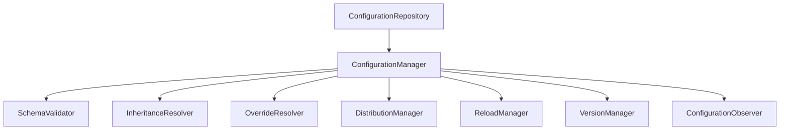

# RFC-0144

**Title:** Configuration Architecture

**Document ID:** RFC-0144

**Version:** 1.0

**Status:** Accepted

**Category:** Deployment Architecture

**Layer:** Deployment / Configuration

**Target:**

```text
deployment/configuration/
```

---

# Abstract

This RFC defines the SH-3 Configuration Architecture (CA).

The Configuration Architecture establishes the canonical model for defining, validating, distributing, versioning, and applying configuration throughout the SH-3 AI Operating System.

Configuration governs platform behavior across Runtime, Kernel, Services, Applications, and Deployment components while preserving deterministic execution, policy compliance, observability, reproducibility, and operational consistency.

Every configuration SHALL be immutable once published, version-aware, schema-validated, auditable, reproducible, and cryptographically verifiable.

This document is normative.

---

# Motivation

Configuration is a fundamental platform artifact.

Without a unified configuration architecture:

- configuration formats diverge
- environment drift increases
- deployments become inconsistent
- validation becomes unreliable
- rollback becomes difficult

The Configuration Architecture establishes a single source of truth for all operational configuration.

---

# Goals

The architecture SHALL provide:

- immutable configuration
- schema validation
- hierarchical inheritance
- deterministic overrides
- configuration distribution
- version management
- hot reload support
- rollback capability

---

# Non-Goals

The architecture SHALL NOT:

- replace secret management
- replace deployment packages
- replace policy definitions
- replace application state

---

# Architecture



---

# Design Principles

## Immutable Configuration

Published configuration SHALL never be modified.

Configuration changes SHALL create new immutable versions.

---

## Schema First

Every configuration SHALL conform to a versioned schema.

---

## Deterministic Resolution

Equivalent configuration inputs SHALL produce equivalent effective configurations.

---

## Explicit Overrides

Override precedence SHALL be deterministic and fully documented.

---

## Observable Changes

Every configuration update SHALL emit immutable lifecycle events.

---

# Components

| Component | Responsibility |
|-----------|----------------|
| ConfigurationManager | Configuration orchestration |
| ConfigurationRepository | Persistent storage |
| SchemaValidator | Schema validation |
| InheritanceResolver | Hierarchical inheritance |
| OverrideResolver | Effective configuration |
| DistributionManager | Distribution |
| ReloadManager | Runtime reload |
| VersionManager | Version control |

---

# Configuration Model

Every configuration SHALL define:

- configuration_id
- configuration_name
- semantic_version
- schema_version
- scope
- namespace
- inheritance
- overrides
- checksum
- metadata

Configuration SHALL remain immutable.

---

# Configuration Hierarchy

Supported scopes include:

- platform
- cluster
- node
- runtime
- kernel
- service
- application
- workflow
- task

Configuration SHALL inherit from parent scopes unless explicitly overridden.

---

# Override Order

Configuration SHALL be resolved using the following precedence:

```text
Task
↓

Workflow
↓

Application
↓

Service
↓

Kernel
↓

Runtime
↓

Node
↓

Cluster
↓

Platform
```

Higher scopes SHALL override lower scopes only through explicit definitions.

---

# Schema Validation

Every configuration SHALL validate:

- field types
- required fields
- value constraints
- dependency constraints
- compatibility rules
- semantic version

Invalid configuration SHALL be rejected.

---

# Distribution

Configuration SHALL support:

- cluster-wide distribution
- namespace distribution
- application-specific distribution
- incremental updates
- atomic synchronization

Distribution SHALL preserve version consistency.

---

# Hot Reload

ReloadManager SHALL support:

- runtime reload
- service reload
- application reload
- workflow reload
- selective reload

Reload SHALL preserve deterministic execution whenever possible.

---

# Version Management

VersionManager SHALL maintain:

- semantic versions
- change history
- compatibility history
- migration metadata
- rollback information

Historical versions SHALL remain accessible.

---

# Rollback

Rollback SHALL restore:

- previous configuration
- inherited configuration
- override state
- validation metadata
- distribution metadata

Rollback SHALL be deterministic.

---

# Governance Integration

Every configuration SHALL validate:

- governance policy
- security policy
- deployment policy
- compliance policy
- namespace policy

Policy violations SHALL prevent activation.

---

# Message Bus Integration

Configuration events include:

- ConfigurationCreated
- ConfigurationValidated
- ConfigurationPublished
- ConfigurationDistributed
- ConfigurationReloaded
- ConfigurationRolledBack
- ConfigurationArchived

Events SHALL remain immutable and versioned.

---

# Persistence Integration

Persistence SHALL maintain:

- configuration history
- schema versions
- inheritance graphs
- override history
- reload history
- rollback history

Historical configuration SHALL remain reproducible.

---

# Observability

Configuration telemetry SHALL expose:

- validation latency
- distribution latency
- reload latency
- active versions
- configuration drift
- rollback count

---

# Distributed Tracing

Every configuration operation SHALL preserve:

- trace_id
- configuration_id
- version_id
- namespace_id
- deployment_id
- node_id

Tracing SHALL reconstruct complete configuration workflows.

---

# Thread Model

The Configuration subsystem supports concurrent:

- validation
- distribution
- reload
- rollback
- telemetry collection

The reference implementation SHALL be:

- deterministic
- thread-safe
- horizontally scalable
- event-driven
- lock-efficient

---

# Metrics

The architecture exposes:

- configuration publication rate
- validation success rate
- distribution latency
- reload success rate
- rollback success rate
- configuration drift rate

---

# Performance Objectives

The architecture should optimize for:

- deterministic configuration resolution
- low validation latency
- efficient distribution
- safe hot reload
- rapid rollback
- scalable configuration management

---

# Future Work

Potential future enhancements include:

- declarative configuration composition
- distributed configuration federation
- adaptive configuration optimization
- AI-assisted validation
- configuration impact analysis
- policy-aware automatic migration

---

# References

- RFC-0143 Package Architecture
- RFC-0142 Node Architecture
- RFC-0140 Deployment Layer Architecture
- RFC-0119 Governance Architecture
- SH-3 Architecture Specification v2.1

---

# End of RFC-0144