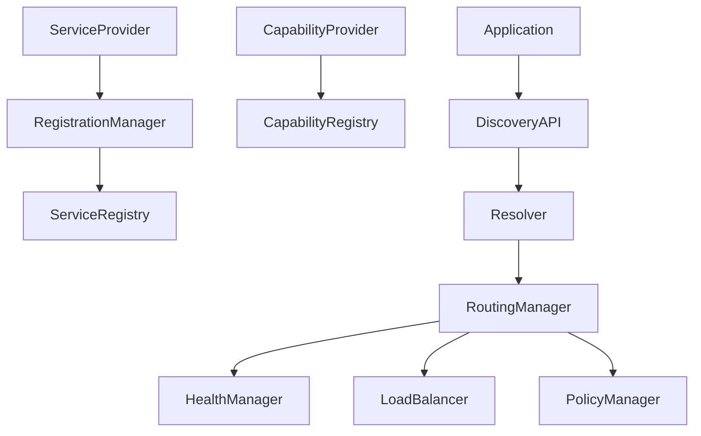

# RFC-0145

**Title:** Service Discovery Architecture

**Document ID:** RFC-0145

**Version:** 1.0

**Status:** Accepted

**Category:** Deployment Architecture

**Layer:** Deployment / Service Discovery

**Target:**

```text
deployment/discovery/
```

---

# Abstract

This RFC defines the SH-3 Service Discovery Architecture (SDA).

The Service Discovery Architecture establishes the canonical mechanism for registering, discovering, resolving, monitoring, and routing platform services across the SH-3 AI Operating System.

Every Runtime, Kernel component, Service, Application, Capability Provider, and Deployment component SHALL participate in a unified discovery system supporting deterministic lookup, namespace isolation, version awareness, health-aware routing, and governance enforcement.

All discovery operations SHALL be deterministic, observable, auditable, reproducible, version-aware, policy-compliant, and horizontally scalable.

This document is normative.

---

# Motivation

Distributed systems require reliable service discovery.

Without a unified discovery architecture:

- service locations become inconsistent
- capability lookup becomes unreliable
- routing becomes fragmented
- scaling becomes difficult
- operational governance weakens

The Service Discovery Architecture provides a single logical discovery mechanism for every deployable component within SH-3.

---

# Goals

The architecture SHALL provide:

- deterministic service lookup
- automatic registration
- automatic deregistration
- namespace isolation
- health-aware routing
- version-aware discovery
- capability discovery
- distributed scalability

---

# Non-Goals

The architecture SHALL NOT:

- replace network transport
- replace service implementation
- replace workflow orchestration
- replace policy evaluation

---

# Architecture



---

# Design Principles

## Automatic Registration

Services SHALL automatically register upon activation.

---

## Automatic Deregistration

Unavailable services SHALL be removed automatically.

---

## Deterministic Resolution

Equivalent discovery requests SHALL produce equivalent results.

---

## Health-Aware Routing

Only healthy service instances SHALL receive requests.

---

## Namespace Isolation

Service visibility SHALL respect namespace boundaries.

---

# Components

| Component | Responsibility |
|-----------|----------------|
| ServiceRegistry | Service catalog |
| CapabilityRegistry | Capability catalog |
| RegistrationManager | Registration lifecycle |
| Resolver | Service resolution |
| RoutingManager | Request routing |
| HealthManager | Health synchronization |
| LoadBalancer | Instance selection |
| DiscoveryAPI | Public interface |

---

# Service Model

Every registered service SHALL define:

- service_id
- service_name
- service_type
- semantic_version
- namespace
- endpoint
- protocol
- health_state
- capabilities
- metadata

Service identifiers SHALL remain globally unique.

---

# Capability Discovery

Capability discovery SHALL support:

- Runtime capabilities
- Kernel capabilities
- platform services
- application capabilities
- workflow capabilities
- extension capabilities

Capability metadata SHALL remain version-aware.

---

# Registration Lifecycle

Every service SHALL follow:

```text
Created

↓

Registered

↓

Validated

↓

Activated

↓

Healthy

↓

Serving

↓

Draining

↓

Deregistered

↓

Archived
```

Lifecycle transitions SHALL emit immutable events.

---

# Resolution

Resolver SHALL support:

- exact lookup
- namespace lookup
- version-aware lookup
- capability lookup
- label lookup
- policy-aware lookup

Resolution SHALL remain deterministic.

---

# Routing

RoutingManager SHALL support:

- direct routing
- health-aware routing
- weighted routing
- version routing
- namespace routing
- locality-aware routing

Routing policies SHALL be deterministic.

---

# Load Balancing

LoadBalancer SHALL support:

- round robin
- weighted round robin
- least loaded
- capability-aware
- locality-aware
- deterministic hashing

Selection policies SHALL be configurable.

---

# Health Synchronization

HealthManager SHALL synchronize:

- Runtime health
- Kernel health
- Service health
- Application health
- Node health
- Cluster health

Unhealthy services SHALL be excluded from routing.

---

# Namespace Isolation

Namespaces SHALL isolate:

- service visibility
- capability visibility
- discovery queries
- routing policies
- authorization boundaries

Cross-namespace discovery SHALL require explicit authorization.

---

# Distributed Discovery

Distributed deployments SHALL support:

- replicated registries
- cluster-wide discovery
- multi-region discovery
- federation
- eventual consistency
- partition recovery

Registry convergence SHALL preserve deterministic behavior.

---

# Governance Integration

Every discovery operation SHALL validate:

- governance policy
- authorization policy
- namespace policy
- security policy
- compliance policy

Unauthorized discovery SHALL be rejected.

---

# Message Bus Integration

Discovery events include:

- ServiceRegistered
- ServiceValidated
- ServiceActivated
- ServiceDiscovered
- ServiceUpdated
- ServiceDraining
- ServiceDeregistered
- RegistrySynchronized

Events SHALL remain immutable and versioned.

---

# Persistence Integration

Persistence SHALL maintain:

- service catalog
- capability catalog
- registration history
- routing history
- health history
- namespace mappings

Historical discovery information SHALL remain reproducible.

---

# Observability

Discovery telemetry SHALL expose:

- registration latency
- discovery latency
- routing latency
- registry size
- health synchronization latency
- lookup throughput

---

# Distributed Tracing

Every discovery operation SHALL preserve:

- trace_id
- service_id
- capability_id
- registry_id
- namespace_id
- node_id

Tracing SHALL reconstruct complete discovery workflows.

---

# Thread Model

The Service Discovery subsystem supports concurrent:

- registration
- deregistration
- lookup
- routing
- telemetry collection

The reference implementation SHALL be:

- deterministic
- thread-safe
- horizontally scalable
- event-driven
- lock-efficient

---

# Metrics

The architecture exposes:

- registration throughput
- lookup throughput
- routing latency
- registry utilization
- discovery success rate
- health synchronization latency

---

# Performance Objectives

The architecture should optimize for:

- low discovery latency
- deterministic resolution
- efficient routing
- scalable registry replication
- rapid health propagation
- minimal routing overhead

---

# Future Work

Potential future enhancements include:

- adaptive service routing
- AI-assisted traffic optimization
- decentralized service registry
- predictive service placement
- global service federation
- topology-aware routing

---

# References

- RFC-0144 Configuration Architecture
- RFC-0143 Package Architecture
- RFC-0142 Node Architecture
- RFC-0141 Cluster Architecture
- RFC-0117 Kernel Service Registry Architecture
- RFC-0119 Governance Architecture
- SH-3 Architecture Specification v2.1

---

# End of RFC-0145