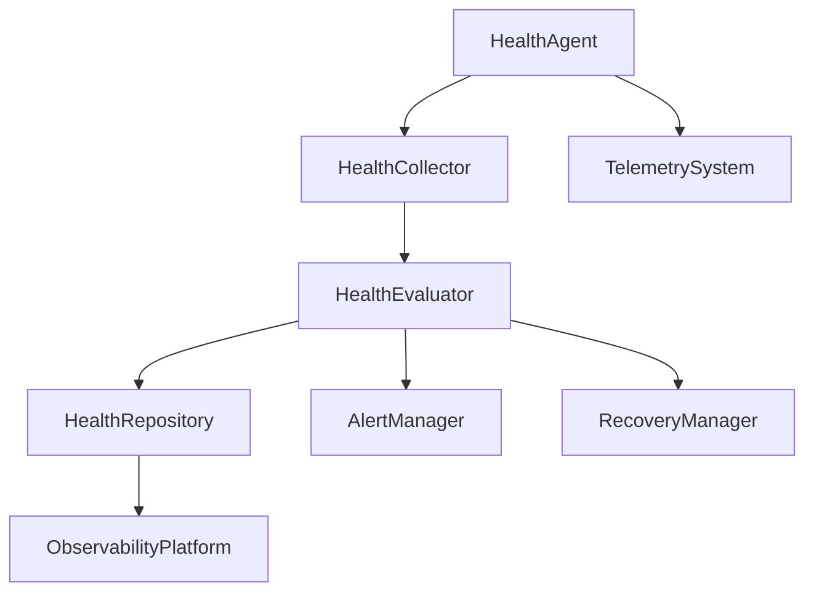

# RFC-0146

**Title:** Health Monitoring Architecture

**Document ID:** RFC-0146

**Version:** 1.0

**Status:** Accepted

**Category:** Deployment Architecture

**Layer:** Deployment / Health Monitoring

**Target:**

```text
deployment/health/
```

---

# Abstract

This RFC defines the SH-3 Health Monitoring Architecture (HMA).

The Health Monitoring Architecture establishes the unified mechanism for observing, evaluating, reporting, and managing the operational health state of every SH-3 component including Nodes, Runtime, Kernel, Services, Applications, Clusters, and Deployment components.

Health monitoring provides continuous visibility into system availability, performance, reliability, and operational correctness.

Every health operation SHALL be deterministic, observable, auditable, version-aware, policy-compliant, and reproducible.

This document is normative.

---

# Motivation

A distributed AI Operating System requires continuous health awareness.

Without a unified health monitoring architecture:

- failures remain undetected
- recovery becomes delayed
- operational state becomes unclear
- service availability decreases
- troubleshooting becomes difficult

The Health Monitoring Architecture provides a consistent health model across all SH-3 layers.

---

# Goals

The architecture SHALL provide:

- unified health model
- continuous monitoring
- health evaluation
- anomaly detection
- failure reporting
- SLA/SLO measurement
- recovery integration

---

# Non-Goals

The architecture SHALL NOT:

- replace application logging
- replace metrics systems
- replace tracing systems
- directly perform recovery actions

Recovery responsibility belongs to RFC-0147 Recovery Architecture.

---

# Architecture



---

# Design Principles

## Continuous Observation

Every critical component SHALL expose health information continuously.

---

## Unified Health Model

All SH-3 components SHALL use a common health representation.

---

## Deterministic Evaluation

Equivalent health inputs SHALL produce equivalent health decisions.

---

## Early Detection

The system SHOULD detect failures before user-visible impact.

---

## Recovery Integration

Health changes SHALL automatically notify recovery systems.

---

# Components

| Component | Responsibility |
|---|---|
| HealthAgent | Local health collection |
| HealthCollector | Health aggregation |
| HealthEvaluator | Health analysis |
| HealthRepository | Historical storage |
| AlertManager | Alert generation |
| HealthAPI | Health queries |
| RecoveryConnector | Recovery integration |

---

# Health Model

Every component SHALL expose:

- component_id
- component_type
- health_state
- status_reason
- timestamp
- metrics
- dependencies
- version
- metadata

---

# Health States

Supported states:

```text
UNKNOWN

INITIALIZING

HEALTHY

DEGRADED

WARNING

UNHEALTHY

FAILED

RECOVERING

MAINTENANCE

OFFLINE
```

State transitions SHALL be observable.

---

# Health Levels

Health SHALL be evaluated at:

```text
Platform

↓

Cluster

↓

Node

↓

Runtime

↓

Kernel

↓

Service

↓

Application

↓

Workflow

↓

Task
```

Each level SHALL aggregate child health states.

---

# Health Checks

Supported health checks include:

- availability check
- heartbeat check
- dependency check
- resource check
- latency check
- capacity check
- policy compliance check
- integrity check

---

# Health Evaluation

HealthEvaluator SHALL consider:

- current metrics
- historical trends
- dependency states
- resource availability
- error rates
- policy status

Evaluation results SHALL be deterministic.

---

# Anomaly Detection

The architecture SHALL support:

- threshold detection
- trend detection
- statistical analysis
- rule-based detection
- policy-based detection

Detected anomalies SHALL generate events.

---

# SLA / SLO Monitoring

The system SHALL measure:

- availability
- latency
- reliability
- recovery time
- error rate
- throughput

SLA/SLO definitions SHALL remain versioned.

---

# Alert Management

AlertManager SHALL support:

- alert creation
- alert suppression
- alert escalation
- alert correlation
- alert resolution

Alerts SHALL include:

- alert_id
- severity
- source
- timestamp
- reason
- related events

---

# Dependency Health

Health evaluation SHALL consider dependency chains.

Example:

```text
Application

depends on

Service

depends on

Runtime

depends on

Node
```

Parent health SHALL reflect dependency failures.

---

# Distributed Health

Distributed environments SHALL support:

- health aggregation
- cross-node monitoring
- regional monitoring
- health replication
- partition handling

Health state SHALL converge across clusters.

---

# Governance Integration

Every health operation SHALL validate:

- security policy
- operational policy
- compliance policy
- monitoring policy

Unauthorized health access SHALL be rejected.

---

# Message Bus Integration

Health events include:

- HealthCheckStarted
- HealthCheckCompleted
- HealthStateChanged
- AnomalyDetected
- AlertCreated
- AlertResolved
- HealthRecovered

Events SHALL remain immutable and versioned.

---

# Persistence Integration

Persistence SHALL maintain:

- health history
- metric snapshots
- alert history
- SLA/SLO records
- anomaly history
- recovery correlation

Historical health state SHALL remain reproducible.

---

# Observability Integration

Health Monitoring SHALL integrate with:

- Metrics
- Logging
- Distributed Tracing
- Event Bus
- Dashboard Systems

All health information SHALL be correlated.

---

# Distributed Tracing

Every health operation SHALL preserve:

- trace_id
- component_id
- health_check_id
- alert_id
- node_id
- cluster_id

Tracing SHALL reconstruct health evaluation flows.

---

# Thread Model

The Health subsystem supports concurrent:

- health collection
- evaluation
- alert generation
- history storage
- telemetry export

The reference implementation SHALL be:

- deterministic
- thread-safe
- horizontally scalable
- event-driven
- lock-efficient

---

# Metrics

The architecture exposes:

- health check frequency
- health evaluation latency
- alert count
- anomaly detection rate
- recovery detection time
- availability percentage

---

# Performance Objectives

The architecture should optimize for:

- low monitoring overhead
- rapid failure detection
- accurate health evaluation
- scalable observation
- reliable alerting
- minimal false positives

---

# Future Work

Potential future enhancements include:

- AI-based anomaly prediction
- autonomous health optimization
- predictive failure analysis
- self-learning health models
- cross-cluster health federation

---

# References

- RFC-0145 Service Discovery Architecture
- RFC-0142 Node Architecture
- RFC-0141 Cluster Architecture
- RFC-0147 Recovery Architecture
- RFC-0118 Observability Architecture
- SH-3 Architecture Specification v2.1

---

# End of RFC-0146