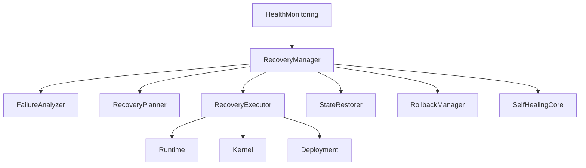

# RFC-0147

**Title:** Recovery Architecture

**Document ID:** RFC-0147

**Version:** 1.0

**Status:** Accepted

**Category:** Deployment Architecture

**Layer:** Deployment / Recovery

**Target:**

```text
deployment/recovery/
```

---

# Abstract

This RFC defines the SH-3 Recovery Architecture (RA).

The Recovery Architecture establishes the unified recovery framework responsible for detecting failures, analyzing recovery requirements, restoring operational state, executing remediation actions, and returning SH-3 components to a healthy operational condition.

The Recovery Architecture integrates with Health Monitoring, SelfHealing, Runtime, Kernel, Persistence, and Deployment subsystems to provide autonomous fault recovery.

Every recovery operation SHALL be deterministic, observable, auditable, policy-compliant, version-aware, and reproducible.

This document is normative.

---

# Motivation

Distributed AI Operating Systems require autonomous recovery capabilities.

Without a unified recovery architecture:

- failures require manual intervention
- service availability decreases
- operational recovery becomes inconsistent
- system state corruption risk increases
- fault propagation becomes difficult to control

The Recovery Architecture provides a controlled self-repair mechanism across all SH-3 layers.

---

# Goals

The architecture SHALL provide:

- automatic failure recovery
- deterministic remediation
- state restoration
- rollback support
- failover handling
- checkpoint recovery
- recovery auditing

---

# Non-Goals

The architecture SHALL NOT:

- replace Health Monitoring
- replace Backup systems
- bypass Security policies
- modify system state without authorization

---

# Architecture



---

# Design Principles

## Autonomous Recovery

Recoverable failures SHOULD be repaired automatically.

---

## Deterministic Recovery

Equivalent failures SHALL produce equivalent recovery actions.

---

## Minimal Intervention

Recovery SHALL modify only required system components.

---

## State Preservation

Recovery SHALL preserve valid system state.

---

## Complete Observability

Every recovery action SHALL be traceable.

---

# Components

| Component | Responsibility |
|---|---|
| RecoveryManager | Recovery orchestration |
| FailureAnalyzer | Failure analysis |
| RecoveryPlanner | Recovery planning |
| RecoveryExecutor | Recovery execution |
| StateRestorer | State restoration |
| RollbackManager | Rollback handling |
| RecoveryRepository | Recovery history |
| SelfHealingConnector | AI healing integration |

---

# Recovery Model

Every recovery operation SHALL define:

- recovery_id
- failure_id
- target_component
- failure_type
- recovery_strategy
- execution_plan
- result
- metadata

Recovery records SHALL remain immutable.

---

# Failure Classification

Supported failure types:

```text
HardwareFailure

SoftwareFailure

ConfigurationFailure

DependencyFailure

ResourceFailure

NetworkFailure

SecurityFailure

PolicyFailure

StateCorruption
```

Failures SHALL be classified before recovery.

---

# Recovery Lifecycle

Every recovery SHALL follow:

```text
FailureDetected

↓

FailureAnalyzed

↓

RecoveryPlanned

↓

AuthorizationValidated

↓

RecoveryExecuting

↓

StateRestored

↓

HealthVerified

↓

RecoveryCompleted

or

RecoveryFailed
```

Each transition SHALL emit immutable events.

---

# Recovery Strategies

Supported strategies include:

- retry
- restart
- reload
- rollback
- failover
- reschedule
- restore checkpoint
- isolate component
- replace component

Strategy selection SHALL remain deterministic.

---

# Failure Analyzer

FailureAnalyzer SHALL evaluate:

- failure source
- impact scope
- dependency graph
- historical failures
- available recovery methods
- policy restrictions

Analysis results SHALL be reproducible.

---

# Recovery Planner

RecoveryPlanner SHALL generate:

- recovery steps
- required permissions
- required resources
- expected outcome
- rollback plan

Recovery plans SHALL be validated before execution.

---

# Recovery Executor

RecoveryExecutor SHALL perform:

- component restart
- state restoration
- workload migration
- service recovery
- deployment rollback

Execution SHALL preserve traceability.

---

# State Restoration

StateRestorer SHALL restore:

- Runtime state
- Kernel state
- Service state
- Application state
- Workflow checkpoints
- Configuration state

Restoration SHALL use versioned persistence data.

---

# Rollback

RollbackManager SHALL support:

- application rollback
- package rollback
- configuration rollback
- deployment rollback
- workflow rollback

Rollback SHALL be atomic whenever possible.

---

# Failover

Failover SHALL support:

- node replacement
- service migration
- workload redistribution
- cluster recovery

Failover decisions SHALL follow cluster policies.

---

# SelfHealing Integration

Recovery SHALL integrate with:

- SelfHealingCore
- LearningLoop
- MetaController
- SystemOptimizer

The system MAY improve future recovery decisions using historical recovery data.

---

# Governance Integration

Every recovery operation SHALL validate:

- security policy
- governance policy
- authorization policy
- recovery policy
- compliance requirements

Unauthorized recovery SHALL be rejected.

---

# Message Bus Integration

Recovery events include:

- FailureDetected
- RecoveryStarted
- RecoveryPlanned
- RecoveryExecuting
- StateRestored
- FailoverTriggered
- RollbackStarted
- RecoveryCompleted
- RecoveryFailed

Events SHALL remain immutable and versioned.

---

# Persistence Integration

Persistence SHALL maintain:

- failure history
- recovery plans
- execution history
- rollback history
- checkpoint data
- recovery metrics

Historical recovery information SHALL remain reproducible.

---

# Observability

Recovery telemetry SHALL expose:

- recovery duration
- recovery success rate
- failure frequency
- rollback frequency
- restoration latency
- failover latency

---

# Distributed Tracing

Every recovery operation SHALL preserve:

- trace_id
- recovery_id
- failure_id
- component_id
- node_id
- cluster_id

Tracing SHALL reconstruct complete recovery workflows.

---

# Thread Model

The Recovery subsystem supports concurrent:

- failure analysis
- recovery planning
- recovery execution
- state restoration
- telemetry collection

The reference implementation SHALL be:

- deterministic
- thread-safe
- horizontally scalable
- event-driven
- lock-efficient

---

# Metrics

The architecture exposes:

- recovery success rate
- mean recovery time
- failure detection time
- rollback success rate
- failover duration
- automated recovery ratio

---

# Performance Objectives

The architecture should optimize for:

- rapid recovery
- minimal downtime
- safe remediation
- deterministic restoration
- low recovery overhead
- continuous availability

---

# Future Work

Potential future enhancements include:

- predictive failure prevention
- AI-generated recovery plans
- autonomous architecture repair
- recovery strategy learning
- cross-cluster healing federation

---

# References

- RFC-0146 Health Monitoring Architecture
- RFC-0145 Service Discovery Architecture
- RFC-0142 Node Architecture
- RFC-0137 Application Deployment Architecture
- SH-3 SelfHealing Architecture
- SH-3 Architecture Specification v2.1

---

# End of RFC-0147