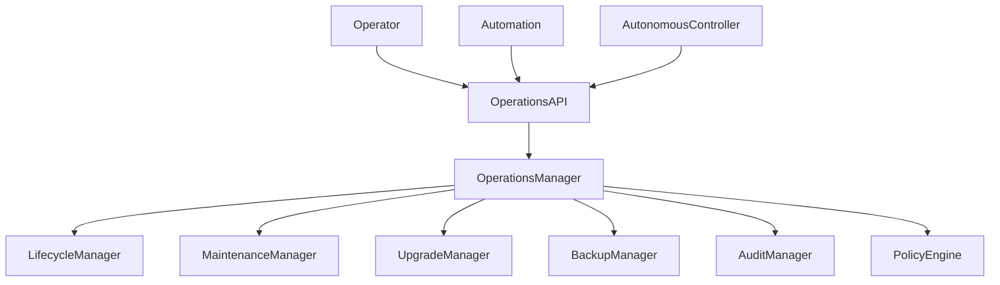

# RFC-0148

**Title:** Operations Architecture

**Document ID:** RFC-0148

**Version:** 1.0

**Status:** Accepted

**Category:** Deployment Architecture

**Layer:** Deployment / Operations

**Target:**

```text
deployment/operations/
```

---

# Abstract

This RFC defines the SH-3 Operations Architecture (OA).

The Operations Architecture specifies the operational control framework responsible for administration, maintenance, monitoring, auditing, upgrades, backups, lifecycle operations, and human/system interaction across SH-3 deployments.

Operations provides the management plane that allows operators, automation systems, and autonomous controllers to safely observe and control deployed SH-3 environments.

Every operational action SHALL be deterministic, authenticated, authorized, observable, auditable, reversible, and policy-compliant.

This document is normative.

---

# Motivation

A production AI Operating System requires a complete operational management layer.

Without a unified operations architecture:

- administration becomes inconsistent
- maintenance procedures diverge
- auditing becomes incomplete
- upgrades become risky
- operational knowledge is lost

The Operations Architecture establishes a standardized management framework for SH-3.

---

# Goals

The architecture SHALL provide:

- operational control
- administration APIs
- lifecycle management
- maintenance workflows
- audit logging
- backup management
- upgrade coordination
- operator interfaces

---

# Non-Goals

The architecture SHALL NOT:

- replace deployment automation
- replace monitoring systems
- bypass security controls
- directly modify internal components

---

# Architecture



---

# Design Principles

## Controlled Operations

All operational actions SHALL pass through validated interfaces.

---

## Complete Auditability

Every administrative action SHALL be recorded.

---

## Reversible Changes

Operations SHOULD support rollback whenever possible.

---

## Automation First

Operational workflows SHOULD support automation.

---

## Least Privilege

Operators SHALL receive only required permissions.

---

# Components

| Component | Responsibility |
|---|---|
| OperationsManager | Operational orchestration |
| OperationsAPI | Management interface |
| LifecycleManager | Lifecycle operations |
| MaintenanceManager | Maintenance workflows |
| UpgradeManager | Upgrade coordination |
| BackupManager | Backup operations |
| AuditManager | Audit recording |
| PolicyEngine | Operational governance |

---

# Operations Model

Every operation SHALL define:

- operation_id
- operator_id
- target_component
- operation_type
- authorization
- execution_plan
- result
- timestamp

Operational records SHALL remain immutable.

---

# Operations API

OperationsAPI SHALL provide:

- system status query
- deployment control
- lifecycle management
- configuration operations
- maintenance execution
- backup operations
- upgrade operations

All APIs SHALL be versioned.

---

# Lifecycle Management

LifecycleManager SHALL support:

- start
- stop
- restart
- pause
- resume
- drain
- retire

Lifecycle changes SHALL preserve system consistency.

---

# Maintenance Management

MaintenanceManager SHALL support:

- planned maintenance
- node draining
- service migration
- resource optimization
- maintenance windows

Maintenance SHALL minimize service interruption.

---

# Upgrade Management

UpgradeManager SHALL support:

- version validation
- staged upgrade
- rolling upgrade
- rollback
- compatibility checking

Upgrade operations SHALL be deterministic.

---

# Backup Management

BackupManager SHALL support:

- configuration backup
- metadata backup
- state backup
- deployment backup
- recovery verification

Backups SHALL be versioned and integrity checked.

---

# Audit Management

AuditManager SHALL record:

- operator actions
- automated actions
- policy decisions
- configuration changes
- deployment changes
- recovery actions

Audit records SHALL be immutable.

---

# Operator Interface

Supported interfaces:

- CLI
- REST API
- SDK
- Dashboard
- Automation API

All interfaces SHALL use identical authorization rules.

---

# Automation Integration

Operations SHALL support:

- scheduled operations
- event-triggered operations
- workflow-based operations
- autonomous operations

Automation SHALL remain observable.

---

# Governance Integration

Every operation SHALL validate:

- identity
- authorization
- policy
- compliance
- operational constraints

Unauthorized operations SHALL fail safely.

---

# Message Bus Integration

Operations events include:

- OperationStarted
- OperationAuthorized
- OperationExecuted
- MaintenanceStarted
- UpgradeStarted
- BackupCompleted
- AuditRecorded
- OperationCompleted
- OperationFailed

Events SHALL remain immutable and versioned.

---

# Persistence Integration

Persistence SHALL maintain:

- operation history
- audit records
- maintenance history
- upgrade history
- backup metadata
- operator activity

Historical operations SHALL remain reproducible.

---

# Observability

Operations telemetry SHALL expose:

- operation latency
- success rate
- failure rate
- upgrade duration
- backup duration
- maintenance status

---

# Distributed Tracing

Every operation SHALL preserve:

- trace_id
- operation_id
- operator_id
- target_id
- deployment_id
- node_id

Tracing SHALL reconstruct complete operational workflows.

---

# Thread Model

The Operations subsystem supports concurrent:

- API requests
- maintenance tasks
- upgrades
- backups
- audit processing

The reference implementation SHALL be:

- deterministic
- thread-safe
- horizontally scalable
- event-driven
- lock-efficient

---

# Metrics

The architecture exposes:

- operations throughput
- operation success rate
- upgrade success rate
- backup success rate
- audit completeness
- maintenance efficiency

---

# Performance Objectives

The architecture should optimize for:

- safe administration
- low operational overhead
- rapid maintenance
- reliable upgrades
- complete auditing
- automated management

---

# Future Work

Potential future enhancements include:

- AI-assisted operations
- autonomous administration
- predictive maintenance
- natural language operations interface
- self-optimizing operational workflows

---

# References

- RFC-0147 Recovery Architecture
- RFC-0146 Health Monitoring Architecture
- RFC-0144 Configuration Architecture
- RFC-0136 Application Security Architecture
- SH-3 Governance Architecture
- SH-3 Architecture Specification v2.1

---

# End of RFC-0148