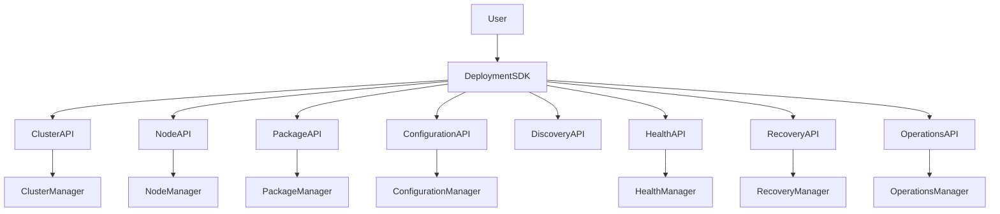

# RFC-0149

**Title:** Deployment SDK Architecture

**Document ID:** RFC-0149

**Version:** 1.0

**Status:** Accepted

**Category:** Deployment Architecture

**Layer:** Deployment / SDK

**Target:**

```text
deployment/sdk/
```

---

# Abstract

This RFC defines the SH-3 Deployment SDK Architecture (DSA).

The Deployment SDK provides the official typed programming interface for interacting with SH-3 Deployment Layer capabilities.

The SDK enables applications, operators, automation systems, and autonomous controllers to manage clusters, nodes, packages, configurations, services, health states, recovery workflows, and operational procedures through stable and versioned APIs.

Every SDK operation SHALL be deterministic, authenticated, authorized, observable, auditable, thread-safe, and policy-compliant.

This document is normative.

---

# Motivation

Deployment operations require a stable abstraction layer.

Without a unified Deployment SDK:

- automation depends on internal implementation
- operational tooling becomes fragmented
- compatibility becomes difficult
- deployment workflows become inconsistent

The Deployment SDK provides a stable contract between external systems and SH-3 Deployment capabilities.

---

# Goals

The architecture SHALL provide:

- typed deployment APIs
- cluster management
- node management
- package management
- configuration control
- health access
- recovery control
- operations integration

---

# Non-Goals

The architecture SHALL NOT:

- expose internal deployment implementation
- bypass authorization
- replace deployment components
- directly modify system storage

---

# Architecture



---

# Design Principles

## Public Contract

The SDK SHALL expose only stable public interfaces.

---

## Strong Typing

All APIs SHALL provide strongly typed request and response models.

---

## Version Compatibility

SDK versions SHALL explicitly define supported platform versions.

---

## Deterministic Operations

Equivalent SDK calls SHALL produce equivalent results.

---

## Secure by Default

Every operation SHALL require authentication and authorization.

---

# Components

| Component | Responsibility |
|---|---|
| DeploymentClient | SDK entry point |
| ClusterClient | Cluster operations |
| NodeClient | Node operations |
| PackageClient | Package operations |
| ConfigurationClient | Configuration operations |
| DiscoveryClient | Service discovery |
| HealthClient | Health monitoring |
| RecoveryClient | Recovery control |
| OperationsClient | Administration |

---

# SDK Structure

Reference structure:

```text
deployment/sdk/

├── client.py
├── models.py
├── exceptions.py
├── cluster.py
├── node.py
├── package.py
├── configuration.py
├── discovery.py
├── health.py
├── recovery.py
├── operations.py
└── version.py
```

---

# Deployment Client

DeploymentClient SHALL provide:

- authentication handling
- connection management
- API version negotiation
- request routing
- telemetry integration

---

# Cluster Client

ClusterClient SHALL support:

- create cluster
- inspect cluster
- update metadata
- list nodes
- query topology
- manage lifecycle

---

# Node Client

NodeClient SHALL support:

- register node
- inspect node
- query capabilities
- manage lifecycle
- drain node
- retire node

---

# Package Client

PackageClient SHALL support:

- upload package
- verify package
- inspect manifest
- resolve dependencies
- install package
- rollback package

---

# Configuration Client

ConfigurationClient SHALL support:

- create configuration
- validate configuration
- publish configuration
- reload configuration
- rollback configuration

---

# Discovery Client

DiscoveryClient SHALL support:

- service lookup
- capability lookup
- endpoint resolution
- health-aware discovery

---

# Health Client

HealthClient SHALL support:

- component health query
- health history retrieval
- alert query
- SLA/SLO status query

---

# Recovery Client

RecoveryClient SHALL support:

- failure query
- recovery plan retrieval
- recovery execution
- rollback execution
- recovery status tracking

---

# Operations Client

OperationsClient SHALL support:

- lifecycle operations
- maintenance operations
- upgrade operations
- backup operations
- audit queries

---

# Data Models

All SDK models SHALL define:

- unique identifier
- semantic version
- timestamp
- metadata
- serialization format

Models SHALL remain immutable.

---

# Error Handling

SDK errors SHALL be typed.

Supported categories:

```text
AuthenticationError

AuthorizationError

ValidationError

CompatibilityError

DeploymentError

RecoveryError

NetworkError

TimeoutError

PolicyViolationError
```

Errors SHALL preserve context.

---

# Authentication

SDK authentication SHALL support:

- token authentication
- certificate authentication
- service identity
- operator identity

Authentication SHALL integrate with Security Layer.

---

# Authorization

Every SDK operation SHALL validate:

- identity
- capability permission
- namespace access
- operational policy

Unauthorized operations SHALL fail safely.

---

# Telemetry Integration

SDK operations SHALL automatically emit:

- metrics
- traces
- audit events
- operation metadata

Telemetry SHALL preserve correlation identifiers.

---

# Event Integration

SDK events include:

- SDKConnected
- APIRequested
- APICompleted
- DeploymentCommandIssued
- DeploymentCommandCompleted
- SDKErrorRaised

Events SHALL remain immutable and versioned.

---

# Persistence Integration

SDK metadata SHALL maintain:

- API usage history
- compatibility information
- operation history
- audit correlation

---

# Thread Model

The Deployment SDK SHALL support concurrent:

- API requests
- resource queries
- monitoring operations
- recovery requests

The reference implementation SHALL be:

- deterministic
- thread-safe
- fully typed
- asynchronous capable
- event-driven

---

# Metrics

The SDK SHALL expose:

- request latency
- request throughput
- error rate
- API availability
- compatibility rate
- authentication failures

---

# Performance Objectives

The SDK should optimize for:

- low API overhead
- efficient serialization
- stable compatibility
- secure communication
- predictable behavior

---

# Future Work

Potential future enhancements include:

- multi-language SDK generation
- automatic client generation
- AI-assisted deployment operations
- declarative deployment SDK
- autonomous infrastructure management

---

# References

- RFC-0148 Operations Architecture
- RFC-0147 Recovery Architecture
- RFC-0146 Health Monitoring Architecture
- RFC-0145 Service Discovery Architecture
- RFC-0143 Package Architecture
- RFC-0139 Application SDK Architecture
- SH-3 Architecture Specification v2.1

---

# End of RFC-0149