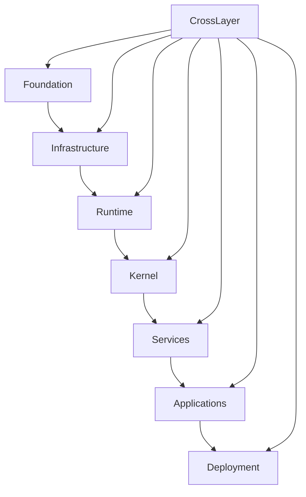

# RFC-0150

**Title:** Cross Layer Architecture

**Document ID:** RFC-0150

**Version:** 1.0

**Status:** Accepted

**Category:** System Architecture

**Layer:** Cross Layer

**Target:**

```text
architecture/cross_layer/
```

---

# Abstract

This RFC defines the SH-3 Cross Layer Architecture (CLA).

The Cross Layer Architecture establishes the common system-wide contracts, communication models, data models, lifecycle rules, versioning policies, error handling mechanisms, observability standards, and compatibility requirements shared across all SH-3 layers.

The Cross Layer Architecture connects:

```text
Foundation
Infrastructure
Runtime
Kernel
Services
Applications
Deployment
```

into a unified AI Operating System Framework.

All cross-layer interactions SHALL be:

- event-driven
- strongly typed
- deterministic
- observable
- testable
- replaceable
- version-aware
- policy-compliant

This document is normative.

---

# Motivation

SH-3 is designed as a layered AI Operating System.

Each layer must remain:

- independently replaceable
- independently testable
- loosely coupled
- operationally observable

Without a cross-layer specification:

- interfaces become inconsistent
- data contracts diverge
- events lose compatibility
- upgrades become unsafe
- debugging becomes difficult

This RFC defines the universal contracts connecting all SH-3 components.

---

# Goals

The architecture SHALL provide:

- universal event model
- universal data model
- universal execution context
- universal error model
- lifecycle standardization
- version compatibility
- observability standardization
- security propagation

---

# Non-Goals

The architecture SHALL NOT:

- replace individual layer specifications
- define business logic
- define implementation details
- restrict internal optimization

---

# Layer Model



---

# Core Principles

## Everything Event Driven

All significant state transitions SHALL be represented as events.

---

## Everything Replaceable

Every component SHALL communicate through contracts.

---

## Everything Typed

All communication SHALL use explicit schemas.

---

## Everything Testable

All cross-layer contracts SHALL support deterministic testing.

---

# Cross Layer Components

| Component | Responsibility |
|---|---|
| Event Model | System event contracts |
| Data Model | Shared data structures |
| Context Model | Execution propagation |
| Error Model | Failure representation |
| Lifecycle Model | Component states |
| Version Model | Compatibility |
| Security Model | Identity propagation |
| Observability Model | System visibility |

---

# Event Model

## Purpose

The Event Model defines the universal communication protocol of SH-3.

Every event SHALL contain:

```text
event_id

event_type

event_version

timestamp

source

destination

trace_id

correlation_id

payload

metadata
```

---

# Event Properties

Events SHALL be:

- immutable
- serializable
- versioned
- replayable
- traceable

---

# Event Categories

## Lifecycle Events

Examples:

```text
ComponentCreated

ComponentStarted

ComponentReady

ComponentStopped
```

---

## Runtime Events

Examples:

```text
ExecutionStarted

ExecutionCompleted

ExecutionFailed
```

---

## Cognitive Events

Examples:

```text
GoalCreated

PlanGenerated

DecisionMade
```

---

## Deployment Events

Examples:

```text
DeploymentStarted

NodeRegistered

PackageInstalled
```

---

## Recovery Events

Examples:

```text
FailureDetected

RecoveryStarted

RecoveryCompleted
```

---

# Data Model

The SH-3 Data Model defines common structures.

All shared objects SHALL include:

```text
id

version

timestamp

metadata
```

---

# Identifier Model

Every entity SHALL use:

```text
UUIDv7
```

as the default identifier format.

Identifiers SHALL be:

- globally unique
- sortable
- traceable

---

# Metadata Model

Metadata SHALL support:

```text
created_at

updated_at

owner

source

labels

annotations
```

---

# Execution Context Model

Execution Context provides propagation across layers.

Context SHALL contain:

```text
context_id

trace_id

correlation_id

tenant_id

security_identity

deadline

priority

metadata
```

---

# Context Rules

Execution Context SHALL:

- propagate through events
- propagate through APIs
- preserve tracing
- preserve authorization

Context SHALL be immutable.

---

# Error Model

All errors SHALL use typed error contracts.

Base structure:

```text
error_id

error_type

error_code

message

source

timestamp

trace_id

details
```

---

# Error Categories

```text
ValidationError

AuthenticationError

AuthorizationError

ExecutionError

DependencyError

ResourceError

PolicyError

CompatibilityError

RecoveryError

SystemError
```

---

# Error Handling Rules

Errors SHALL:

- preserve original context
- remain serializable
- remain traceable
- support recovery decisions

---

# Lifecycle Model

All components SHALL follow:

```text
Created

↓

Initialized

↓

Starting

↓

Ready

↓

Running

↓

Stopping

↓

Stopped

↓

Archived
```

---

# Lifecycle Guarantees

Lifecycle transitions SHALL:

- be validated
- emit events
- be observable
- be auditable

---

# Version Model

Every SH-3 component SHALL define:

```text
component_version

api_version

schema_version

compatibility_version
```

---

# Compatibility Rules

Compatibility SHALL evaluate:

- API compatibility
- schema compatibility
- event compatibility
- dependency compatibility
- runtime compatibility

---

# Security Model

Security context SHALL propagate across all layers.

Required fields:

```text
identity

permissions

roles

capabilities

security_level
```

---

# Security Rules

All cross-layer operations SHALL validate:

- authentication
- authorization
- policy compliance

No layer SHALL bypass security validation.

---

# Observability Model

Every operation SHALL produce:

## Metrics

```text
latency

throughput

errors

resource_usage
```

---

## Logs

Structured logs SHALL contain:

```text
timestamp

level

component

trace_id

message
```

---

## Traces

Every distributed operation SHALL preserve:

```text
trace_id

span_id

parent_span_id
```

---

# Testing Model

Cross-layer components SHALL support:

- unit testing
- integration testing
- contract testing
- deterministic replay
- simulation testing

---

# Dependency Rules

Allowed dependency direction:

```text
Application

↓

Deployment

↓

Kernel

↓

Services

↓

Runtime

↓

Infrastructure

↓

Foundation
```

Cross-layer services SHALL NOT create circular dependencies.

---

# Message Bus Integration

The Cross Layer Architecture defines the universal event bus contract.

All events SHALL pass through:

```text
EventBus

↓

Router

↓

Subscribers

↓

Handlers
```

---

# Persistence Integration

Persistent objects SHALL preserve:

- identifiers
- versions
- timestamps
- metadata
- history

State changes SHALL be reconstructable.

---

# Thread Model

Cross-layer infrastructure SHALL support:

- concurrent event processing
- concurrent API execution
- distributed operations
- asynchronous workflows

Reference implementations SHALL be:

- deterministic
- thread-safe
- lock-efficient
- event-driven

---

# Metrics

The architecture exposes:

- event throughput
- serialization latency
- context propagation latency
- error rate
- compatibility failures
- cross-layer call latency

---

# Performance Objectives

The architecture should optimize for:

- low coupling
- minimal communication overhead
- deterministic execution
- scalable event processing
- reliable compatibility

---

# Future Work

Potential enhancements:

- automatic schema evolution
- AI-generated compatibility adapters
- cross-layer optimization engine
- formal verification of contracts
- distributed transaction model

---

# References

- RFC-0149 Deployment SDK Architecture
- RFC-0139 Application SDK Architecture
- RFC-0118 Observability Architecture
- RFC-0119 Governance Architecture
- SH-3 Architecture Specification v2.1

---

# End of RFC-0150