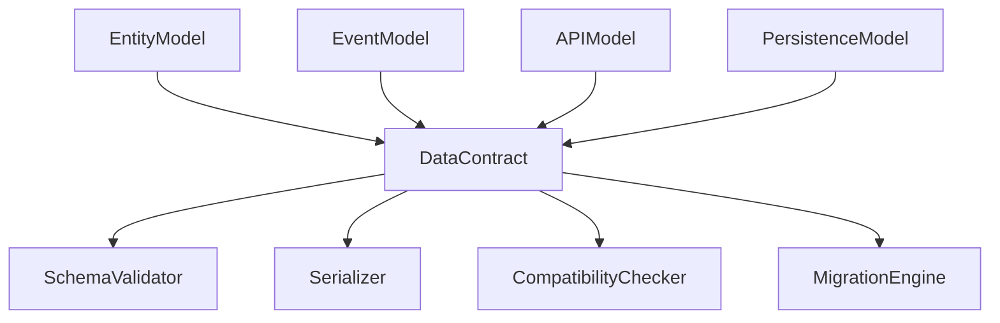

# RFC-0151

**Title:** Data Contract Architecture

**Document ID:** RFC-0151

**Version:** 1.0

**Status:** Accepted

**Category:** System Architecture

**Layer:** Cross Layer / Data Contract

**Target:**

```text
architecture/data_contract/
```

---

# Abstract

This RFC defines the SH-3 Data Contract Architecture (DCA).

The Data Contract Architecture establishes the universal data exchange rules used across all SH-3 components, layers, services, events, APIs, persistence systems, and deployment mechanisms.

Data Contracts define:

- entity structures
- event payload formats
- API request and response schemas
- serialization rules
- schema evolution policies
- compatibility guarantees

All SH-3 data exchange SHALL be:

- strongly typed
- schema validated
- version controlled
- deterministic
- serializable
- backward compatible
- observable

This document is normative.

---

# Motivation

SH-3 is a distributed AI Operating System Framework.

Every layer exchanges information:

```text
Foundation
 ↓
Infrastructure
 ↓
Runtime
 ↓
Kernel
 ↓
Services
 ↓
Applications
 ↓
Deployment
```

Without unified data contracts:

- schemas diverge
- integrations become fragile
- migrations become unsafe
- event replay becomes impossible
- compatibility decreases

The Data Contract Architecture provides a universal communication foundation.

---

# Goals

The architecture SHALL provide:

- universal entity schema
- event payload contracts
- API contracts
- serialization standards
- schema versioning
- migration strategy
- compatibility validation

---

# Non-Goals

The architecture SHALL NOT:

- define business domain models
- replace database schemas
- restrict internal data structures
- replace application-specific contracts

---

# Architecture



---

# Design Principles

## Contract First

All shared data structures SHALL be defined before implementation.

---

## Explicit Schema

Every exchangeable object SHALL have a schema.

---

## Immutable Versions

Published schemas SHALL never change.

New versions SHALL be created.

---

## Deterministic Serialization

Equivalent objects SHALL produce equivalent serialized output.

---

## Compatibility Preservation

New versions SHALL preserve previous valid consumers whenever possible.

---

# Core Data Contract Model

Every SH-3 data object SHALL inherit:

```text
BaseContract
```

Required fields:

```text
contract_id

contract_type

contract_version

created_at

updated_at

metadata
```

---

# Entity Contract

Entities represent persistent or logical objects.

Entity structure:

```text
Entity

├── id
├── type
├── version
├── state
├── metadata
└── relationships
```

---

# Entity Requirements

Entities SHALL:

- have unique identifiers
- define explicit versions
- support serialization
- support validation
- preserve history

---

# Event Contract

Events SHALL follow:

```text
EventContract

├── event_id
├── event_type
├── event_version
├── timestamp
├── source
├── context
├── payload
└── metadata
```

---

# Event Payload Rules

Event payloads SHALL:

- be immutable
- be schema validated
- contain no hidden state
- support replay

---

# API Contract

API contracts SHALL define:

```text
Request

Response

Error

Version

Authentication

Authorization
```

---

# Request Contract

Every request SHALL contain:

```text
request_id

trace_id

caller

timestamp

payload

metadata
```

---

# Response Contract

Every response SHALL contain:

```text
request_id

status

timestamp

payload

metadata
```

---

# Serialization Model

SH-3 SHALL support:

Primary:

```text
JSON
```

High performance:

```text
MessagePack
```

Binary contract:

```text
Protocol Buffers
```

---

# Serialization Requirements

Serialization SHALL provide:

- deterministic output
- schema validation
- version awareness
- language interoperability

---

# Schema Definition

Schemas SHALL define:

- fields
- types
- required status
- constraints
- defaults
- version

---

# Schema Versioning

Version format:

```text
Major.Minor.Patch
```

Example:

```text
1.0.0
```

---

# Version Rules

## Major

Breaking changes.

Examples:

- field removal
- incompatible type change

---

## Minor

Compatible additions.

Examples:

- optional fields
- additional metadata

---

## Patch

Non-structural changes.

Examples:

- documentation
- validation improvements

---

# Compatibility Model

Compatibility SHALL evaluate:

```text
Producer

↓

Schema

↓

Consumer
```

Validation:

- field compatibility
- type compatibility
- version compatibility
- semantic compatibility

---

# Schema Migration

MigrationEngine SHALL support:

- forward migration
- backward migration
- version translation
- validation after migration

---

# Migration Rules

Migration SHALL:

- preserve meaning
- preserve identifiers
- preserve timestamps
- preserve traceability

---

# Data Validation

SchemaValidator SHALL validate:

- required fields
- field types
- constraints
- references
- versions

Invalid data SHALL be rejected.

---

# Metadata Contract

Metadata SHALL support:

```text
owner

source

labels

annotations

created_at

updated_at

trace_id
```

---

# Context Propagation

All contracts SHALL support:

```text
ExecutionContext
```

Required:

```text
trace_id

correlation_id

security_identity
```

---

# Persistence Contract

Persistent data SHALL preserve:

- contract version
- schema version
- entity identity
- migration history

---

# Security Contract

Data exchange SHALL support:

- identity
- authorization
- integrity verification
- confidentiality classification

---

# Observability Contract

Every data operation SHALL expose:

Metrics:

```text
serialization_time

validation_time

migration_time
```

Logs:

```text
contract_type

version

trace_id
```

Traces:

```text
contract_flow
```

---

# Message Bus Integration

The EventBus SHALL validate:

```text
Event

↓

SchemaValidator

↓

Router

↓

Handler
```

before delivery.

---

# Testing Requirements

Data Contracts SHALL support:

- schema tests
- compatibility tests
- serialization tests
- migration tests
- replay tests

---

# Thread Model

Data Contract operations SHALL support:

- concurrent validation
- concurrent serialization
- concurrent migration
- asynchronous processing

Reference implementations SHALL be:

- deterministic
- thread-safe
- lock-efficient

---

# Metrics

The architecture exposes:

- validation success rate
- serialization latency
- migration count
- schema compatibility failures
- contract usage frequency

---

# Performance Objectives

The architecture should optimize for:

- low serialization overhead
- fast validation
- safe evolution
- language interoperability
- deterministic processing

---

# Future Work

Potential enhancements:

- automatic schema generation
- AI-assisted migration
- formal schema verification
- zero-copy serialization
- distributed contract registry

---

# References

- RFC-0150 Cross Layer Architecture
- RFC-0149 Deployment SDK Architecture
- RFC-0117 Kernel Service Registry Architecture
- RFC-0118 Observability Architecture
- SH-3 Architecture Specification v2.1

---

# End of RFC-0151